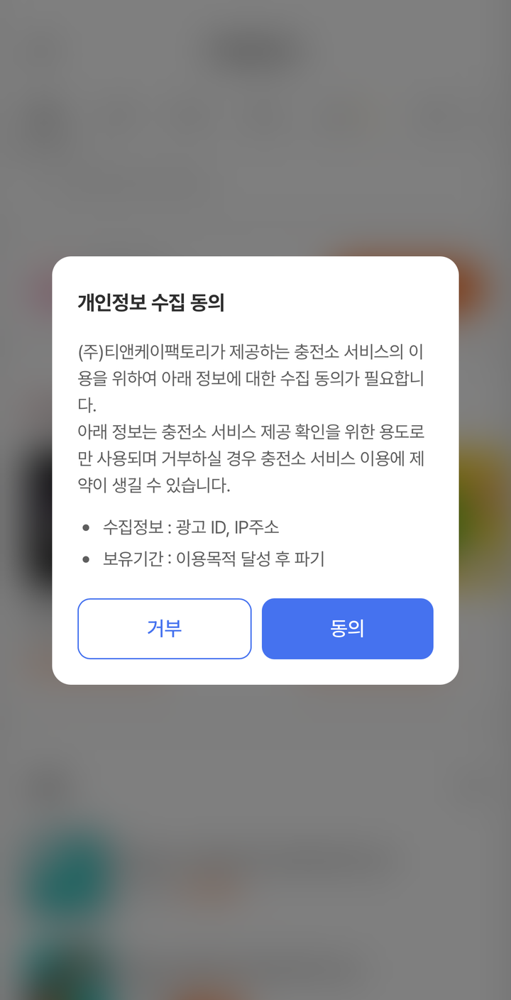
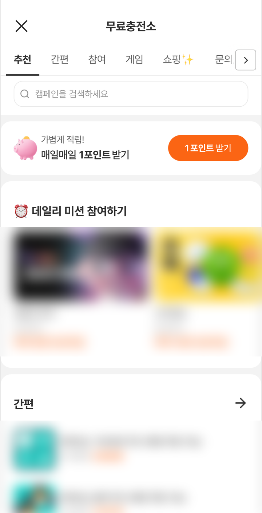
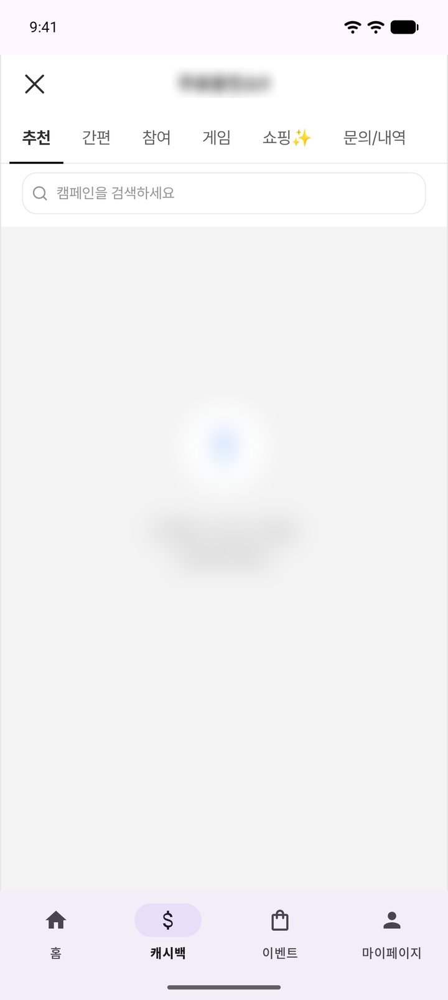
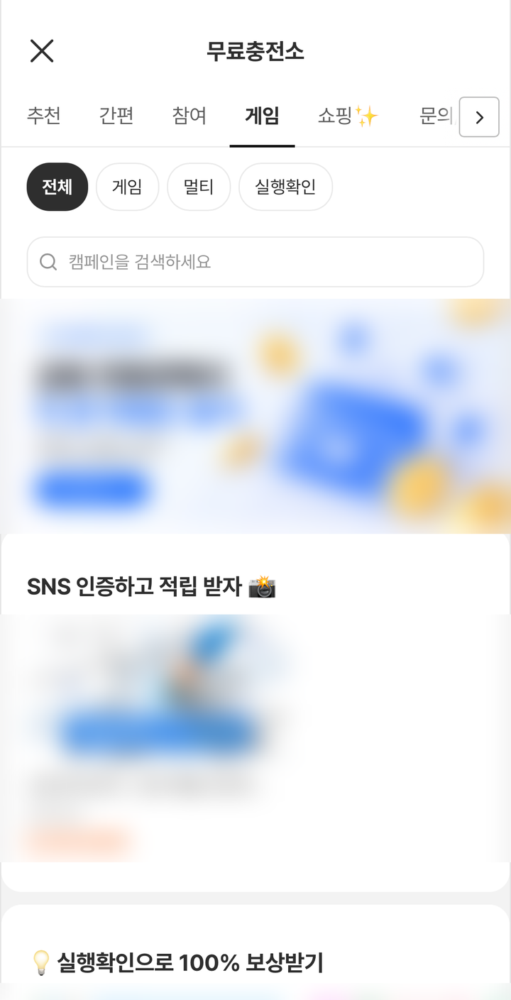
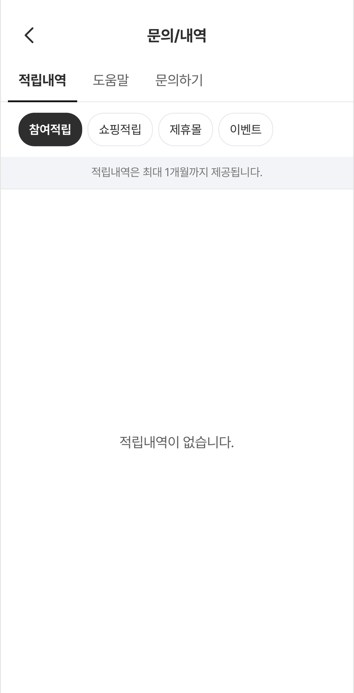
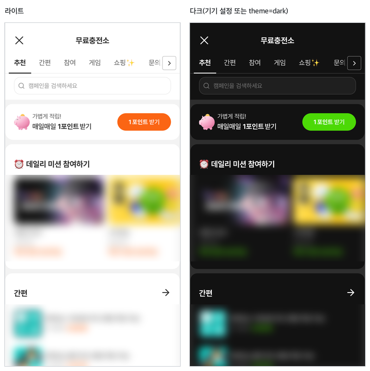

# 네이티브 SDK 에서 이관

이 페이지에서 하는 일: 기존 네이티브 SDK(`com.tnkfactory:rwd`)를 쓰는 앱을 하이브리드 SDK(`com.tnkfactory.ad:hrwd`)로 옮깁니다. 바꿀 코드를 전/후 비교로 보여 드립니다.

## 언제 필요한가

기존 네이티브 SDK 를 이미 쓰고 있는 개발사에게만 필요합니다. 신규 연동이라면 이 페이지는 건너뛰고 [연동 가이드](README.md)부터 시작하세요.

iOS 앱도 함께 옮긴다면 [iOS 이관](../ios/migration.md)을 같이 보세요. 오퍼월 화면은 Android·iOS 가 같습니다.

---

## 한눈에 보기

| 구분 | 내용 |
|---|---|
| **그대로** | 앱 ID(`tnkad_app_id`) 선언, 서버 보상 콜백 URL 과 그 구현, `setUserName`·`setCOPPA` 에 넘기는 값, 오퍼월을 전체 화면으로 여는 흐름 (호출 대상만 `TnkPpiHybSdk` 로 바뀝니다) |
| **바뀜** | 라이브러리 좌표와 import 경로, 호출 대상(`TnkSession`·`TnkOfferwall` → `TnkPpiHybSdk`), 화면 안에 넣기(`getAdListView` → `TnkOfferwallView`), 적립 가능 포인트 조회, 개인정보 동의 호출, 특정 광고 진입(결과 콜백 없음) |
| **빠짐** | 오퍼월 디자인 설정(`TnkAdConfig`·`TnkStyle`), 광고 목록 데이터 직접 조회, 사용자 포인트 잔액 조회·구매·인출, 플레이스먼트 뷰(추후 제공 예정) 등 |

> ⚠️ **TNK 서버에 사용자 포인트 관리를 맡긴 앱**(`queryPoint`·`purchaseItem`·`withdrawPoints` 사용)은 이관 전에 담당자에게 문의해 주세요. 하이브리드 오퍼월에는 잔액 조회·구매·인출 화면이 없어 현재 미제공입니다. 하이브리드 SDK 에서는 [서버 보상 콜백](../common/server-callback.md)으로 받은 포인트를 개발사 서버에서 관리합니다.

### 이관 순서

- [ ] 1. 의존성을 `com.tnkfactory.ad:hrwd` 로 **교체**합니다. 기존 `com.tnkfactory:rwd` 는 지웁니다 (아래 패턴 1)
- [ ] 2. 매니페스트에서 `AdWallActivity` 선언을 삭제합니다 (패턴 2)
- [ ] 3. import 와 호출 대상을 `TnkPpiHybSdk` 로 바꿉니다 (패턴 3)
- [ ] 4. 오퍼월 디자인 설정(`TnkAdConfig.*`·`TnkStyle.*`) 줄과 그 import 를 삭제합니다 (패턴 3, 아래 '디자인 설정' 표)
- [ ] 5. 앱 화면 안에 넣던 오퍼월은 `TnkOfferwallView` 로 바꿉니다 (패턴 4)
- [ ] 6. 적립 가능 포인트 조회 코드(`getEarnPoint`·`queryAdvertiseCount`)를 `getTotalPoint` 로 바꿉니다 (패턴 5, SDK 1.0.16 이상)
- [ ] 7. 개인정보 동의 호출을 바꾸고, `setUserName` 을 `setAgreePrivacy` 보다 먼저 호출합니다 (패턴 6)
- [ ] 8. 앱에서 직접 동의를 받는 앱(`setAgreePrivacy(context, true)` 를 호출하는 앱)은 앱 화면에 '동의 철회' 수단을 두고 `revokePrivacyConsent(context)` 를 연결합니다. 이 경우 오퍼월에는 '개인 정보 수집 동의 해제' 메뉴가 나오지 않습니다 (패턴 6)
- [ ] 9. 특정 광고 진입 코드를 바꿉니다 (패턴 7)
- [ ] 10. 시작 탭·필터를 지정하던 코드는 딥링크로 바꿉니다 (패턴 8)
- [ ] 11. 아래 '전체 API 대조표'에서 남은 호출을 찾아 치환·삭제합니다. '현재 미제공(문의)' 항목은 담당자에게 문의합니다
- [ ] 12. 서버 콜백 URL 구현과 `tnkad_app_id` 선언은 **그대로 둡니다** (변경 없음). 기존 매니페스트의 `tnkad_tracking` meta-data 도 남겨두셔도 무해합니다 (패턴 2)

치환 작업을 AI 도구에 맡길 수도 있습니다. 방법은 [AI 도구에 문서 연결하기](../publisher/ai-tools.md)를 보세요. 결과는 반드시 직접 확인하세요.

---

## 패턴별 전/후

각 패턴은 "무엇이 바뀌나" 한 줄과 전/후 코드로 되어 있습니다. `-` 줄은 기존 네이티브 SDK 코드, `+` 줄은 하이브리드 SDK 코드입니다.

### 패턴 1. 의존성·빌드 설정

**무엇이 바뀌나:** 라이브러리 좌표가 바뀝니다. Maven 저장소 주소는 그대로 쓰면 됩니다. 빌드 요구사항(`minSdk` 21 이상, `compileSdk` 35 이상 등)은 [1. 설치](install.md)를 확인하세요.

> ⚠️ 의존성은 추가가 아니라 **교체**입니다. 기존 `com.tnkfactory:rwd` 는 지우세요. 기존 SDK 와 하이브리드 SDK 를 한 앱에 함께 두는 구성은 확인되지 않았습니다. 일부 화면(예: `AdPlacementView`)을 기존 SDK 로 유지해야 한다면 이관 전에 담당자에게 문의해 주세요. 지운 뒤 컴파일 오류가 나는 곳은 아래 패턴과 '전체 API 대조표'로 바꾸면 됩니다.

```diff
 // settings.gradle.kts — 저장소는 그대로 사용합니다
 dependencyResolutionManagement {
     repositories {
         google()
         mavenCentral()
         maven("https://repository.tnkad.net:8443/repository/public/")
     }
 }

 // app/build.gradle.kts
 dependencies {
-    implementation("com.tnkfactory:rwd:8.09.30")
-    implementation("com.tnkfactory:rwd_store:8.08.81")   // 포인트 스토어를 쓰던 경우
+    implementation("com.tnkfactory.ad:hrwd:1.0.16")
 }
```

- `-` 줄의 버전 숫자는 예시입니다. 쓰고 계신 값과 달라도 같은 줄을 지우면 됩니다. `+` 줄에는 최신 버전을 쓰세요. 최신 버전은 [릴리스 노트](changelog.md)에서 확인할 수 있습니다.
- 포인트 스토어(`com.tnkfactory:rwd_store`)와 그 밖의 보조 라이브러리(`com.tnkfactory:tnk_rwd_toss` 등)는 현재 하이브리드 SDK 에서 제공하지 않습니다. 쓰고 있다면 지우기 전에 담당자에게 문의해 주세요.

### 패턴 2. 매니페스트

**무엇이 바뀌나:** 네이티브 SDK 가이드에 따라 직접 선언했던 오퍼월 화면(`AdWallActivity`)이 필요 없어집니다. 선언을 삭제하세요. 앱 ID 선언은 그대로 둡니다.

```diff
 <application ...>

     <meta-data
         android:name="tnkad_app_id"
         android:value="발급받은-앱-아이디" />

-    <activity
-        android:name="com.tnkfactory.ad.AdWallActivity"
-        android:exported="true"
-        android:screenOrientation="portrait"
-        android:theme="@style/Theme.AppCompat.DayNight.DarkActionBar"
-        android:windowSoftInputMode="adjustResize"
-        android:configChanges="screenSize|smallestScreenSize|orientation|screenLayout|keyboardHidden" />

 </application>
```

- 하이브리드 SDK 는 오퍼월 화면을 직접 등록합니다. `INTERNET` 같은 권한도 SDK 가 포함하므로 따로 선언하지 않아도 되고, 이미 선언돼 있어도 문제없습니다. 자세한 내용은 [2. AndroidManifest 설정](manifest.md)을 보세요.
- 기존 매니페스트에 `tnkad_tracking` meta-data 가 있다면 남겨두셔도 무해합니다. 하이브리드 SDK 에서는 이 값이 동작에 반영되지 않습니다. 이 값으로 분석 리포트를 쓰셨다면 담당자에게 문의해 주세요.
- 코드에서 `AdWallActivity.start(context)` 나 `AdWallActivity::class.java` 로 오퍼월을 열었다면 `TnkPpiHybSdk.openOfferwall(context)` 로 바꿔야 합니다. 하이브리드 SDK 에는 `AdWallActivity` 클래스가 없어서 이런 코드는 컴파일되지 않습니다.

### 패턴 3. 초기화 + 사용자 + 오퍼월 열기

**무엇이 바뀌나:** 가장 흔한 코드입니다. `TnkOfferwall` 인스턴스와 `TnkSession` 호출이 모두 `TnkPpiHybSdk` 호출로 바뀌고, 호출에는 `Context` 를 넘깁니다.

```diff
-import com.tnkfactory.ad.TnkOfferwall
-import com.tnkfactory.ad.TnkSession
-import com.tnkfactory.ad.TnkAdConfig
-import com.tnkfactory.ad.TNK_POINT_EFFECT_TYPE
+import com.tnkfactory.ad.hrwd.TnkPpiHybSdk

 class MainActivity : AppCompatActivity() {
-    private val tnkOfferwall by lazy { TnkOfferwall(this) }

     override fun onCreate(savedInstanceState: Bundle?) {
         super.onCreate(savedInstanceState)
         setContentView(R.layout.activity_main)

-        TnkAdConfig.pointEffectType = TNK_POINT_EFFECT_TYPE.UNIT
-        tnkOfferwall.setUserName("개발사-사용자-식별값")
-        tnkOfferwall.setCOPPA(false)
-        TnkSession.applicationStarted(this)
+        TnkPpiHybSdk.setUserName(applicationContext, "개발사-사용자-식별값")
+        TnkPpiHybSdk.setCOPPA(applicationContext, false)
+        TnkPpiHybSdk.applicationStarted(applicationContext)

         findViewById<View>(R.id.btn_offerwall).setOnClickListener {
-            tnkOfferwall.startOfferwallActivity(this)
+            TnkPpiHybSdk.openOfferwall(this)
         }
     }
 }
```

**사용자가 보는 것:** 버튼을 누르면 오퍼월이 전체 화면으로 열립니다. 처음 여는 사용자에게는 개인정보 수집 동의 팝업이 먼저 나옵니다. 오퍼월 화면은 Android·iOS 가 같습니다.

<figure><figcaption><p>처음 여는 사용자에게는 동의 팝업이 먼저 나옵니다.</p></figcaption></figure>

<figure><figcaption><p>동의하면 오퍼월 첫 화면이 보입니다.</p></figcaption></figure>

- 앱 ID 는 매니페스트의 `tnkad_app_id` 를 그대로 씁니다. 별도의 초기화 호출은 필요 없습니다. 코드로 앱 ID 를 넣어야 하면 `init` 을 다른 SDK 호출보다 먼저 호출하세요 — [3. 초기화](initialize.md)
- `applicationStarted` 는 호출해도 되고 생략해도 됩니다. 오퍼월 동작에는 영향이 없습니다.
- 사용자 식별값 설정은 필수입니다. 로그인 후처럼 사용자를 알 수 있는 시점에 호출하세요.
- `TnkAdConfig.*`·`TnkStyle.*` 같은 오퍼월 디자인 설정 줄은 import 와 함께 지웁니다 (위 diff 의 `pointEffectType` 은 예시입니다). 오퍼월 안의 포인트 표시(아이콘·단위)는 앱 코드로 정하지 않고 오퍼월 화면이 표시합니다. 기존과 같은 표시가 필요하면 담당자에게 요청해 주세요 — 아래 '디자인 설정' 표.
- `openOfferwall` 은 버튼 처리처럼 메인 스레드에서 호출하세요. 코루틴 안에서 열던 기존 코드의 `withContext(Dispatchers.Main) { … }` 는 그대로 두면 됩니다. `context` 에는 지금 보이는 화면의 Activity 를 넘기는 것을 권장하며, `applicationContext` 처럼 Activity 가 아닌 `Context` 를 넘겨도 열립니다.
- 광고 ID 는 오퍼월을 열 때 SDK 가 알아서 준비하므로 따로 조회하지 않아도 됩니다. 네이티브 샘플처럼 광고 ID 를 사용자 식별값으로 쓰셨다면 회원 ID 같은 고정 값으로 바꿔 주세요. 광고 ID 를 삭제했거나 Google Play 서비스가 없는 기기에서는 광고 ID 를 받을 수 없어, 사용자 식별값이 설정되지 않고 보상을 구분할 수 없습니다. 바꾸기 어렵다면 담당자에게 문의해 주세요.

**빠른 이관:** `TnkOfferwall(this)` 코드를 그대로 두고 싶다면 import 만 `com.tnkfactory.ad.hrwd.TnkOfferwall` 로 바꿔도 `setUserName`·`setCOPPA`·`startOfferwallActivity` 는 동작합니다. 이때 `startOfferwallActivity` 에는 Activity 를 넘겨야 합니다(Fragment 에서는 `requireActivity()`). 그 밖의 인스턴스 메서드(`applicationStarted`·`setUserAge`·`getEarnPoint`·`adDetail` 등)는 없으므로 `TnkPpiHybSdk` 로 옮기는 것을 권장합니다.

### 패턴 4. 화면 안에 넣기

**무엇이 바뀌나:** `getAdListView()` 로 받은 뷰를 컨테이너에 붙이던 코드가, `TnkOfferwallView` 를 만들어 붙이고 `loadOfferwall()` 을 호출하는 코드로 바뀝니다. 닫기 처리(`onCloseRequested`)가 새로 생깁니다.

```diff
+import android.view.ViewGroup.LayoutParams.MATCH_PARENT
+import com.tnkfactory.ad.hrwd.webview.TnkOfferwallView

 class AdListActivity : AppCompatActivity() {
-    private val tnkOfferwall by lazy { TnkOfferwall(this) }

     override fun onCreate(savedInstanceState: Bundle?) {
         super.onCreate(savedInstanceState)
         setContentView(R.layout.activity_ad_list)

         val container = findViewById<FrameLayout>(R.id.fl_ad_list_container)
-        container.addView(tnkOfferwall.getAdListView())
+        val offerwallView = TnkOfferwallView(this)
+        container.addView(offerwallView, FrameLayout.LayoutParams(MATCH_PARENT, MATCH_PARENT))
+        offerwallView.loadOfferwall()
     }
 }
```

**사용자가 보는 것:** 앱 화면의 일부(예: 탭 하나)가 오퍼월로 채워집니다. 하단 탭 같은 앱 화면은 그대로 보입니다. 광고 목록 데이터는 오퍼월 화면이 직접 불러오므로 `load()` 같은 사전 로드 호출은 필요 없습니다.

<figure><figcaption><p>앱 화면 안에 넣으면 앱의 하단 탭 바 위에 오퍼월이 표시됩니다. 화면 배치를 보여 주는 예시이며 광고 목록은 비어 있습니다.</p></figcaption></figure>

오퍼월의 닫기(X) 버튼을 눌렀을 때 할 일은 `onCloseRequested` 로 연결합니다. 탭 안에 넣었다면 반드시 등록하세요.

```kotlin
offerwallView.onCloseRequested = {
    bottomNav.selectedItemId = R.id.nav_home   // 예: 다른 탭으로 이동
}
```

| `onCloseRequested` | 사용자가 보는 것 | 언제 쓰나 |
|---|---|---|
| 등록 | 등록한 동작이 실행됩니다. 오퍼월은 앱 화면 안에 그대로 남습니다. | 탭 안에 넣을 때 (반드시 등록) |
| 등록하지 않음 | 오퍼월을 담은 화면(Activity)이 종료됩니다. 탭 구조 앱에서는 앱 화면 전체가 닫힙니다. | 오퍼월 전용 화면(위 diff 의 `AdListActivity`)일 때 |

앱이 자체 상단 바를 그린다면 `extraParams` 로 오퍼월의 상단 헤더를 숨길 수 있습니다.

```kotlin
offerwallView.loadOfferwall(extraParams = mapOf("hideHeader" to "1"))
```

> ⚠️ 전체 화면으로 열 때(`openOfferwall`)는 `hideHeader` 를 쓰지 마세요. 오퍼월의 닫기(X) 버튼이 사라져 기기 뒤로가기로만 닫을 수 있습니다. 값별 화면 변화와 화면 예시는 [4. 오퍼월 띄우기](offerwall.md)의 '화면 설정' 항목을 보세요.

탭에 넣었다면 탭을 오갈 때마다 `loadOfferwall()` 을 다시 부르지 마세요. 동의 팝업에서 [거부] 뒤 닫은 경우의 처리를 포함해 [4. 오퍼월 띄우기](offerwall.md)의 '탭에 넣을 때 주의' 항목을 보세요.

특정 광고·카테고리만 앱 화면 일부에 노출하는 플레이스먼트 뷰는 추후 제공될 예정입니다. 기존 네이티브 SDK 의 `AdPlacementView` 를 사용 중이시면 담당자에게 알려 주세요.

### 패턴 5. 포인트 조회

**무엇이 바뀌나:** 기존 `getEarnPoint` 는 일반 광고와 구매형 광고의 합계를 한 숫자로 돌려줬습니다. 하이브리드 SDK 1.0.16 이상에서는 `getTotalPoint` 하나로 같은 합계를 한 번에 받습니다.

```diff
-tnkOfferwall.getEarnPoint { point ->
-    binding.tvPoint.text = "받을 수 있는 포인트 : $point p"
-}
+TnkPpiHybSdk.getTotalPoint(this) { info ->
+    if (info == null || !info.isSuccess) return@getTotalPoint   // 실패하면 표시하지 않거나 이전 값을 유지합니다
+    binding.tvPoint.text = "받을 수 있는 포인트 : ${info.pointAmount} p"
+}
```

광고 수와 포인트 합계를 함께 받던 `queryAdvertiseCount` 도 `getTotalPoint` 하나로 바꿉니다. 결과의 `adCount`(광고 수)와 `pointAmount`(포인트 합계)를 그대로 쓰면 됩니다. 기존 Android SDK 는 포인트 합계로 구매형 광고의 포인트만 돌려줬으므로, 바꾼 뒤 표시되는 값이 이전과 다를 수 있습니다.

```diff
-TnkSession.queryAdvertiseCount(this, object : ServiceCallback() {
-    override fun onReturn(context: Context?, result: Any?) {
-        val count = (result as IntArray)[0]   // 적립 가능한 광고 수
-        val point = (result as IntArray)[1]   // 포인트 합계
-        binding.tvPoint.text = "${count}개 ${point}P"
-    }
-})
+TnkPpiHybSdk.getTotalPoint(this) { info ->
+    if (info == null || !info.isSuccess) return@getTotalPoint   // 실패하면 표시하지 않거나 이전 값을 유지합니다
+    binding.tvPoint.text = "${info.adCount}개 ${info.pointAmount}P"
+}
```

콜백은 항상 메인 스레드에서 한 번 호출되므로 바로 화면을 갱신해도 됩니다. 일반 광고와 구매형 광고를 각각 조회하므로 함수 하나만 호출할 때보다 조금 더 걸릴 수 있습니다. 콜백에 오는 `TotalPointInfo` 는 이렇게 처리하세요.

| 콜백으로 오는 값 | 의미 | 처리 |
|---|---|---|
| `null` | 네트워크 오류 등으로 조회에 실패했습니다. | 표시하지 않거나 이전 값을 유지합니다. |
| `isSuccess` 가 `false` | 서버가 실패로 응답했습니다. `retCode`·`retMessage` 로 사유를 볼 수 있습니다. 이때의 `pointAmount` 는 쓰지 마세요. | `null` 과 같이 처리합니다. |
| `isSuccess` 가 `true` | `pointAmount`(포인트 합계)와 `adCount`(광고 수)가 들어 있습니다. 일반·구매형 중 한쪽 조회만 실패한 경우에도 성공한 쪽의 값만 담아 이 값으로 옵니다(기존 `getEarnPoint` 와 같은 방식). | 화면에 표시합니다. 값이 평소보다 작을 수 있습니다. |

**SDK 1.0.15 이하를 쓰는 경우:** `getTotalPoint` 가 없으므로 `getAdvertiseTotalPoint`(일반 광고)와 `getProductTotalPoint`(구매형 광고)를 각각 호출해 결과를 더합니다. `queryAdvertiseCount` 도 두 결과의 `adCount`·`pointAmount` 를 각각 더해 바꿉니다.

```kotlin
TnkPpiHybSdk.getAdvertiseTotalPoint(this) { ppi ->
    TnkPpiHybSdk.getProductTotalPoint(this) { shopping ->
        val ok = listOfNotNull(ppi, shopping).filter { it.isSuccess }
        val count = ok.sumOf { it.adCount }
        val point = ok.sumOf { it.pointAmount }
        binding.tvPoint.text = "${count}개 ${point}P"
    }
}
```

두 함수를 각각 쓰면 일반 광고와 구매형 광고를 나눠 보여 줄 수도 있고, 어느 쪽 조회가 실패했는지도 구분할 수 있습니다. `null` 이거나 `isSuccess` 가 `false` 인 쪽은 합계에 넣지 않고 0 으로 셉니다.

- 호출 방법과 결과 값별 동작은 [9. 적립 가능 포인트 조회](total-point.md)에 정리되어 있습니다.
- 합계 계산 방식은 SDK 마다 다를 수 있으니, 이관 후 화면에 표시된 값을 한 번 확인해 주세요.
- 로그아웃 후 다른 계정으로 로그인하는 앱은 `setUserName` 다음에 `clearApiSession()` 을 호출하세요 — [3. 초기화](initialize.md)
- 사용자가 이미 적립한 **잔액** 조회(`queryPoint`)·아이템 구매(`purchaseItem`)·전체 인출(`withdrawPoints`)은 현재 하이브리드 SDK 에서 제공하지 않습니다. 필요하신 경우 담당자에게 문의해 주세요.

```diff
-TnkSession.queryPoint(this, object : ServiceCallback() {
-    override fun onReturn(context: Context?, result: Any?) {
-        val balance = result as? Int ?: 0   // TNK 서버에 맡긴 사용자 포인트 잔액
-    }
-})
+// 현재 미제공 — 담당자에게 문의해 주세요. 서버 보상 콜백으로 받은 포인트는 개발사 서버에서 관리합니다.
```

### 패턴 6. 개인정보 동의

**무엇이 바뀌나:** 동의 팝업을 앱에서 띄우던 호출은 필요 없어집니다. 오퍼월(특정 광고 진입 포함)에 들어갈 때 동의 팝업이 자동으로 나옵니다. 앱에서 직접 동의를 받은 경우의 알림과 철회 호출은 이름이 바뀝니다.

```diff
-TnkSession.showAgreePrivacyPopup(this, object : AgreePrivacyPopupListener {
-    override fun onConfirm() { /* 동의 후 진행할 일 */ }
-    override fun onCancle() { /* 거부했을 때 */ }
-})
+// 삭제 — 오퍼월(특정 광고 진입 포함)에 들어갈 때 동의 팝업이 자동으로 나옵니다

-TnkAdConfig.useTermsPopup = false
-TnkSession.setAgreePrivacy(this, true)
+TnkPpiHybSdk.setUserName(applicationContext, "개발사-사용자-식별값")   // 반드시 먼저
+TnkPpiHybSdk.setAgreePrivacy(applicationContext, true)               // 앱에서 직접 동의를 받은 경우에만

-val agreed = TnkSession.getAgreePrivacy(this)
+val agreed = TnkPpiHybSdk.isAgreePrivacy(applicationContext)

-TnkSession.setAgreePrivacy(this, false)   // 사용자가 동의를 철회했을 때
+TnkPpiHybSdk.revokePrivacyConsent(applicationContext)   // 사용자가 앱에서 '동의 철회' 를 눌렀을 때만 호출
```

기존에는 `setAgreePrivacy(…, false)` 로 철회까지 처리했지만, 하이브리드에서는 열려 있는 오퍼월까지 갱신하는 `revokePrivacyConsent` 를 씁니다.

값별 동작(`setAgreePrivacy` 의 `true`·`false`·호출하지 않음, `revokePrivacyConsent` 호출 전·후, `setUserName` 과 동의 상태)과 화면 예시는 [7. 개인정보 설정](privacy.md)의 '값별 동작' 항목에 있습니다. 이관할 때는 아래 세 가지를 지켜 주세요.

- **`setUserName` → `setAgreePrivacy` 순서로 호출하세요.** 사용자 식별값이 바뀌면(최초 지정 포함) 동의 상태가 초기화됩니다. 기존 네이티브 SDK 와 같은 규칙입니다.
- **철회에는 `setAgreePrivacy(context, false)` 를 쓰지 마세요.** 저장된 값만 바뀌고 이미 열려 있는 오퍼월은 그대로입니다. 열려 있는 오퍼월까지 첫 화면부터 다시 열어 동의 팝업을 보여 주는 것은 `revokePrivacyConsent` 입니다.
- **`revokePrivacyConsent` 는 사용자의 철회 동작에서만 호출하세요.** 앱 시작이나 `onResume` 에서 호출하면 오퍼월이 그때마다 첫 화면으로 돌아갑니다. 철회한 뒤 `setAgreePrivacy(context, true)` 를 다시 호출하면 철회가 취소됩니다.

**기존 네이티브 SDK 에서 받은 동의** (Android SDK 1.0.12 이상)

| 하이브리드 SDK 의 `setUserName` 에 넘긴 값 | 기존 동의 | 사용자가 보는 것 |
|---|---|---|
| 기존 SDK 에서 쓰던 **같은 사용자 식별값** | 유지 | 동의 팝업이 다시 나오지 않습니다 |
| 다른 값, 또는 기존 SDK 에서 식별값을 지정하지 않았던 경우 | 첫 `setUserName` 에서 초기화 | 다음에 오퍼월에 들어갈 때 동의 팝업이 나옵니다 |

> ⚠️ 기존 SDK 에서 앱이 직접 동의를 받아 `setAgreePrivacy` 를 썼다면, 하이브리드 SDK 에서도 `setUserName` 다음에 `setAgreePrivacy(context, true)` 를 호출하세요. 호출하지 않으면 동의는 유지되지만 오퍼월에 "개인 정보 수집 동의 해제" 메뉴가 나타납니다.

**COPPA·GDPR 값 대응**

| 기존 네이티브 SDK | 하이브리드 SDK |
|---|---|
| `setCOPPA(true)` / `setCOPPA(false)` | `TnkPpiHybSdk.setCOPPA(context, true)` / `setCOPPA(context, false)` — 값은 그대로입니다 |
| `setGdprConsent(context, true)` / `(context, false)` | `TnkPpiHybSdk.setGDPR(context, 1)` / `setGDPR(context, 0)` |

COPPA·GDPR 값의 의미는 [7. 개인정보 설정](privacy.md)을 보세요.

### 패턴 7. 특정 광고 진입

**무엇이 바뀌나:** 호출 대상이 `TnkOfferwall` 인스턴스에서 `TnkPpiHybSdk` 로 바뀌고, 결과 콜백이 없어집니다. 이름과 인자(`appId`, `actionId`)는 같습니다.

```diff
-tnkOfferwall.adAction(this, 914912L, 0) { isSuccess, error ->
-    // 결과 처리
-}
+TnkPpiHybSdk.adAction(this, 914912L)

-tnkOfferwall.startOfferwallActivity(this, 563792L)   // 푸시로 받은 광고를 바로 열기
+TnkPpiHybSdk.adAction(this, 563792L)
```

`adDetail`·`adJoin`·`showAdDetailDialog` 도 같은 방식으로 바꿉니다. `showAdDetailDialog` 는 `adDetail` 로 바꾸세요. `appId` 는 광고(캠페인) 번호이며 `Long` 입니다. `actionId` 는 기본값 `0` 을 그대로 두고, 구매형(CPS·쇼핑) 광고만 `5` 를 넘깁니다.

세 호출 모두 오퍼월을 전체 화면으로 엽니다. 동의 전이면 동의 팝업이 먼저 나오고, 동의하면 해당 광고로 진입합니다(거부하면 진입하지 않습니다). 닫았을 때 사용자가 보는 화면이 다릅니다.

| 메서드 | 기존 네이티브 SDK 에서 닫으면 | 하이브리드 SDK 에서 닫으면 |
|---|---|---|
| `adDetail` | 개발사 화면으로 돌아옵니다. | 개발사 화면으로 돌아옵니다 (같음) |
| `adJoin` | 광고 페이지에서 돌아오면 개발사 화면이 보입니다. | 광고 페이지에서 돌아오면 **오퍼월 첫 화면**이 보입니다 (달라짐) |
| `adAction` | 개발사 화면으로 돌아옵니다. | **오퍼월 첫 화면**이 보입니다 (달라짐) |

닫았을 때 개발사 화면으로 바로 돌아가야 한다면 `adDetail` 을 쓰세요. 자세한 내용은 [8. 특정 광고 진입](ad-entry.md)을 보세요.

### 패턴 8. 시작 탭·필터 지정

**무엇이 바뀌나:** 전역 설정(`TnkAdConfig.headerConfig`)을 해 두고 오퍼월을 여는 두 단계가, 딥링크 한 번의 호출로 바뀝니다.

```diff
-TnkAdConfig.headerConfig.startCategory = 4
-TnkAdConfig.headerConfig.startFilterID = 509
-tnkOfferwall.startOfferwallActivity(this)
+TnkPpiHybSdk.handleScheme(this, "tnkscheme://select_menu?cat_id=4&filter_id=509")
```

오퍼월이 닫혀 있으면 SDK 가 오퍼월을 열고 해당 탭으로 이동합니다. 이미 열려 있으면 그 화면에서 이동합니다. 앱 화면 안에 넣은 오퍼월을 다른 탭에 로드해 두었다면 그 오퍼월에서 이동하므로, 오퍼월 탭으로 전환해 주세요.

| 파라미터 | 사용자가 보는 것 |
|---|---|
| `cat_id` | 오퍼월이 열리며 해당 카테고리 탭이 선택됩니다. **꼭 넣어야 합니다.** 기존 `startCategory` 에 넣던 값을 씁니다. |
| `filter_id` | 그 탭에서 해당 필터까지 선택됩니다. 기존 `startFilterID` 에 넣던 값을 씁니다. 생략하거나 그 탭에 없는 값이면 "전체"가 선택됩니다. |

- `startFilterID` 만 쓰던 앱도 `cat_id` 가 필요합니다. 필터가 속한 카테고리 ID 를 함께 넣으세요.
- 오퍼월에 없는 `cat_id` 를 넣으면 오퍼월은 열리지만 해당 탭으로 이동하지 않습니다. 오퍼월의 화면 구성에 따라서도 이동하지 않을 수 있으니, ID 값이 확실하지 않으면 담당자에게 문의해 주세요.
- 딥링크를 받는 방법은 [6. 딥링크](deeplink.md)를 보세요.

<figure><figcaption><p>handleScheme 로 열면 cat_id 로 지정한 탭(여기서는 게임)이 선택된 채 오퍼월이 열립니다.</p></figcaption></figure>

---

## 전체 API 대조표

기존 네이티브 SDK 의 공개 API(`TnkSession` · `TnkOfferwall` · `TnkAdConfig` 등)를 하나씩 대조한 표입니다. **구분** 열의 뜻은 다음과 같습니다.

| 구분 | 뜻 |
|---|---|
| **그대로** | 이름과 인자가 같습니다. 호출 대상과 import 만 바꾸면 됩니다. |
| **치환** | 대응하는 호출이 있습니다. 이름·인자·결과 형태가 다르니 표의 설명대로 바꿉니다. |
| **제거** | 하이브리드 SDK 에서는 필요 없는 호출입니다. 호출을 삭제하세요. |
| **현재 미제공(문의)** | 현재 하이브리드 SDK 에서는 제공하지 않습니다. 필요하신 경우 담당자에게 문의해 주세요. |

### 초기화 · 앱 실행

| 네이티브 | 하이브리드 | 구분 |
|---|---|---|
| `TnkOfferwall(context)` 생성 시 자동 초기화 (매니페스트 `tnkad_app_id` 사용) | 별도 초기화 호출 없이 `setUserName`·`openOfferwall` 이 초기화합니다. `tnkad_app_id` 는 그대로 둡니다. | **그대로** |
| `TnkSession.enableLogging(flag)` | `TnkPpiHybSdk.enableLogging(flag)` (`enableLogging(context, flag)` 도 됩니다) | **그대로** |
| `TnkSession.applicationStarted(context)` | `TnkPpiHybSdk.applicationStarted(context)` — 호출은 그대로 두거나 생략해도 오퍼월 동작에 영향이 없습니다. 이 앱을 TNK 에 광고로 등록해 실행 보상 확인이나 분석 리포트를 쓰셨다면, 현재 하이브리드 SDK 는 그 요청을 보내지 않으니 담당자에게 문의해 주세요. | **그대로** |
| `tnkOfferwall.applicationStarted()` (인스턴스에서 인자 없이 호출) | `TnkPpiHybSdk.applicationStarted(context)` — `import com.tnkfactory.ad.hrwd.TnkOfferwall` 로 바꿔도 이 메서드는 없으므로, 호출 대상을 `TnkPpiHybSdk` 로 바꾸고 `Context` 를 넘깁니다. 생략해도 오퍼월 동작에 영향이 없습니다. | **치환** |
| `appStartedOnceAMonth(context)` · `TnkSession.actionCompleted(context, actionName)` · `buyCompleted(context, itemName)` | 이 앱을 TNK 에 광고로 등록해 실행·액션·구매 완료를 알리던 호출입니다. 현재 미제공 — 담당자 문의. 오퍼월만 쓰신다면 오퍼월 동작과 관계가 없으니 호출을 삭제하세요. | **현재 미제공(문의)** |
| `TnkSession.getReferrer(context)` | 필요 없습니다. 반환값을 앱에서 직접 쓰셨다면 담당자에게 문의해 주세요. | **제거** |
| `TnkSession.deleteTestLog(context)` | 테스트 중 받은 보상 기록을 지워 반복 테스트하던 기능입니다. 현재 미제공 — 담당자 문의. | **현재 미제공(문의)** |
| `TnkSession.prohibitConcurrentInvoke(...)` | 필요 없습니다. 호출을 삭제하세요. | **제거** |
| `TnkSession.runOnMainThread` · `runOnIoThread` | 앱에서 표준 방식(`Handler(Looper.getMainLooper())`, 코루틴 등)을 쓰세요. | **제거** |
| `TnkSession.isAdidLimit(context) { ... }` | 필요 없습니다. 광고 ID 설정이 필요한 광고에 참여할 때 오퍼월이 설정 안내를 보여 줍니다. | **제거** |

### 사용자 · 기기 식별

| 네이티브 | 하이브리드 | 구분 |
|---|---|---|
| `TnkSession.setUserName(context, userName)` · `tnkOfferwall.setUserName(userName)` | `TnkPpiHybSdk.setUserName(context, userName)` | **그대로** |
| `TnkSession.getUserName(context)` | `TnkPpiHybSdk.getUserName(context)` | **그대로** |
| `tnkOfferwall.setUserAge(context, age)` · `setUserGender(context, gender)` | `TnkPpiHybSdk.setUserAge(context, age)` · `setUserGender(context, gender)` — 기존 코드를 두어도 오류는 없지만, 현재 버전에서는 이 값을 오퍼월에 반영하지 않습니다. 나이·성별을 활용하고 계셨다면 담당자에게 문의해 주세요. | **치환** |
| `TnkSession.setDeviceIds(context, deviceId, udid)` | 현재 미제공 — 담당자 문의. | **현재 미제공(문의)** |

### 개인정보 동의

| 네이티브 | 하이브리드 | 구분 |
|---|---|---|
| `TnkSession.setAgreePrivacy(activity, true)` | `TnkPpiHybSdk.setAgreePrivacy(context, true)` — 앱에서 직접 동의를 받은 경우에만, `setUserName` 다음에 호출합니다. | **그대로** |
| `TnkAdConfig.useTermsPopup = false` | `TnkPpiHybSdk.setAgreePrivacy(context, true)` — 앱에서 직접 동의를 받은 경우에만 | **치환** |
| `TnkSession.setAgreePrivacy(activity, false)` (사용자 철회) | `TnkPpiHybSdk.revokePrivacyConsent(context)` — 사용자가 앱에서 '동의 철회' 를 눌렀을 때만 호출합니다. | **치환** |
| `TnkSession.getAgreePrivacy(activity)` | `TnkPpiHybSdk.isAgreePrivacy(context)` | **치환** |
| `TnkSession.showAgreePrivacyPopup(activity, listener)` · `AgreePrivacyPopupListener` | 필요 없습니다. 오퍼월(특정 광고 진입 포함)에 들어갈 때 동의 팝업이 자동으로 나옵니다. | **제거** |
| `tnkOfferwall.showTermsDialog(context, ...)` · `termsCheck(context, ...)` | 같은 이유로 필요 없습니다. | **제거** |
| `TnkSession.setPrivacyAgreementListener(listener)` · `TnkPrivacyAgreementListener` | 사용자가 오퍼월에서 동의·철회했을 때 앱에 알려 주는 기능은 현재 미제공 — 담당자 문의. 동의 상태는 필요할 때 `isAgreePrivacy(context)` 로 확인할 수 있습니다. | **현재 미제공(문의)** |
| `tnkOfferwall.setCOPPA(bool)` | import 만 바꾸거나 `TnkPpiHybSdk.setCOPPA(context, bool)` | **그대로** |
| `TnkApi.setGdprConsent(context, bool)` | `TnkPpiHybSdk.setGDPR(context, 1)` (`true`) · `setGDPR(context, 0)` (`false`) | **치환** |

### 오퍼월 열기 · 화면 안에 넣기

| 네이티브 | 하이브리드 | 구분 |
|---|---|---|
| `TnkOfferwall(context)` + `startOfferwallActivity(context)` | `TnkPpiHybSdk.openOfferwall(context)`. 기존 코드를 두려면 import 를 `com.tnkfactory.ad.hrwd.TnkOfferwall` 로 바꾸고 `startOfferwallActivity` 에 Activity 를 넘깁니다. | **치환** |
| `startOfferwallActivity(context, adId)` | `TnkPpiHybSdk.adAction(context, adId)` | **치환** |
| `AdWallActivity.start(context)` · `AdWallActivity::class.java` | `TnkPpiHybSdk.openOfferwall(context)` | **치환** |
| `load(listener)` + `getAdListView()` | `TnkOfferwallView` 를 배치하고 `loadOfferwall()` 을 호출합니다. 닫기는 `onCloseRequested` 로 처리합니다. (패턴 4) | **치환** |
| `getAdListView(adId)` | 앱 화면 안에 넣은 오퍼월에서 특정 광고로 바로 들어가는 기능은 현재 미제공 — 담당자 문의. 전체 화면으로 여는 `TnkPpiHybSdk.adAction(context, adId)` 로 대신할 수 있습니다. | **현재 미제공(문의)** |
| `loadWithNewsData(listener)` · `getEmbedAdList()` · `getEmbedNewsList()` · `getFeedPopup()` | 현재 미제공 — 담당자 문의. | **현재 미제공(문의)** |
| `getAdPlacementView(activity)` · `AdPlacementView` · `PlacementEventListener` | 특정 광고·카테고리만 앱 화면 일부에 노출하는 플레이스먼트 뷰는 추후 제공될 예정입니다. 기존 네이티브 SDK 의 `AdPlacementView` 를 사용 중이시면 담당자에게 알려 주세요. | **현재 미제공(문의)** |
| `showMyMenu(activity)` | 마이메뉴 화면을 바로 여는 기능은 현재 하이브리드 SDK 에서 제공하지 않습니다. 버튼을 그대로 두려면 `openOfferwall(context)` 으로 오퍼월을 여세요. 오퍼월 첫 화면이 열리고, 참여·적립 내역과 도움말·문의는 상단 "문의/내역"에서 볼 수 있습니다. 마이메뉴로 바로 보내야 한다면 담당자에게 문의해 주세요. | **현재 미제공(문의)** |
| `getHelpdeskUrl(context)` · `getRewardUrl(context)` · `geFaqUrl(context)` · `getHelpUrl(context)` | 같은 내용이 오퍼월의 "문의/내역" 메뉴에 있습니다. 주소를 앱에서 얻는 기능은 현재 미제공 — 담당자 문의. | **현재 미제공(문의)** |
| `dataChanged()` · `getAdlistJson(context, ...)` | 광고 목록·상세는 오퍼월 화면이 직접 보여 주며, 목록 데이터를 앱으로 넘기는 기능은 현재 미제공 — 담당자 문의. | **현재 미제공(문의)** |
| `showDialog(flag)` | 필요 없습니다. 로딩 표시는 오퍼월 화면이 처리하니 호출을 삭제하세요. | **제거** |
| `getEventLink(eventId, ...)` · `openEventWebView(context, eventId, ...)` · `showCustomTapActivity(activity, url, params)` | 이벤트 페이지·외부 링크를 여는 기능은 현재 미제공 — 담당자 문의. | **현재 미제공(문의)** |

<figure><figcaption><p>참여·적립 내역과 도움말·문의는 오퍼월 안의 "문의/내역" 메뉴에서 볼 수 있습니다.</p></figcaption></figure>

### 특정 광고 진입

| 네이티브 (`TnkOfferwall` 인스턴스) | 하이브리드 (`TnkPpiHybSdk`) | 구분 |
|---|---|---|
| `adDetail(context, appId, actionId) { ok, err -> }` | `adDetail(context, appId, actionId = 0)` — 호출 대상이 바뀌고 결과 콜백이 없어집니다. | **치환** |
| `adJoin(context, appId, actionId) { ok, err -> }` | `adJoin(context, appId, actionId = 0)` | **치환** |
| `adAction(context, appId, actionId) { ok, err -> }` | `adAction(context, appId, actionId = 0)` — 닫으면 오퍼월 첫 화면이 보입니다. | **치환** |
| `showAdDetailDialog(context, appId, actionId) { ok, err -> }` | `adDetail(context, appId, actionId = 0)` | **치환** |

### 포인트 · 상태 조회

| 네이티브 | 하이브리드 | 구분 |
|---|---|---|
| `tnkOfferwall.getEarnPoint { }` · `getEarnPointSync()` · `suspend getEarnPoint()` | `getTotalPoint`(1.0.16 이상)의 `pointAmount` 를 씁니다. 1.0.15 이하에서는 `getAdvertiseTotalPoint` 와 `getProductTotalPoint` 결과의 `pointAmount` 를 더합니다. (패턴 5) | **치환** |
| `TnkSession.queryAdvertiseCount(context, callback)` | `getTotalPoint`(1.0.16 이상) 결과(`TotalPointInfo`)의 `adCount`·`pointAmount` 를 씁니다. 1.0.15 이하에서는 `getAdvertiseTotalPoint` 와 `getProductTotalPoint` 결과의 `adCount`·`pointAmount` 를 각각 더합니다. (패턴 5) | **치환** |
| `tnkOfferwall.getEarnPointByFilter(filterId) { }` | 필터별 합계는 현재 미제공 — 담당자 문의. | **현재 미제공(문의)** |
| `TnkSession.queryPoint(...)` (동기·비동기) | 사용자 포인트 잔액 조회는 현재 미제공 — 담당자 문의. TNK 서버에 포인트 관리를 맡기신 앱은 이관 전에 꼭 문의해 주세요. | **현재 미제공(문의)** |
| `TnkSession.purchaseItem(...)` · `withdrawPoints(...)` (각 2종) | 아이템 구매·전체 인출은 현재 미제공 — 담당자 문의. 위와 같이 이관 전에 문의해 주세요. | **현재 미제공(문의)** |
| `TnkSession.queryPublishState(...)` · `queryAdvertiseState(...)` · `STATE_*` 상수 | 게시 상태 조회는 현재 미제공 — 담당자 문의. 게시 상태에 따라 오퍼월 진입 버튼을 숨기던 앱은 문의해 주세요. | **현재 미제공(문의)** |
| `ServiceCallback` · `TnkResultListener` · `TnkError` | 하이브리드 SDK 에는 없습니다. 위 호출들의 결과는 `TotalPointInfo?` 로 바뀌었고, 보상 지급 완료는 `TnkRewardListener` 로 받습니다. | **제거** |

### 오퍼월 이벤트

| 네이티브 | 하이브리드 | 구분 |
|---|---|---|
| `TnkAdAnalytics.setEventListener(listener)` (카테고리·필터·광고 클릭 같은 오퍼월 이벤트) | 네이티브와 같은 종류의 이벤트는 현재 미제공 — 담당자 문의. 오퍼월에서 일어난 이벤트를 이름과 JSON 문자열 그대로 받는 `setEventListener` 가 있지만 이벤트 종류가 달라 1:1 로 대응하지 않습니다 ([5. 보상 지급 수신](reward.md)). 보상 지급 완료는 `setRewardListener` 로 받습니다. | **현재 미제공(문의)** |
| `TnkAdHideUtil` · `TnkOnBackPressListener` · `TnkAdListModel` | 목록 화면용 보조 클래스(광고 숨기기 등)는 현재 미제공 — 담당자 문의. | **현재 미제공(문의)** |

### 디자인 설정

오퍼월 화면의 구성(탭·필터 등)은 TnkFactory 가 개발사별로 설정합니다. 앱 코드에서 바꾸는 방식이 아니므로, 바꾸고 싶은 부분은 담당자에게 요청해 주세요.

| 네이티브 | 하이브리드 | 구분 |
|---|---|---|
| `TnkAdConfig.*` (`pointEffectType`, `useCuration`, `detailViewImageType`, `layoutConfig`, `setLayoutInfo`, `setPlacementLayout` 등) | 앱 코드에서 설정하지 않습니다. 호출을 삭제하세요. 바꾸고 싶은 화면 구성은 담당자에게 요청해 주세요. | **제거** |
| `TnkAdConfig.headerConfig.startCategory` · `startFilter` · `startFilterID` | 딥링크 `tnkscheme://select_menu?cat_id=..&filter_id=..` 를 `handleScheme` 에 넘깁니다. (패턴 8) | **치환** |
| `TnkAdConfig.setOfferwallTheme(DARK)` · `(LIGHT)` | `extraParams` 의 `theme` (`"dark"` · `"light"`) — 아래 '다크 모드 고정' 과 [4. 오퍼월 띄우기](offerwall.md)의 '다크 모드' 항목 | **치환** |
| `TnkAdConfig.setOfferwallTheme(SYSTEM)` · `(UNSPECIFIED)` | `theme` 를 넣지 않으면 기기(앱)의 다크 모드 설정을 따릅니다. 호출을 삭제하세요. | **제거** |
| `TnkStyle.*` (화면 전환 애니메이션, 동의 팝업 문구·버튼 색 등) | 앱 코드에서 설정하지 않습니다. 호출을 삭제하세요. | **제거** |
| `TnkAdLayoutConfig` · `TnkHeaderConfig` 의 그 밖의 설정 · 커스텀 툴바·헤더 클래스 | 앱 코드에서 설정하지 않습니다. 호출을 삭제하세요. | **제거** |
| 포인트 스토어(`com.tnkfactory:rwd_store` 의 `RwdPlusStore*` 화면) | 현재 미제공 — 담당자 문의. | **현재 미제공(문의)** |

**다크 모드 고정:** 네이티브에서 `TnkAdConfig.setOfferwallTheme(DARK)` 나 `(LIGHT)` 로 고정했다면 오퍼월을 열 때 `theme` 를 넘깁니다. 넘기지 않으면 오퍼월은 기기(앱)의 다크 모드 설정을 따릅니다. 라이트로 고정했던 앱이 `theme` 를 빠뜨리면 다크 모드 기기에서 오퍼월이 어둡게 보입니다.

```diff
-TnkAdConfig.setOfferwallTheme(TnkOfferwallTheme.DARK)
-tnkOfferwall.startOfferwallActivity(this)
+TnkPpiHybSdk.openOfferwall(this, mapOf("theme" to "dark"))
```

<figure><figcaption><p>기기 설정(또는 theme 값)에 따라 오퍼월이 라이트·다크로 보입니다.</p></figcaption></figure>

지원 기능은 순차적으로 확대하고 있습니다.

---

## Java 로 작성한 앱이라면

- 기존 `TnkSession` 은 Kotlin `object` 라서 Java 에서 `TnkSession.INSTANCE.xxx()` 로 불렀습니다. `TnkPpiHybSdk` 의 공개 메서드는 모두 `static` 으로 호출할 수 있어 `TnkPpiHybSdk.xxx()` 로 바로 부릅니다.
- `adDetail(context, appId)` 처럼 인자를 줄여서 부를 수 있습니다.
- 결과를 콜백으로 받는 `getTotalPoint`·`getAdvertiseTotalPoint`·`getProductTotalPoint` 는 람다 끝에서 `kotlin.Unit.INSTANCE` 를 돌려줘야 합니다.

```diff
-TnkSession.INSTANCE.setUserName(this, "개발사-사용자-식별값");
+TnkPpiHybSdk.setUserName(getApplicationContext(), "개발사-사용자-식별값");
```

```java
import kotlin.Unit;

TnkPpiHybSdk.getTotalPoint(this, info -> {   // 1.0.16 이상
    if (info != null && info.isSuccess()) {
        tvPoint.setText(info.getPointAmount() + "P");
    }
    return Unit.INSTANCE;   // Kotlin 함수 타입 콜백은 Unit 을 돌려줘야 합니다
});
```

---

## 이관 뒤 확인할 것

- [ ] 실기기에서 오퍼월이 열립니다. 열리지 않으면 [문제 해결](troubleshooting.md)을 확인하세요.
- [ ] 처음 여는 사용자에게 동의 팝업이 나오고, 동의하면 광고 목록이 보입니다.
- [ ] 광고 참여 뒤 서버 보상 콜백이 이전처럼 호출됩니다.
- [ ] 적립 가능 포인트를 표시하는 앱은 표시 값이 이전과 비슷한지 확인합니다.
- [ ] 대조표에서 '현재 미제공(문의)' 로 표시된 호출이 코드에 남아 있지 않은지 확인합니다.

---

다음: [문제 해결](troubleshooting.md)
