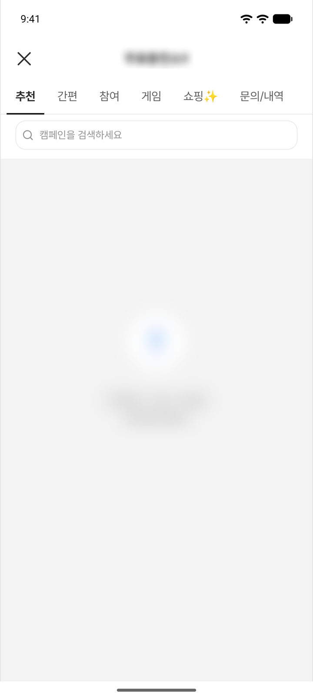
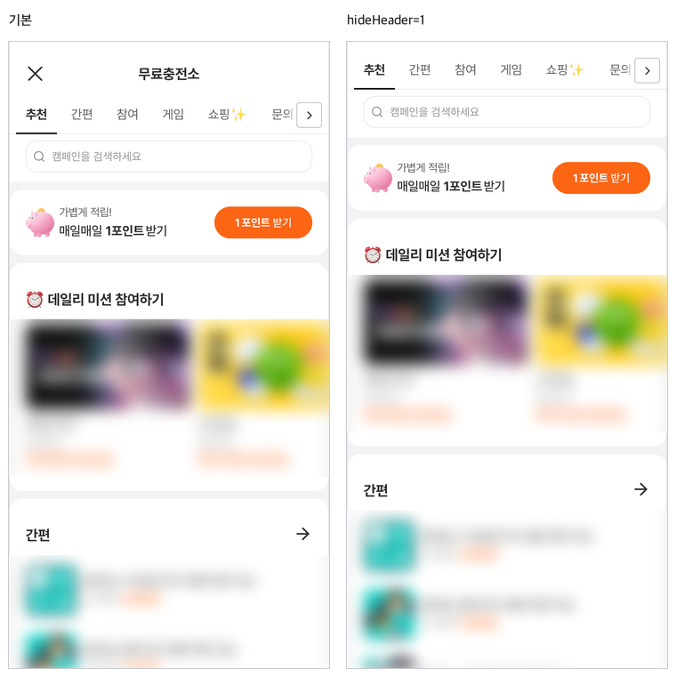

# 4. 오퍼월 띄우기

사용자가 보는 오퍼월 화면을 앱에서 여는 방법입니다. 전체 화면으로 열기와 앱 화면 안에 넣기 중 하나를 고르세요.

모든 개발사에게 필요한 단계입니다. [3. 초기화](initialize.md)를 마친 뒤 진행하세요.

> ⚠️ Android 에뮬레이터·가상 기기에서는 오퍼월이 열리지 않습니다. 동작 확인은 실기기에서 해 주세요.

---

## 어느 방식을 쓸까요

| | 전체 화면으로 열기 | 앱 화면 안에 넣기(삽입) |
|---|---|---|
| 사용자가 보는 것 | 오퍼월이 앱 화면 전체를 덮는 별도 화면으로 열립니다. | 앱 화면의 일부(예: 하단 탭 하나)가 오퍼월로 채워집니다. 앱의 하단 탭 등은 그대로 보입니다. |
| 이럴 때 쓰세요 | 버튼·배너를 눌러 오퍼월로 들어갈 때 (권장) | 탭 하나를 통째로 오퍼월로 쓰는 등 앱 화면 안에 상시 노출할 때 |
| 코드 | 한 줄 | 레이아웃 배치 + 로드 + 닫기 처리 |
| 닫기·뒤로가기 | SDK 가 처리합니다. | 닫기 동작을 앱에서 연결합니다. |
| `hideHeader`·`hideBack` | 쓰지 마세요 (오퍼월의 닫기 버튼이 사라집니다). | 앱이 자체 상단 바를 그릴 때 사용합니다. |

오퍼월 화면은 Android·iOS 가 같습니다.

<figure><figcaption><p>전체 화면으로 열면 오퍼월이 기기 화면을 모두 사용합니다. 화면 배치를 보여 주는 예시이며 광고 목록은 비어 있습니다.</p></figcaption></figure>

<figure><figcaption><p>앱 화면 안에 넣으면 앱의 하단 탭 바 위에 오퍼월이 표시됩니다. 화면 배치를 보여 주는 예시이며 광고 목록은 비어 있습니다.</p></figcaption></figure>

---

## 전체 화면으로 열기

```kotlin
TnkPpiHybSdk.openOfferwall(this)
```

Java

```java
TnkPpiHybSdk.openOfferwall(this);
```

호출하면 오퍼월이 앱 화면 위에 전체 화면으로 열립니다. 사용자는 상단의 닫기(X) 버튼이나 기기의 뒤로가기로 닫고 앱 화면으로 돌아옵니다.

호출 전에 따로 준비할 것은 없습니다. 매니페스트에 Activity 를 등록할 필요도 없습니다.

`openOfferwall` 은 버튼 처리처럼 메인 스레드에서 호출하세요. 코루틴 안에서 열던 기존 코드는 `withContext(Dispatchers.Main) { … }` 를 그대로 두면 됩니다. `context` 에는 지금 보이는 화면의 Activity 를 넘기는 것을 권장하며, `applicationContext` 처럼 Activity 가 아닌 `Context` 를 넘겨도 열립니다.

헤더 숨김·다크 모드 고정 같은 화면 설정은 아래 '화면 설정', '다크 모드' 절을 보세요.

---

## 앱 화면 안에 넣기(삽입)

### 1. 레이아웃에 배치

```xml
<com.tnkfactory.ad.hrwd.webview.TnkOfferwallView
    android:id="@+id/offerwallView"
    android:layout_width="match_parent"
    android:layout_height="match_parent" />
```

### 2. 로드

```kotlin
binding.offerwallView.loadOfferwall()
```

Activity 는 `onCreate`, Fragment 는 `onViewCreated` 에서 **뷰 하나당 한 번** 호출하세요. 같은 뷰가 살아 있는 동안 다시 부를 필요는 없습니다. 다시 부르면 오퍼월이 첫 화면부터 새로 열립니다.

> ⚠️ **사용자가 바뀌면 다시 로드하세요.** 로그아웃 후 다른 계정으로 로그인했다면 `setUserName` 으로 새 사용자 식별값을 설정한 뒤 `loadOfferwall()` 을 다시 호출합니다. 다시 로드하지 않으면 이전 사용자의 오퍼월이 계속 보이고, 참여·적립도 이전 사용자로 처리될 수 있습니다.

### 3. 닫기 요청 처리

사용자가 오퍼월의 닫기(X) 버튼이나 네트워크 연결 오류 팝업의 [닫기]를 누르면 `onCloseRequested` 가 호출됩니다.

```kotlin
binding.offerwallView.onCloseRequested = {
    // 예: 탭을 이전 탭으로 되돌리기
    binding.bottomNav.selectedItemId = R.id.nav_home
}
```

Java

```java
binding.offerwallView.setOnCloseRequested(() -> {
    // 예: 탭을 이전 탭으로 되돌리기
    binding.bottomNav.setSelectedItemId(R.id.nav_home);
    return kotlin.Unit.INSTANCE;
});
```

| `onCloseRequested` | 사용자가 보는 것 | 언제 쓰나 |
|---|---|---|
| 등록 | 등록한 동작이 실행됩니다. 오퍼월은 앱 화면 안에 그대로 남습니다. | 앱 화면 안에 넣을 때 (반드시 등록) |
| 등록하지 않음 | 오퍼월을 담은 화면(Activity)이 종료됩니다. 탭 구조 앱에서는 앱 화면 전체가 닫힙니다. | 전체 화면으로 열 때는 등록할 일이 없습니다. |

### 뒤로가기와 화면 수명

`AppCompatActivity`(또는 `ComponentActivity`)나 AndroidX Fragment 안에 넣으면 따로 할 일이 없습니다.

- **뒤로가기** — 오퍼월 안에서 광고 상세·문의/내역 화면을 열었거나 이전 화면이 있으면 그 화면부터 닫힙니다. 더 돌아갈 곳이 없으면 앱의 원래 뒤로가기 동작(화면 종료 등)으로 넘어갑니다.
- **화면 종료** — 오퍼월을 담은 화면이 종료되면 오퍼월도 자동으로 정리됩니다. 정리된 뷰에 `loadOfferwall()` 을 다시 불러도 무시되므로, Fragment 화면이 새로 만들어지면 새 뷰에 다시 호출하세요.

> `android.app.Activity` 를 직접 상속한 화면에서는 이 자동 처리가 동작하지 않습니다.

### 탭에 넣을 때 주의

탭을 바꿀 때 오퍼월 뷰를 다시 만들지 않고 `visibility` 로 숨기기만 하면, 오퍼월 화면 상태(스크롤 위치, 진행 중인 참여)가 유지됩니다. 이때 `loadOfferwall()` 은 처음 한 번만 호출합니다. 탭을 전환하거나 화면이 보일 때마다 다시 부르지 마세요. 사용자가 바뀌었을 때나 아래의 동의 거부 뒤처럼 첫 화면부터 새로 보여야 할 때만 다시 호출합니다.

> ⚠️ 사용자가 동의 팝업에서 [거부]를 누르고 닫기(X)를 누르면 `onCloseRequested` 가 호출되지만, 탭의 오퍼월에는 거부 안내 화면이 그대로 남습니다. 탭으로 돌아왔을 때 `isAgreePrivacy(context)` 가 `false` 이면 `loadOfferwall()` 을 다시 호출해 동의 팝업을 다시 보여 주세요. 그러지 않으면 앱을 다시 시작하기 전까지 사용자가 다시 동의할 방법이 없습니다 — [7. 개인정보 설정](privacy.md)의 'A. 앱이 동의를 직접 받지 않는 경우' 항목

> ⚠️ 숨겨 둔 동안에도 오퍼월은 살아 있습니다. 오퍼월 안에서 광고 상세 등 다른 화면을 연 채 다른 탭으로 옮기면, 그 탭에서 누른 뒤로가기를 숨겨진 오퍼월이 먼저 처리해 아무 반응이 없어 보일 수 있습니다. 탭 구조에서는 이 동작을 실기기에서 꼭 확인해 주세요.

> 숨겨 둔 오퍼월은 [6. 딥링크](deeplink.md)도 받습니다. 딥링크가 오면 오퍼월 탭으로 전환해 주세요. 탭의 오퍼월이 아직 로드되지 않았다면 SDK 가 전체 화면 오퍼월을 따로 열 수 있으니, 전환과 로드를 먼저 한 뒤 링크를 넘기세요.

### 상태바 아래 여백 (edge-to-edge)

전체 화면으로 열 때는 SDK 가 처리하므로 할 일이 없습니다. 앱 화면 안에 넣을 때는 오퍼월 뷰를 어디에 두었는지에 따라 다릅니다.

| 오퍼월 뷰의 위치 | 할 일 |
|---|---|
| 화면 맨 위(상태바 뒤)까지 붙임 | 아래 코드로 상태바 높이를 알려 주세요. 알려 주지 않으면 오퍼월 맨 위(닫기·제목)가 상태바에 가려집니다. |
| 앱 툴바 아래처럼 상태바와 떨어져 있음 | 호출하지 마세요. 호출하면 오퍼월 위쪽에 빈 띠가 생깁니다. |

```kotlin
import androidx.core.view.ViewCompat
import androidx.core.view.WindowInsetsCompat

ViewCompat.setOnApplyWindowInsetsListener(binding.root) { _, insets ->
    val topPx = insets.getInsets(WindowInsetsCompat.Type.statusBars()).top
    binding.offerwallView.setSafeAreaTopPx(topPx / resources.displayMetrics.density)
    insets
}
```

> 💡 값은 dp 단위(픽셀 ÷ density)로 넘깁니다. targetSdk 35 이상 앱은 Android 15 기기에서 기본으로 상태바 뒤까지 화면이 그려지므로, 오퍼월 뷰를 맨 위에 붙였다면 꼭 확인하세요.

### 오퍼월 전체가 표시됩니다

앱 화면 안에 넣어도 표시되는 것은 오퍼월 전체 화면입니다. 특정 광고·카테고리만 앱 화면 일부에 노출하는 플레이스먼트 뷰는 추후 제공될 예정입니다. 기존 네이티브 SDK 의 `AdPlacementView` 를 사용 중이시면 담당자에게 알려 주세요.

특정 광고의 상세 화면으로 바로 보내려면 [8. 특정 광고 진입](ad-entry.md)을 사용하세요.

---

## 화면 설정

오퍼월을 열 때 `extraParams` 로 화면 모양을 바꿀 수 있습니다. 공개된 키는 `hideHeader`, `hideBack`, `theme` 세 가지입니다. `theme` 은 아래 '다크 모드' 절에서 설명합니다.

```kotlin
// 전체 화면으로 열 때
TnkPpiHybSdk.openOfferwall(this, extraParams = mapOf("theme" to "dark"))

// 앱 화면 안에 넣을 때
binding.offerwallView.loadOfferwall(extraParams = mapOf("hideHeader" to "1"))
```

Java

```java
Map<String, String> params = new HashMap<>();
params.put("hideHeader", "1");
binding.offerwallView.loadOfferwall(null, params);
```

### `hideHeader` — 상단 헤더 숨기기

| 설정 | 사용자가 보는 것 | 언제 쓰나 |
|---|---|---|
| `"1"` | 적용되는 화면 구성에서는 오퍼월 첫 화면 맨 위의 [닫기(X) + 제목] 바가 사라지고 그 아래 내용이 위로 올라옵니다. 광고 상세·문의/내역 화면의 상단 바와 상태바 높이만큼의 여백은 그대로입니다. | 앱 화면 안에 넣고 앱이 자체 상단 바를 그릴 때 |
| 넣지 않음 | [닫기(X) + 제목] 바가 보입니다. 닫기(X)를 누르면 전체 화면은 닫히고, 앱 화면 안에 넣은 경우에는 `onCloseRequested` 가 호출됩니다. | 전체 화면으로 열 때 (기본) |
| 그 밖의 값 | 넣지 않은 것과 같습니다. 값은 문자열 `"1"` 만 인식합니다. | — |

### `hideBack` — 왼쪽 닫기 버튼 숨기기

| 설정 | 사용자가 보는 것 | 언제 쓰나 |
|---|---|---|
| `"1"` | 적용되는 화면 구성에서는 오퍼월 첫 화면 상단 바의 왼쪽 닫기 버튼만 사라집니다. 오른쪽 버튼은 그대로 보입니다. | 앱 화면 안에 넣고 앱이 자체 뒤로가기·닫기 수단을 제공할 때 |
| 넣지 않음 | 왼쪽 닫기 버튼이 보입니다. | 전체 화면으로 열 때 (기본) |
| 그 밖의 값 | 넣지 않은 것과 같습니다. 값은 문자열 `"1"` 만 인식합니다. | — |

<figure><figcaption><p>hideHeader 를 지정하면 맨 위 [닫기(X) + 제목] 바가 사라집니다. 오른쪽 화면에는 닫기 버튼이 없습니다. 오퍼월 화면은 Android·iOS 가 같습니다.</p></figcaption></figure>

> ⚠️ **전체 화면으로 열 때는 `hideHeader`·`hideBack` 을 쓰지 마세요.** 전체 화면 오퍼월을 닫는 버튼은 오퍼월 상단 바의 닫기(X) 하나뿐입니다. 숨기면 Android 에서는 기기 뒤로가기로만 닫을 수 있고, iOS 에서는 닫을 방법이 없습니다. 두 옵션은 앱 화면 안에 넣고 앱이 닫기 수단을 직접 제공할 때만 사용하세요.

> ⚠️ `hideHeader`·`hideBack` 은 오퍼월의 화면 구성에 따라 적용되지 않을 수 있습니다. 사용하기 전에 TnkFactory 담당자에게 확인해 주세요.

> 표에 없는 키는 넣지 마세요. 오퍼월이 정상 동작하지 않을 수 있습니다. 탭·필터 노출 같은 오퍼월 화면 구성은 TnkFactory 가 개발사별로 설정하며, 변경이 필요하면 담당자에게 문의해 주세요.

---

## 다크 모드

오퍼월은 기기(앱)의 다크 모드 설정을 따라 밝은 화면 또는 어두운 화면으로 표시됩니다. 항상 같은 모양으로 보여야 한다면 `theme` 를 지정하세요.

```kotlin
TnkPpiHybSdk.openOfferwall(this, extraParams = mapOf("theme" to "light"))   // "dark" = 항상 어둡게
```

| `theme` | 사용자가 보는 것 | 언제 쓰나 |
|---|---|---|
| `"dark"` | 기기 설정과 관계없이 항상 어두운 화면 | 앱이 어두운 화면만 쓸 때 |
| `"light"` | 기기 설정과 관계없이 항상 밝은 화면 | 앱이 밝은 화면만 쓸 때 |
| 넣지 않음 | 기기(앱)의 다크 모드 설정을 따릅니다. | 대부분 (기본) |

값은 소문자 `"dark"`, `"light"` 만 인식하며, 그 밖의 값은 넣지 않은 것과 같습니다.

<figure><figcaption><p>기기 설정(또는 theme 값)에 따라 오퍼월이 라이트·다크로 보입니다.</p></figcaption></figure>

(Android SDK 1.0.13 이상) 전체 화면으로 열면 SDK 가 상태바 아이콘과 하단 내비게이션 바 영역의 색까지 오퍼월 화면에 맞춥니다.

앱 화면 안에 넣은 경우에는 오퍼월 테마에 맞춰 **앱 상태바의 아이콘 색(밝게·어둡게)이 바뀝니다.** 앱 상태바 배경과 아이콘 색이 어울리지 않으면 `theme` 를 앱 화면에 맞춰 고정하세요. 하단 영역과 상태바 배경은 앱 화면에서 처리합니다.

---

## 기존 네이티브 SDK 코드로 여는 경우

기존 네이티브 SDK(`com.tnkfactory:rwd`)의 `TnkOfferwall` 인스턴스 방식 가운데 `setUserName`·`setCOPPA`·`startOfferwallActivity` 는 그대로 쓸 수 있습니다. `import` 를 바꾸세요.

```diff
- import com.tnkfactory.ad.TnkOfferwall
+ import com.tnkfactory.ad.hrwd.TnkOfferwall
```

`startOfferwallActivity` 에는 `Activity` 를 넘깁니다(Fragment 에서는 `requireActivity()`). 광고 번호를 함께 넘기던 `startOfferwallActivity(context, adId)` 는 없으므로 [8. 특정 광고 진입](ad-entry.md)의 `adAction` 으로 바꾸세요.

```kotlin
val offerwall = TnkOfferwall(this)
offerwall.setUserName("개발사-사용자-식별값")
offerwall.setCOPPA(false)
offerwall.startOfferwallActivity(this)
```

Java

```java
TnkOfferwall offerwall = new TnkOfferwall(this);
offerwall.setUserName("개발사-사용자-식별값");
offerwall.setCOPPA(false);
offerwall.startOfferwallActivity(this);
```

`startOfferwallActivity` 는 전체 화면으로 열기(`openOfferwall`)와 같습니다. 새로 연동한다면 `openOfferwall` 을 권장합니다. 오퍼월 목록 화면을 직접 그리던 기능(`getAdListView` 등)은 오퍼월 화면으로 대체되었습니다 — [네이티브 SDK 에서 이관](migration.md)

---

다음: [5. 보상 지급 수신](reward.md)
