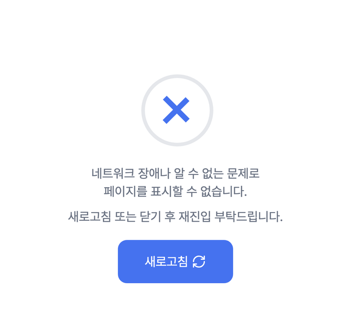
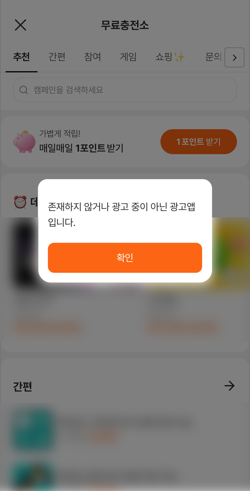

# 문제 해결

연동 중 자주 겪는 증상을 **증상 → 원인 → 해결** 순서로 정리했습니다.
해결되지 않으면 맨 아래의 문의처로 연락해 주세요.

---

## 먼저 로그를 켜세요

```kotlin
TnkPpiHybSdk.enableLogging(BuildConfig.DEBUG)   // 개발 빌드에서만 켭니다
```

> 💡 `BuildConfig` 를 찾을 수 없다는 오류가 나면 앱 모듈 `build.gradle(.kts)` 의 `android { buildFeatures { buildConfig = true } }` 를 켜거나, 디버그 여부를 판단하는 기존 방식을 그대로 쓰세요.

| 설정 | 보이는 것 |
|---|---|
| `enableLogging(true)` | Logcat 의 `TnkPpiHyb` 태그에 SDK 로그(초기화, 오퍼월 주소 생성 등)가 나옵니다 |
| `enableLogging(false)` 또는 호출하지 않음 | `TnkPpiHyb` 태그 로그가 나오지 않습니다 (기본값) |

> ⚠️ 출시 빌드에서는 끄세요. 로그에 사용자 정보가 담긴 값이 포함될 수 있습니다.

오퍼월 화면 쪽 로그는 `enableLogging` 과 상관없이 항상 아래 태그로 출력됩니다.

| Logcat 태그 | 내용 | `enableLogging(true)` 필요 |
|---|---|:-:|
| `TnkPpiHyb` | 초기화, 오퍼월 주소 생성 등 SDK 동작 | 필요 |
| `TnkOfferwall` | 오퍼월 화면 동작(닫기, 보상 알림, 딥링크 전달, 네트워크 오류) | 불필요 |
| `TnkLandingWebView` | 광고 랜딩 화면 | 불필요 |

터미널에서는 이렇게 두 태그를 함께 봅니다.

```bash
adb logcat -s TnkPpiHyb TnkOfferwall
```

Android Studio 의 Logcat 에서는 위 태그 이름으로 각각 검색해 보세요.

초기화 직후 아래를 찍어 보면 대부분의 설정 문제가 바로 드러납니다.

```kotlin
if (BuildConfig.DEBUG) {
    Log.i("TNK", "version=${TnkPpiHybSdk.VERSION}" +
            " appId=${TnkPpiHybSdk.getAppId(this)}" +
            " userName=${TnkPpiHybSdk.getUserName(this)}")
}
```

확인이 끝나면 이 코드는 지우세요. 출시 빌드에서 사용자 식별값을 로그로 남기지 마세요.

> 💡 `isInitialized()` 는 값을 읽기만 하고 초기화하지 않습니다. `init()` 을 직접 부르지 않았다면 다른 SDK 호출(`setUserName` 등) 전에는 `false` 로 나올 수 있으며 정상입니다. `getAppId()` 는 호출하면 SDK 가 초기화를 마친 뒤 값을 돌려줍니다.

---

## 에뮬레이터·가상 기기에서 오퍼월이 열리지 않습니다

Android 에뮬레이터·가상 기기에서는 오퍼월이 열리지 않습니다. 동작 확인은 실기기에서 해 주세요.

- **증상**: 버튼을 눌러도 아무 화면이 뜨지 않거나, 삽입한 오퍼월이 빈 채로 남습니다.
- **원인**: 에뮬레이터·가상 기기에서는 오퍼월을 열지 않는 것이 정상 동작입니다. 연동 오류가 아닙니다.
- **해결**: USB 로 연결한 실기기에서 확인하세요.

| 연동 방식 | 에뮬레이터·가상 기기에서 보이는 것 |
|---|---|
| 전체 화면으로 열기 (`openOfferwall`, 기존 방식의 `startOfferwallActivity`, `adDetail`, `adJoin`, `adAction`) | 호출해도 아무 화면도 뜨지 않습니다 |
| 화면 안에 삽입 (`TnkOfferwallView` 의 `loadOfferwall`) | 뷰가 빈 채로 남습니다 |
| 딥링크 (`handleScheme`) | `true` 를 돌려주지만 오퍼월은 열리지 않습니다 |

> 💡 iOS 시뮬레이터에서는 이런 제한이 없습니다 — [지원 범위](../common/support-matrix.md)의 '플랫폼별 차이'

---

## 빌드 오류

### `Dependency '...' requires libraries and applications that depend on it to compile against version NN or later`

- **증상**: 빌드가 위와 같은 메시지로 중단됩니다.
- **원인**: 앱의 `compileSdk` 가 SDK 가 함께 가져오는 AndroidX 라이브러리의 요구 버전보다 낮습니다. 오류 메시지에 적힌 버전(NN)이 요구 버전입니다.
- **해결**: `compileSdk` 를 오류 메시지에 적힌 버전 이상으로 올리세요. 확인된 요구사항은 `compileSdk` 35 이상입니다 — [1. 설치](install.md)의 빌드 요구사항

```kotlin
android {
    compileSdk = 36   // 오류 메시지에 적힌 버전 이상
}
```

### `Could not find com.tnkfactory.ad:hrwd:...`

- **증상**: 의존성을 내려받지 못해 빌드가 중단됩니다.
- **원인**: TnkFactory Maven 저장소가 등록되지 않았습니다. 저장소를 모듈 `build.gradle` 쪽에 넣었다면 `repositoriesMode` 설정 때문에 적용되지 않았을 수 있습니다.
- **해결**: [1. 설치](install.md)의 저장소 등록을 확인하세요. 저장소는 `settings.gradle(.kts)` 의 `dependencyResolutionManagement { repositories { … } }` 안에 넣습니다.

```kotlin
maven("https://repository.tnkad.net:8443/repository/public/")
```

| `repositoriesMode` | 모듈 `build.gradle` 에 넣은 저장소 선언 |
|---|---|
| `PREFER_SETTINGS` | 무시됩니다 |
| `FAIL_ON_PROJECT_REPOS` | 빌드 오류가 납니다 |

### `AdWallActivity` 선언 충돌 (매니페스트 병합 오류)

- **증상**: 기존 네이티브 SDK 에서 이관한 뒤 매니페스트 병합 단계에서 `com.tnkfactory.ad.AdWallActivity` 와 관련한 충돌 오류가 납니다. 오류 문구는 빌드 도구에 따라 다를 수 있습니다.
- **원인**: 앱 매니페스트에 `com.tnkfactory.ad.AdWallActivity` 를 직접 선언해 두었습니다. 하이브리드 SDK 가 같은 이름을 함께 제공합니다.
- **해결**: 앱 매니페스트의 그 `<activity>` 선언을 **제거**하세요. 자세한 내용은 [네이티브 SDK 에서 이관](migration.md)을 참고하세요.

---

## 오퍼월이 뜨지 않거나 빈 화면입니다

에뮬레이터·가상 기기에서 테스트하고 있다면 먼저 위의 "에뮬레이터·가상 기기에서 오퍼월이 열리지 않습니다" 항목을 확인하세요.

### 앱 ID 가 적용되지 않았습니다

```kotlin
Log.i("TNK", "appId=${TnkPpiHybSdk.getAppId(this)}")
```

- **증상**: 값이 `null` 이거나 비어 있거나, 코드로 넣은 앱 ID 와 다른 값입니다.
- **원인 1** (`null`): 매니페스트의 `tnkad_app_id` meta-data 가 없거나 `<application>` 태그 **밖**에 있습니다. 빌드 변형별로 매니페스트가 갈라지면 해당 변형에도 들어 있어야 합니다.
- **원인 2** (코드로 넣은 값과 다름): `init(context, 앱 ID)` 를 다른 SDK 호출보다 늦게 불렀습니다. `setUserName`, `start`, `getAppId`, `openOfferwall` 같은 호출이 먼저 있으면 SDK 가 매니페스트 값으로 초기화를 마치고, 그 뒤의 `init` 은 적용되지 않습니다. `getAppId` 는 매니페스트의 값을 돌려줍니다.
- **해결**: 매니페스트로 앱 ID 를 넣거나, 코드로 넣는다면 `init` 을 앱 실행 때마다 **가장 먼저** 호출하세요. 코드로 넘긴 값이 매니페스트 값보다 우선합니다.

### 사용자 식별값이 없습니다

- **증상**: `getUserName(context)` 가 `null` 입니다.
- **원인**: `setUserName` 을 호출하지 않았습니다. 사용자 식별값은 보상 지급의 기준값입니다.
- **해결**: 오퍼월을 열기 전에 `setUserName(context, "개발사-사용자-식별값")` 을 호출하세요.

### 패키지명이 등록한 값과 다릅니다

- **증상**: 앱 ID 와 사용자 식별값은 맞게 넣었는데, 디버그 빌드처럼 패키지명이 다른 빌드에서만 오퍼월이 정상적으로 표시되지 않을 수 있습니다.
- **원인**: TNK 는 **패키지명(`applicationId`)으로 앱을 식별**합니다. 퍼블리셔 페이지에 등록한 값과 설치한 앱의 패키지명(예: `com.example.app.debug`)이 다르면 오퍼월이 정상적으로 표시되지 않을 수 있습니다.
- **해결**: 설치한 앱의 패키지명이 등록한 값과 같은지 확인하세요 — [APP ID 발급받기](../publisher/app-id.md). 패키지명이 다른 빌드로 확인해야 한다면 담당자에게 문의해 주세요.

### '네트워크 연결 오류' 팝업이 뜹니다

- **증상**: "네트워크 연결이 원활하지 않아 페이지를 불러올 수 없습니다" 라는 팝업이 뜹니다. Logcat 의 `TnkOfferwall` 태그에 `onReceivedError` 로 시작하는 로그가 남습니다.
- **원인**: 오퍼월 화면을 불러오지 못했습니다.
- **해결**: 먼저 기기의 인터넷 연결을 확인하세요. 회사 네트워크나 VPN 같은 특정 네트워크에서만 반복된다면 담당자에게 문의해 주세요.

| 버튼 | 전체 화면으로 연 오퍼월 | 화면 안에 삽입한 오퍼월 |
|---|---|---|
| [다시 시도] | 같은 화면을 다시 불러옵니다 | 같은 화면을 다시 불러옵니다 |
| [닫기] | 오퍼월이 닫힙니다 | `onCloseRequested` 에 등록한 동작이 실행됩니다. 등록하지 않았으면 그 화면(Activity)이 종료됩니다 |

> 삽입한 오퍼월에서 [닫기] 뒤에 오퍼월을 다시 보여 주려면 `loadOfferwall()` 을 다시 호출하세요. 팝업이 뜬 뷰는 빈 화면으로 바뀐 상태입니다.

### 오퍼월 안에 '페이지를 표시할 수 없습니다' 화면이 보입니다

<figure><figcaption><p>네트워크 문제 등으로 내용을 불러오지 못하면 새로고침 버튼이 있는 안내 화면이 나올 수 있습니다(예시). 오퍼월 화면은 Android·iOS 가 같습니다.</p></figcaption></figure>

- **증상**: 오퍼월 화면 가운데에 "네트워크 장애나 알 수 없는 문제로 페이지를 표시할 수 없습니다" 문구와 [새로고침] 버튼이 보입니다. 앞의 '네트워크 연결 오류' 팝업과는 다른 화면입니다.
- **원인**: 네트워크 문제 등으로 오퍼월이 내용을 불러오지 못했습니다.
- **해결**: 기기의 인터넷 연결을 확인하고 [새로고침]을 눌러 보세요. 연결이 정상인데도 반복된다면 담당자에게 문의해 주세요.

### 특정 광고로 진입했더니 '존재하지 않거나 광고 중이 아닌 광고앱입니다' 안내가 뜹니다

<figure><figcaption><p>광고를 찾지 못했을 때 나오는 안내입니다. 번호가 맞아도 이 기기에서 조회할 수 없는 광고라면 같은 안내가 나올 수 있습니다.</p></figcaption></figure>

- **증상**: `adDetail` · `adJoin` · `adAction` 으로 오퍼월을 열었더니 위 안내가 뜹니다.
- **원인**: 넘긴 광고 번호(`appId`)의 광고가 없거나 지금 진행 중이 아닙니다. 번호가 맞아도 이 기기에서 조회할 수 없는 광고라면 같은 안내가 나올 수 있습니다.
- **해결**: 광고 번호와 `actionId` 를 확인하세요 — [8. 특정 광고 진입](ad-entry.md). 번호가 맞는데도 계속 나온다면 광고 번호와 함께 담당자에게 문의해 주세요.

---

## 광고 참여 시 '추적 허용이 필요해요' 팝업이 뜹니다

- **증상**: 광고 참여 버튼을 눌렀더니 '추적 허용이 필요해요' 팝업이 뜨고 참여가 진행되지 않습니다.
- **원인**: 기기에서 광고 ID 를 삭제했거나 광고 추적을 제한한 상태입니다. 광고 ID 가 필요한 광고는 이 상태에서 참여할 수 없으며, 연동 오류가 아닙니다.
- **해결**: 사용자가 [설정으로 이동]을 누르면 기기의 광고 ID 설정 화면이 열립니다(SDK 1.0.15 이상, 이전 버전은 설정 첫 화면). 새 광고 ID 를 받은 뒤 다시 참여하면 됩니다. [취소]를 누르면 참여 없이 팝업만 닫힙니다.

> 설정 화면의 경로와 메뉴 이름은 기기마다 다를 수 있습니다. 팝업에는 `[설정] -> [개인정보 보호] -> [광고] -> [새 광고ID 받기]` 안내가 함께 나옵니다.

---

## 보상이 지급되지 않습니다

- **증상**: 오퍼월에서 참여를 마쳤는데 사용자에게 포인트가 지급되지 않습니다.
- **원인**: `setRewardListener` 는 **화면 갱신용 알림**일 뿐이고, 실제 포인트 지급은 서버 콜백으로 이루어집니다. 아래를 순서대로 확인하세요.
  1. 퍼블리셔 페이지에 개발사 콜백 URL 이 등록되어 있는지
  2. 콜백 서버가 **HTTP 200** 을 응답하는지 (200 이 아니면 5분 · 1시간 간격으로 최대 24시간 재시도 후 폐기)
  3. `md_chk` 검증이 정식 규격과 맞는지
  4. `setUserName()` 에 넣은 사용자 식별값과 콜백의 `md_user_nm` 이 일치하는지
- **해결**: 위 항목을 고친 뒤 다시 확인하세요. 자세한 내용은 [서버 보상 콜백 URL](../common/server-callback.md)을 참고하세요.

> ⚠️ 로그인 전 임시값으로 오퍼월에 진입했다가 나중에 `setUserName()` 을 바꾸면
> 그 사이 발생한 보상은 임시값으로 지급되어 회수할 수 없습니다.
> 오퍼월 진입은 사용자 식별값이 확정된 뒤로 미루세요.

### 앱의 토스트·잔액 갱신이 오지 않습니다

- **증상**: 서버에서는 지급됐는데 앱 화면의 토스트나 잔액이 바뀌지 않습니다.
- **원인**: `setRewardListener` 를 등록하기 전에 도착한 알림은 전달되지 않습니다.
- **해결**: 오퍼월을 열기 전에 리스너를 등록하세요. 알림은 화면 갱신용이므로, 지급 여부는 서버 콜백으로 확인하세요.

---

## 삽입한 오퍼월(`TnkOfferwallView`)이 동작하지 않습니다

### 화면이 비어 있습니다

- **증상**: 앱 화면 안에 넣은 오퍼월 영역이 아무것도 없이 비어 있습니다.
- **원인 1**: `loadOfferwall()` 을 호출하지 않았습니다. XML 배치만으로는 로드되지 않습니다.
- **원인 2**: 에뮬레이터·가상 기기에서 실행 중입니다 — 위의 "에뮬레이터·가상 기기에서 오퍼월이 열리지 않습니다" 항목을 확인하세요.
- **원인 3**: Fragment 화면이 다시 만들어져 새 뷰가 생겼는데 `loadOfferwall()` 을 호출하지 않았습니다. 이미 정리된 뷰에는 호출해도 무시되며, Logcat 의 `TnkOfferwall` 태그에 `loadOfferwall() called on destroyed view — ignored.` 가 남습니다.
- **해결**: 뷰를 만들 때 `loadOfferwall()` 을 호출하세요. Fragment 라면 `onViewCreated` 에서 호출합니다. 네트워크 오류 팝업의 [닫기] 뒤처럼 다시 보여 줘야 할 때만 다시 호출합니다.

### 탭을 오갈 때마다 처음부터 다시 로드됩니다

- **증상**: 다른 탭에 갔다 돌아오면 오퍼월이 첫 화면부터 다시 나옵니다.
- **원인**: 화면이 보일 때마다 `loadOfferwall()` 을 호출하고 있습니다. 다시 호출하면 첫 화면부터 새로 로드합니다.
- **해결**: **탭을 전환하거나 화면이 보일 때마다 `loadOfferwall()` 을 다시 부르지 말고, 탭을 전환할 때는 뷰의 visibility 만 바꾸세요.** 그래야 스크롤 위치와 진행 중인 참여 상태가 유지됩니다. 사용자가 바뀌었을 때나 네트워크 오류 팝업의 [닫기] 뒤처럼 첫 화면부터 새로 보여야 할 때만 다시 호출합니다. 숨겨 둔 오퍼월이 뒤로가기를 먼저 처리할 수 있으니 [4. 오퍼월 띄우기](offerwall.md)의 '탭에 넣을 때 주의' 항목도 확인하세요.

### 닫기 버튼을 누르면 화면 전체가 종료됩니다

- **증상**: 오퍼월의 닫기(X) 버튼을 눌렀더니 오퍼월이 아니라 앱 화면 전체가 닫힙니다.
- **원인**: 삽입한 오퍼월에 `onCloseRequested` 를 등록하지 않았습니다.
- **해결**: 닫기 버튼을 눌렀을 때 할 동작을 등록하세요. 탭 안에 넣었다면 반드시 등록해야 합니다.

| `onCloseRequested` | 오퍼월의 닫기 버튼(또는 네트워크 오류 팝업의 [닫기])을 누르면 |
|---|---|
| 등록함 | 등록한 동작이 실행됩니다 (예: 다른 탭으로 이동) |
| 등록하지 않음 | 오퍼월을 담은 화면(Activity)이 종료됩니다. 탭 화면에 넣었다면 앱 화면 전체가 닫힙니다 |

```kotlin
binding.offerwallView.onCloseRequested = {
    binding.bottomNav.selectedItemId = R.id.nav_home
}
```

### 동의를 거부한 뒤 닫아도 거부 안내 화면이 그대로 남습니다

- **증상**: 탭에 넣은 오퍼월에서 동의 팝업의 [거부]를 누르고 닫기(X)를 눌렀는데, 탭으로 돌아오면 거부 안내 화면이 그대로 보입니다.
- **원인**: 닫기(X)를 누르면 `onCloseRequested` 에 등록한 동작만 실행되고, 탭 안의 오퍼월은 다시 불러오지 않습니다. 앱을 다시 시작하기 전까지 사용자가 다시 동의할 방법이 없습니다.
- **해결**: 탭으로 돌아왔을 때 `isAgreePrivacy(context)` 가 `false` 이면 `loadOfferwall()` 을 다시 호출하세요. 동의 팝업이 다시 나옵니다 — [4. 오퍼월 띄우기](offerwall.md)의 '탭에 넣을 때 주의' 항목

### 콘텐츠가 상태바에 가려집니다

- **증상**: 오퍼월 맨 위 내용이 상태바 뒤에 가려집니다.
- **원인**: 앱 화면이 상태바 뒤까지 그려지는(edge-to-edge) 화면인데, 오퍼월에 상태바 높이를 알려 주지 않았습니다.
- **해결**: 상단 inset 을 오퍼월 뷰에 전달하세요. 물리 픽셀이 아니라 **dp 단위**(물리 픽셀 ÷ density) 값을 넘겨야 합니다 — [4. 오퍼월 띄우기](offerwall.md)

```kotlin
val topPx = insets.getInsets(WindowInsetsCompat.Type.statusBars()).top
binding.offerwallView.setSafeAreaTopPx(topPx / resources.displayMetrics.density)
```

### 이미지 첨부 버튼을 눌러도 파일 선택 창이 뜨지 않습니다

- **증상**: 광고 참여 중 이미지 첨부 버튼을 눌러도 파일 선택 창이 뜨지 않습니다.
- **원인**: 오퍼월을 담은 화면이 AndroidX `ComponentActivity`(`AppCompatActivity` 포함)가 아니면 파일 선택을 SDK 가 처리하지 못합니다.
- **해결**: 오퍼월을 `ComponentActivity` 기반 화면에 넣으세요.

---

## 딥링크가 동작하지 않습니다

- **증상**: `tnkscheme://` 링크를 눌러도 오퍼월이 열리지 않거나 원하는 탭으로 이동하지 않습니다.
- **원인과 해결**: 아래를 순서대로 확인하세요.
  1. 매니페스트에 `tnkscheme` intent-filter 가 있는지 — [6. 딥링크](deeplink.md)
  2. `onCreate()` 와 `onNewIntent()` **양쪽 모두**에서 `handleScheme()` 을 호출하는지
  3. `onNewIntent()` 에서 `setIntent(intent)` 를 먼저 호출했는지
  4. 에뮬레이터·가상 기기가 아니라 **실기기**에서 시험하고 있는지 — 에뮬레이터에서는 오퍼월이 열리지 않습니다

`handleScheme()` 의 반환값으로 SDK 가 처리했는지 알 수 있습니다.

| 반환값 | 의미 |
|---|---|
| `true` | SDK 가 처리했습니다. 오퍼월이 떠 있으면 그 화면으로 전달하고, 없으면 오퍼월을 열어 전달합니다 |
| `false` | SDK 가 다루지 않는 URL 입니다. `tnkscheme` 이 아니거나, `tnkscheme://` 뒤에 명령이 빠진 URL 입니다(예: `tnkscheme://select_menu?cat_id=3` 처럼 명령이 있어야 합니다). 앱이 자체 딥링크로 처리하세요 |

터미널에서 직접 테스트할 수 있습니다. USB 로 연결한 실기기에서 실행하세요.

```bash
adb shell am start -a android.intent.action.VIEW -d "tnkscheme://select_menu?cat_id=3"
```

---

## 그 밖의 문의

tech@tnkfactory.com
