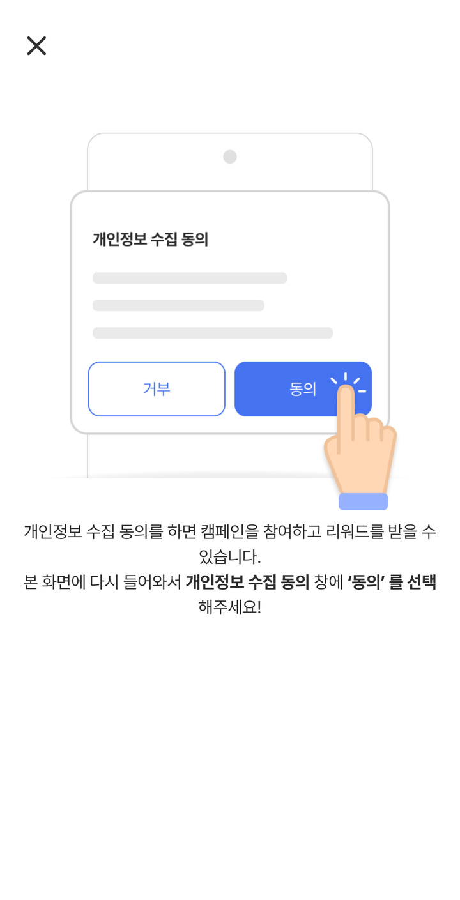

# 8. 특정 광고 진입

배너·푸시·이벤트 페이지 같은 개발사 화면에서 오퍼월 목록을 거치지 않고 **특정 광고의 상세 또는 참여**로 바로 보내는 방법입니다.

선택 기능입니다. 특정 광고로 바로 보내는 화면이 있는 개발사만 사용하세요. (iOS SDK 1.0.0 이상)

---

## 코드

```swift
let sdk = TnkPpiHybSdk.shared
sdk.adDetail(from: self, appId: 123456)   // 상세 화면으로
sdk.adJoin(from: self, appId: 123456)     // 상세 없이 바로 참여
sdk.adAction(from: self, appId: 123456)   // 오퍼월 목록에서 누른 것과 같은 규칙
```

`from` 에는 오퍼월을 띄울 화면(보통 `self`)을 넘깁니다. 전환 애니메이션을 끄려면 `animated: false` 를 넘깁니다.

> ⚠️ 여기서 `appId` 는 `configure(appId:)` 에 넣은 **개발사 앱 ID 가 아니라**, 보낼 **광고(캠페인) 번호**입니다. 숫자(`Int64`)로 넘기며, 어떤 광고를 보낼지는 TnkFactory 담당자와 캠페인을 협의할 때 전달받습니다. 위 `123456` 은 예시 값입니다.

호출 전에 [`setUserName(_:)`](initialize.md) 이 설정돼 있어야 보상이 정상 지급됩니다.

### `actionId`

기본값 `0` 을 그대로 쓰시면 됩니다. 구매형(CPS·쇼핑) 광고만 `5` 를 지정합니다.

| `actionId` | 대상 광고 | 언제 쓰나 |
|---|---|---|
| `0` (생략) | 일반(비구매형) 광고 | 대부분 |
| `5` | 구매형(CPS·쇼핑) 광고 | 구매형 광고로 보낼 때만 |

```swift
sdk.adDetail(from: self, appId: 123456, actionId: 5)   // 구매형 광고
```

---

## 메서드별로 사용자가 보는 것

| 메서드 | 사용자가 보는 것 | 닫거나 돌아오면 | 언제 쓰나 |
|---|---|---|---|
| `adDetail` | 오퍼월이 열리고 해당 광고의 **상세 화면**이 바로 보입니다. 광고 설정과 관계없이 항상 상세를 보여 줍니다. | 상세 화면을 닫으면 오퍼월도 함께 닫혀 개발사 화면으로 돌아갑니다. | 광고 소개를 먼저 보여 주고 싶을 때 |
| `adJoin` | 오퍼월이 열린 채 상세 없이 **바로 참여**가 진행되고, 광고 페이지(스토어·광고주 페이지 등)로 이동합니다. | 광고 페이지에서 돌아오면 오퍼월 첫 화면이 보입니다. 개발사 화면으로 돌아가려면 오퍼월을 닫아야 합니다. | 참여 버튼을 눌러 바로 참여시킬 때 |
| `adAction` | 오퍼월 목록에서 그 광고를 누른 것과 같습니다. 광고 설정에 따라 상세 화면이 보이거나 바로 참여가 진행됩니다. | 오퍼월 첫 화면이 보입니다. | 상세·참여 분기를 SDK 에 맡길 때 |

<figure><figcaption><p>adDetail 로 열면 오퍼월이 열리며 해당 광고의 상세 화면이 바로 보입니다. 광고 내용은 예시를 위해 흐리게 처리했습니다. 오퍼월 화면은 Android·iOS 가 같습니다.</p></figcaption></figure>

세 메서드 모두 항상 오퍼월을 **전체 화면 모달**로 엽니다. 앱 화면 안에 넣은 오퍼월을 쓰고 있어도 별도의 전체 화면으로 열립니다. 아래로 쓸어 닫을 수 없고, 상단의 닫기(X) 버튼으로 닫습니다.

### 결과 콜백은 없습니다

호출 결과를 앱으로 돌려주지 않습니다. 광고가 종료됐거나 찾을 수 없으면 오퍼월 화면이 직접 안내 문구를 보여 줍니다.

---

## 개인정보 수집 동의와의 관계

특정 광고 진입도 오퍼월과 같이 **개인정보 수집 동의를 확인한 뒤** 진행됩니다.

| 동의 상태 | 사용자가 보는 것 |
|---|---|
| 이미 동의함 (또는 앱이 `setAgreePrivacy(true)` 로 알림) | 동의 팝업 없이 바로 해당 광고로 진입합니다. |
| 아직 동의하지 않음 | 오퍼월이 열리고 동의 팝업이 먼저 보입니다. 동의하면 해당 광고로 진입합니다. |
| 팝업에서 거부함 | 개인정보 수집 동의를 안내하는 화면이 보이고 광고로 진입하지 않습니다. 닫기(X)를 누르면 오퍼월이 닫히고 개발사 화면으로 돌아옵니다. |

<figure><figcaption><p>동의 전이면 동의 팝업이 먼저 보이고, 동의하면 해당 광고로 진입합니다.</p></figcaption></figure>

<figure><figcaption><p>거부하면 이 안내 화면이 보이고 광고로 진입하지 않습니다. 닫기(X)를 누르면 오퍼월이 닫힙니다.</p></figcaption></figure>

`setAgreePrivacy(true)` 로 알린 앱에서는 오퍼월의 '개인 정보 수집 동의 해제' 메뉴도 보이지 않습니다 — [7. 개인정보 설정](privacy.md)

---

## 기존 네이티브 SDK 와 다른 점

기존 네이티브 SDK(`TnkRwdSdk2`)의 `presentAdDetailView` / `adJoin` / `adAction` 에 대응합니다. 다음이 다릅니다.

- **호출 대상** — `TnkSession.sharedInstance()` 가 아니라 `TnkPpiHybSdk.shared` 에서 호출합니다. 상세 호출 이름은 `presentAdDetailView` 에서 `adDetail` 로 바뀌었습니다.
- **결과 콜백 없음** — 성공·실패를 받는 `completion` 이 없습니다. 실패 안내는 오퍼월 화면이 직접 보여 줍니다.
- **오퍼월이 함께 열림** — 기존에는 개발사 화면 위에 상세 화면을 띄우거나 오퍼월 없이 참여만 했습니다. 이제는 세 메서드 모두 오퍼월을 전체 화면 모달로 엽니다. `fullscreen`·`navigationPush`·`subAppId` 같은 표시 방식 옵션은 없습니다.
- **동의 확인 호출이 필요 없음** — 기존 푸시 예제처럼 `openPrivacyTermAlert` 로 동의를 먼저 확인하지 않아도 됩니다. 동의 확인은 위 '개인정보 수집 동의와의 관계'처럼 오퍼월이 처리합니다.

```diff
- TnkSession.sharedInstance()?.presentAdDetailView(self, appId: 123456) { success, error in
-     // 결과 처리
- }
+ TnkPpiHybSdk.shared.adDetail(from: self, appId: 123456)
```

`adJoin`, `adAction` 도 같은 방식으로 바꾸면 됩니다.

---

## 오퍼월 진입과의 차이

- [`openOfferwall(from:)`](offerwall.md) — 오퍼월 **첫 화면(목록)** 으로 진입
- `adDetail` / `adJoin` / `adAction` — **특정 광고 하나**로 진입

---

다음: [9. 적립 가능 포인트 조회](total-point.md)
