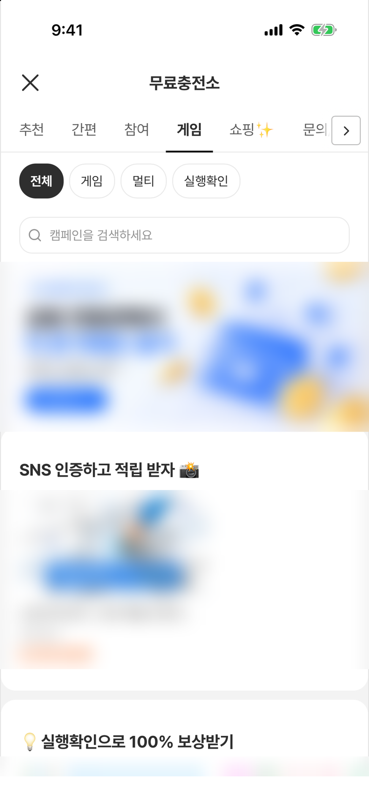

# 6. 딥링크

푸시 알림이나 외부 배너에서 `tnkscheme://` 로 시작하는 링크를 받으면, 오퍼월의 특정 카테고리로 바로 보내는 방법입니다.

선택 기능입니다. 딥링크를 쓰지 않는다면 이 페이지는 건너뛰셔도 됩니다.

```
tnkscheme://select_menu?cat_id=3
```

---

## 지원하는 딥링크

| 링크 | 사용자가 보는 것 |
|---|---|
| `tnkscheme://select_menu?cat_id={카테고리 ID}` | 오퍼월이 열리고 해당 카테고리 탭이 선택됩니다. |
| `tnkscheme://select_menu?cat_id={카테고리 ID}&filter_id={필터 ID}` | 해당 카테고리 탭에서 그 필터까지 선택됩니다. 필터가 그 탭에 없으면 '전체'가 선택됩니다. |

<figure><figcaption><p>iOS 에서 딥링크를 받으면 오퍼월이 열리고 지정한 탭(여기서는 게임)이 선택됩니다.</p></figcaption></figure>

카테고리·필터 ID 와 그 밖에 사용할 수 있는 딥링크 목록은 TnkFactory 담당자에게 문의하세요. 오퍼월의 화면 구성에 따라 이동하지 않을 수 있으며, 이때는 오퍼월 첫 화면이 열립니다. 새로운 딥링크가 추가되어도 **SDK 를 업데이트할 필요가 없습니다.**

---

## 1. URL 스킴 등록

`Info.plist`

```xml
<key>CFBundleURLTypes</key>
<array>
  <dict>
    <key>CFBundleURLName</key>
    <string>com.example.app.tnk</string>
    <key>CFBundleURLSchemes</key>
    <array><string>tnkscheme</string></array>
  </dict>
</array>
```

> ⚠️ `tnkscheme` 는 TNK 오퍼월을 붙인 여러 앱이 함께 쓰는 스킴입니다. 같은 기기에 그런 앱이 여러 개 있으면 앱 밖 링크가 다른 앱을 열 수 있습니다. 앱 밖에서 보내는 링크는 앱 고유 스킴이나 유니버설 링크로 받은 뒤, 앱 안에서 `handleScheme("tnkscheme://select_menu?cat_id=3", from: {첫 화면})` 처럼 문자열로 넘기는 방식을 권장합니다. 앱이 시작되거나 백그라운드에서 돌아오는 시점에 부를 수 있으니, 이때도 `from:` 으로 오퍼월을 띄울 화면을 함께 넘기세요(아래 2. SDK 에 전달 참고).

---

## 2. SDK 에 전달

앱이 떠 있을 때와 딥링크로 처음 실행될 때(콜드스타트) **양쪽 모두** 처리해야 합니다. 앱이 `SceneDelegate` 를 쓰는지 `AppDelegate` 만 쓰는지에 따라 호출 위치가 다릅니다.

### SceneDelegate 를 쓰는 앱

```swift
final class SceneDelegate: UIResponder, UIWindowSceneDelegate {

    var window: UIWindow?

    // 앱이 이미 떠 있는 경우
    func scene(_ scene: UIScene, openURLContexts contexts: Set<UIOpenURLContext>) {
        for context in contexts {
            // 오퍼월 링크는 SDK 가 처리
            if TnkPpiHybSdk.shared.handleScheme(context.url, from: window?.rootViewController) { continue }
            // 그 밖의 링크는 앱이 처리 (개발사 코드)
            handleMyOwnDeeplink(context.url)
        }
    }

    // 딥링크로 앱이 처음 뜨는 경우
    func scene(_ scene: UIScene,
               willConnectTo session: UISceneSession,
               options connectionOptions: UIScene.ConnectionOptions) {
        guard let windowScene = scene as? UIWindowScene else { return }

        // SDK 설정(configure · setUserName)과 첫 화면 구성을 먼저 마칩니다.
        let window = UIWindow(windowScene: windowScene)
        window.rootViewController = UINavigationController(rootViewController: MainViewController())   // 개발사 첫 화면
        window.makeKeyAndVisible()
        self.window = window

        // 앱이 막 시작되는 시점이므로, 오퍼월을 띄울 화면(window.rootViewController)을 함께 넘깁니다.
        for context in connectionOptions.urlContexts {
            if TnkPpiHybSdk.shared.handleScheme(context.url, from: window.rootViewController) { continue }
            handleMyOwnDeeplink(context.url)
        }
    }
}
```

`from:` 에는 오퍼월을 띄울 화면을 넘깁니다. 앱이 꺼진 상태에서 딥링크로 실행될 때(`willConnectTo`)와 백그라운드에 있다가 딥링크로 돌아올 때(`openURLContexts`) **두 경우 모두** 반드시 넘기세요.

앱이 막 시작되는 시점이나 백그라운드에서 돌아오는 시점에는 오퍼월을 띄울 화면을 SDK 가 찾지 못할 수 있습니다. `willConnectTo` 에서는 위 코드처럼 window 를 만든 뒤 `window.rootViewController` 를, `openURLContexts` 에서는 `window?.rootViewController` 를 넘깁니다. 넘기지 않으면 딥링크를 받았는데도 오퍼월이 열리지 않을 수 있고, 이후 받은 딥링크도 열리지 않을 수 있습니다.

스토리보드로 첫 화면을 띄우는 앱은 위 예시처럼 window 를 새로 만들지 마세요. `willConnectTo` 에서 이미 만들어져 있는 `window?.rootViewController` 를 넘기면 됩니다.

앱이 알림창·모달처럼 다른 화면을 띄워 둔 상태에서도 딥링크를 받을 수 있다면, `window?.rootViewController` 대신 그 맨 위에 보이는 화면을 넘기세요. 첫 화면이 이미 다른 화면을 띄우고 있으면 오퍼월이 열리지 않을 수 있습니다.

로그인 뒤에야 사용자 식별값을 알 수 있는 앱은 로그인 전에 받은 링크를 보관해 두세요. `setUserName` 을 호출한 다음에 `handleScheme` 에 넘기면 됩니다. 식별값 없이 연 오퍼월에서 생긴 보상은 올바른 사용자에게 지급되지 않을 수 있습니다([3. 초기화](initialize.md)).

### SceneDelegate 를 쓰지 않는 앱 (AppDelegate 만 사용)

앱이 꺼져 있다가 딥링크로 실행될 때도 이 메서드가 호출됩니다.

```swift
func application(_ app: UIApplication, open url: URL,
                 options: [UIApplication.OpenURLOptionsKey: Any] = [:]) -> Bool {
    if TnkPpiHybSdk.shared.handleScheme(url, from: window?.rootViewController) { return true }
    return handleMyOwnDeeplink(url)   // 그 밖의 링크는 앱이 처리 (개발사 코드)
}
```

여기서 `window` 는 `AppDelegate` 의 `window` 입니다. `from:` 을 생략하면 SDK 가 오퍼월을 띄울 화면을 찾지 못해 열리지 않을 수 있으니, 앱의 첫 화면을 넘기세요. 앱이 이미 다른 화면을 모달로 띄워 둔 상태에서도 딥링크를 받을 수 있다면, 그 맨 위 화면을 넘기세요.

### 푸시 등에서 문자열로 넘기는 경우

`SceneDelegate` 를 쓰는 앱과 `AppDelegate` 만 쓰는 앱 모두 해당합니다. 문자열을 직접 넘길 수도 있습니다. 푸시 데이터에서 링크를 문자열로 받는 경우에 씁니다. 푸시 알림을 눌러 앱이 시작되거나 백그라운드에서 돌아오는 시점에 부르는 경우가 많고, 이때는 오퍼월을 띄울 화면을 SDK 가 찾지 못할 수 있으므로 `from:` 으로 화면을 넘기세요.

```swift
// 푸시 알림을 눌렀을 때 호출됩니다 (UNUserNotificationCenterDelegate)
func userNotificationCenter(_ center: UNUserNotificationCenter,
                            didReceive response: UNNotificationResponse,
                            withCompletionHandler completionHandler: @escaping () -> Void) {
    // 푸시 데이터에서 링크 문자열을 꺼냅니다 (키 이름 "link" 는 예시이며, 개발사가 정합니다).
    // 링크 예: "tnkscheme://select_menu?cat_id=3"
    if let link = response.notification.request.content.userInfo["link"] as? String {
        // firstScreen: 앱의 첫 화면입니다 (개발사 코드). 위 예시에서 넘긴 화면과 같습니다.
        // SceneDelegate 를 쓰는 앱은 씬의 window?.rootViewController, AppDelegate 만 쓰는 앱은 AppDelegate 의 window?.rootViewController.
        TnkPpiHybSdk.shared.handleScheme(link, from: firstScreen)
    }
    completionHandler()
}
```

`from:` 에는 앞의 안내와 같은 기준으로 앱의 첫 화면을 넘기세요. 앱을 쓰는 중 앱 안의 알림창(`UIAlertController`)·모달이 떠 있을 때 푸시를 누를 수 있다면 그 맨 위 화면을 넘깁니다. 넘기지 않으면 푸시를 눌렀는데도 오퍼월이 열리지 않을 수 있고, 이후 받은 딥링크도 열리지 않을 수 있습니다. 푸시로 앱이 시작되는 시점에 아직 첫 화면이 준비되지 않았다면, 링크를 보관해 두었다가 첫 화면을 만든 뒤 넘기세요.

---

## 동작 방식

딥링크를 받았을 때 오퍼월의 상태에 따라 사용자가 보는 것이 달라집니다.

| 딥링크를 받은 때 | 사용자가 보는 것 |
|---|---|
| 오퍼월이 열려 있지 않음 | 전체 화면 오퍼월이 열리고 해당 화면으로 이동합니다. 앱이 딥링크로 처음 실행될 때나 백그라운드에서 돌아올 때도 같습니다. 이때는 위 2단계처럼 `from:` 으로 오퍼월을 띄울 화면을 넘기세요. |
| 전체 화면 오퍼월이 열려 있음 | 그 오퍼월에서 바로 해당 화면으로 이동합니다. |
| 앱 화면 안에 넣은 오퍼월(`TnkOfferwallView`)을 로드해 둠 | 새로 열지 않고 그 오퍼월에서 이동합니다. 오퍼월이 가려진 탭 안에 있으면 사용자 눈에 보이지 않습니다. |

> ⚠️ 앱 화면 안에 넣은 오퍼월을 탭에 두었다면, `handleScheme` 을 부르기 **전에 오퍼월 탭으로 전환**하고 그 화면의 오퍼월을 불러(`loadOfferwall(_:)`) 두세요. 탭의 오퍼월이 로드되지 않은 상태에서 부르면 SDK 가 전체 화면 오퍼월을 따로 열어, 탭의 오퍼월과 전체 화면 오퍼월이 함께 생길 수 있습니다. 반대로 탭의 오퍼월이 로드되어 있으면 가려진 탭 안에서만 이동하므로 사용자 화면에는 변화가 없습니다. 탭 전환은 SDK 가 하지 않으므로 앱에서 처리해야 합니다.

---

## 반환값

`handleScheme` 은 SDK 가 그 딥링크를 **받아 처리했는지**를 `Bool` 로 돌려줍니다.

| 반환값 | 의미 | 개발사가 할 일 |
|---|---|---|
| `true` | `tnkscheme://` 딥링크로 받아들여 오퍼월을 열었거나 열려 있는 오퍼월로 보냈습니다. | 아무것도 하지 않습니다. 오퍼월이 탭 안에 있다면 `handleScheme` 을 부르기 전에 오퍼월 탭으로 전환해 둡니다. |
| `false` | `tnkscheme://` 딥링크가 아니거나 명령이 없어 SDK 는 아무것도 하지 않았습니다. | 앱이 자체 딥링크로 처리합니다. |

개발사가 여러 스킴을 함께 쓰는 경우, `false` 일 때만 자체 라우팅으로 넘기면 됩니다.

> `true` 는 딥링크를 받아들였다는 뜻이며, 해당 화면이 열렸다는 보장은 아닙니다. 어느 오퍼월에서 이동했는지도 알려 주지 않습니다. 지원하지 않는 링크이거나 대상 카테고리가 없으면 오퍼월이 열리기만 하고 화면은 이동하지 않습니다.

---

## 테스트

시뮬레이터에서 바로 확인할 수 있습니다.

```sh
xcrun simctl openurl booted "tnkscheme://select_menu?cat_id=3"
```

---

다음: [7. 개인정보 설정](privacy.md)
