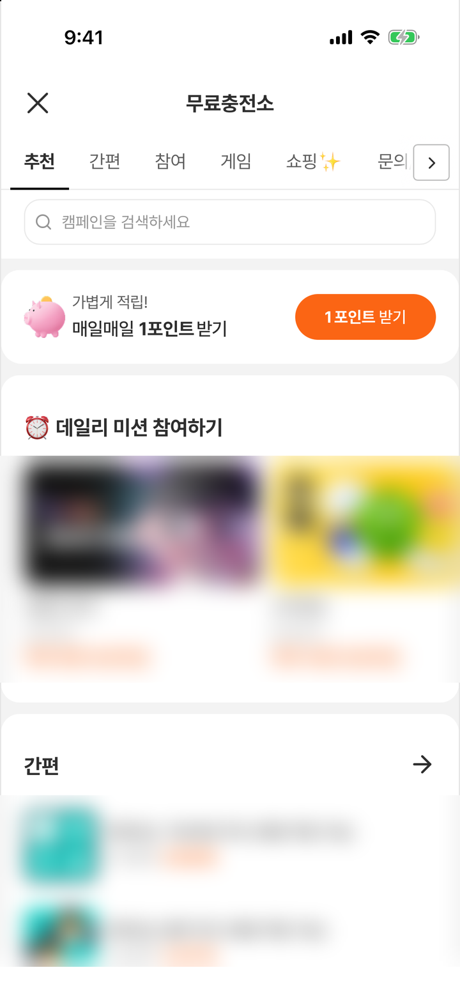
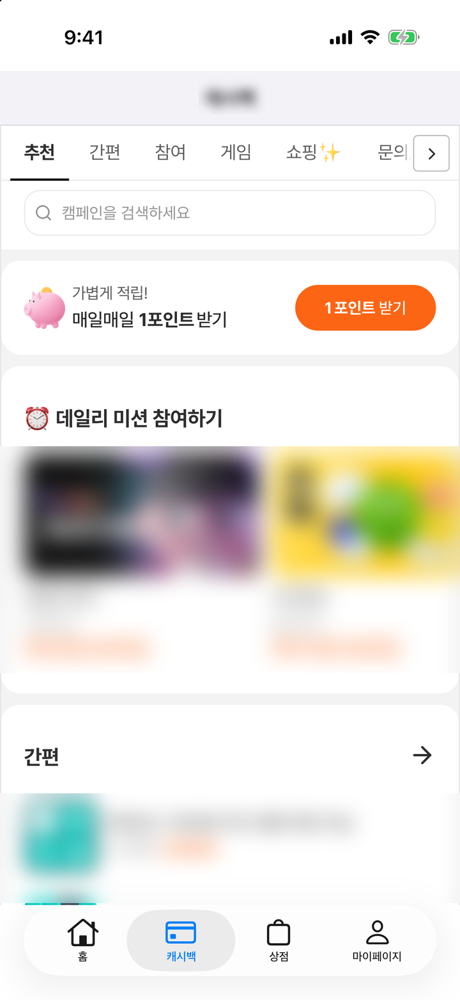
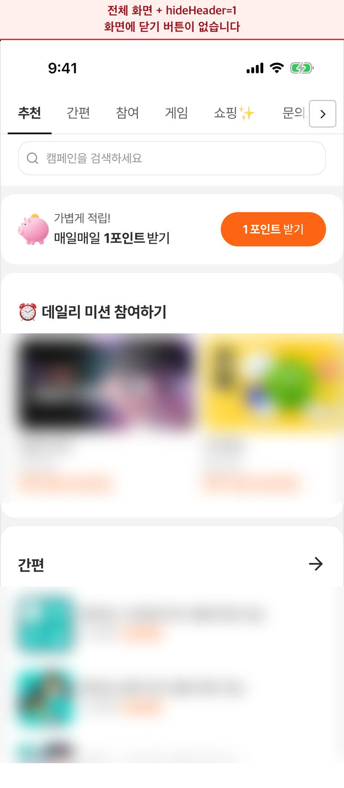

# 4. 오퍼월 띄우기

사용자가 보는 오퍼월 화면을 앱에서 여는 방법입니다. 전체 화면으로 열기와 앱 화면 안에 넣기 중 하나를 고르세요.

모든 개발사에게 필요한 단계입니다. [3. 초기화](initialize.md)를 마친 뒤 진행하세요.

---

## 어느 방식을 쓸까요

| | 전체 화면으로 열기 | 앱 화면 안에 넣기(삽입) |
|---|---|---|
| 사용자가 보는 것 | 오퍼월이 앱 화면 전체를 덮는 별도 화면으로 열립니다. 아래로 쓸어 닫을 수 없고, 상단의 닫기(X) 버튼으로 닫습니다. | 앱 화면의 일부(예: 탭 하나)가 오퍼월로 채워집니다. 앱의 탭 바 등은 그대로 보입니다. |
| 이럴 때 쓰세요 | 버튼·배너를 눌러 오퍼월로 들어갈 때 (권장) | 탭 하나를 통째로 오퍼월로 쓰는 등 앱 화면 안에 상시 노출할 때 |
| 코드 | 한 줄 | 뷰 배치 + 로드 + 닫기 처리 + 정리 |
| 닫기·뒤로가기 | SDK 가 처리합니다. | 닫기 동작을 앱에서 연결합니다. |
| `hideHeader`·`hideBack` | **쓰지 마세요** (닫을 방법이 없어집니다). | 앱이 자체 상단 바를 그릴 때 사용합니다. |

오퍼월 화면은 Android·iOS 가 같습니다.

<figure><figcaption><p>전체 화면으로 열면 오퍼월이 기기 화면을 모두 사용합니다.</p></figcaption></figure>

<figure><figcaption><p>앱 화면 안에 넣으면 앱의 상단 바와 탭 바 사이에 오퍼월이 표시됩니다. 이 화면은 hideHeader 를 지정해 오퍼월 헤더가 없습니다.</p></figcaption></figure>

---

## 전체 화면으로 열기

```swift
TnkPpiHybSdk.shared.openOfferwall(from: self)
```

전환 애니메이션을 끄려면 `animated: false` 를 넘깁니다.

```swift
TnkPpiHybSdk.shared.openOfferwall(from: self, animated: false)
```

`from` 에는 오퍼월을 띄울 화면(보통 `self`)을 넘깁니다. 오퍼월이 앱 화면 위에 전체 화면으로 열리고, 사용자는 상단의 닫기(X) 버튼으로 닫고 앱 화면으로 돌아옵니다.

오퍼월 안에 이전 화면(광고 상세 등)이 있으면 화면 왼쪽 가장자리를 밀어 되돌아갈 수 있습니다.

헤더 숨김·다크 모드 고정 같은 화면 설정은 아래 '화면 설정', '다크 모드' 절을 보세요.

---

## 앱 화면 안에 넣기(삽입)

`TnkOfferwallView` 는 `UIView` 라 원하는 위치에 넣을 수 있습니다.

```swift
import UIKit
import TnkPpiHyb

final class CashbackViewController: UIViewController {

    private let offerwall = TnkOfferwallView(frame: .zero)

    override func viewDidLoad() {
        super.viewDidLoad()
        view.backgroundColor = .systemBackground   // 다크 모드에 맞는 배경색

        offerwall.translatesAutoresizingMaskIntoConstraints = false
        view.addSubview(offerwall)
        NSLayoutConstraint.activate([
            offerwall.topAnchor.constraint(equalTo: view.safeAreaLayoutGuide.topAnchor),
            offerwall.leadingAnchor.constraint(equalTo: view.leadingAnchor),
            offerwall.trailingAnchor.constraint(equalTo: view.trailingAnchor),
            offerwall.bottomAnchor.constraint(equalTo: view.safeAreaLayoutGuide.bottomAnchor),
        ])

        // 사용자가 오퍼월의 닫기(X)를 누르면 호출됩니다. (예: 첫 번째 탭으로 이동)
        offerwall.onCloseRequested = { [weak self] in
            self?.tabBarController?.selectedIndex = 0
        }

        // 오퍼월이 밝은/어두운 상태바 글자를 원할 때 호출됩니다. 내 화면의 상태바를 다시 그리게 합니다.
        offerwall.onStatusBarStyleChanged = { [weak self] _ in
            self?.setNeedsStatusBarAppearanceUpdate()
        }

        // SDK 가 만든 주소로 로드합니다.
        if let url = TnkPpiHybSdk.shared.buildOfferwallURL() {
            offerwall.loadOfferwall(url)
        }
    }

    override var preferredStatusBarStyle: UIStatusBarStyle {
        offerwall.requestedStatusBarStyle
    }

    deinit {
        offerwall.cleanup()   // 이 화면을 더 이상 쓰지 않을 때 한 번
    }
}
```

### 삽입형에 넘길 주소 만들기

`loadOfferwall(_:)` 에는 SDK 가 만든 주소를 넘깁니다. 주소는 `buildOfferwallURL(extraParams:)` 로 만드세요. `loadOfferwall(_:)` 은 주소 하나만 받으므로, 화면 설정(`extraParams`)도 `buildOfferwallURL(extraParams:)` 에 넣습니다.

```swift
if let url = TnkPpiHybSdk.shared.buildOfferwallURL(extraParams: ["hideHeader": "1"]) {
    offerwall.loadOfferwall(url)
}
```

> ⚠️ 만든 주소에는 사용자 정보가 담겨 있습니다. 로그·분석 도구에 남기거나 저장·외부로 보내지 말고 바로 `loadOfferwall(_:)` / `show` 에 넘기세요. 직접 만든 주소를 넘기지도 마세요.

> ⚠️ **사용자가 바뀌면 주소를 다시 만들어 로드하세요.** 로그아웃 후 다른 계정으로 로그인했다면 `setUserName(_:)` 으로 새 사용자 식별값을 설정한 뒤 `buildOfferwallURL()` 로 주소를 다시 만들어 `loadOfferwall(_:)` 을 호출합니다. 다시 로드하지 않으면 이전 사용자의 오퍼월이 계속 보이고, 참여·적립도 이전 사용자로 처리될 수 있습니다.

### 닫기 요청 처리

사용자가 오퍼월의 닫기(X) 버튼이나 네트워크 연결 오류 팝업의 [닫기]를 누르면 `onCloseRequested` 가 호출됩니다.

| `onCloseRequested` | 사용자가 보는 것 | 언제 쓰나 |
|---|---|---|
| 등록 | 등록한 동작이 실행됩니다. (예: 탭 이동, 화면 닫기) | 앱 화면 안에 넣을 때 (반드시 등록) |
| 등록하지 않음 | 닫기(X)를 눌러도 아무 일도 일어나지 않습니다. | 전체 화면으로 열 때는 등록할 일이 없습니다. SDK 가 알아서 닫습니다. |

### 뒤로가기

오퍼월 안에 이전 화면(광고 상세 등)이 있으면 화면 왼쪽 가장자리를 밀어 되돌아갈 수 있습니다. 앱이 자체 뒤로가기 버튼을 두었다면 `goBackIfPossible()` 에 연결하세요. 오퍼월 안에서 되돌아갈 곳이 없으면 `false` 를 돌려줍니다.

```swift
@objc private func backTapped() {
    if !offerwall.goBackIfPossible() {
        navigationController?.popViewController(animated: true)   // 오퍼월 첫 화면이면 내 화면을 닫습니다
    }
}
```

### 정리 (`cleanup`)

> ⚠️ 오퍼월을 담은 화면을 더 이상 쓰지 않을 때(`deinit`) `cleanup()` 을 **한 번** 호출하세요. 진행 중인 로딩을 멈추고 오퍼월 화면과의 연결을 정리합니다. 탭 전환처럼 잠시 가려지는 경우(`viewDidDisappear` 등)에는 호출하지 마세요.

`cleanup()` 을 호출한 뒤에는 그 뷰에 `loadOfferwall(_:)` 을 다시 불러도 무시됩니다. 다시 보여 주려면 `TnkOfferwallView` 를 새로 만들어야 합니다.

`deinit` 이 호출되려면 `onCloseRequested` 같은 클로저 안에서 `[weak self]` 를 써야 합니다. 그렇지 않으면 화면이 해제되지 않아 `deinit` 이 불리지 않습니다.

### 상태바와 배경색

오퍼월 화면이 밝은 글자나 어두운 글자의 상태바를 원하면 `onStatusBarStyleChanged` 가 호출됩니다. 위 코드처럼 `setNeedsStatusBarAppearanceUpdate()` 를 호출하고, `preferredStatusBarStyle` 이 `requestedStatusBarStyle` 을 돌려주게 하세요. 연결하지 않으면 상태바 글자색이 배경과 겹칠 수 있습니다.

오퍼월이 화면 맨 위, 상태바 바로 아래까지 차지할 때만 연결하세요. 앱의 상단 바(내비게이션 바 등) 아래에 넣었다면 상태바는 앱 상단 바에 맞춘 그대로 두면 됩니다.

앱 화면 안에 넣으면 오퍼월 위·아래 빈 영역에는 앱 화면의 배경색이 그대로 보입니다. 다크 모드에 맞춰 그 화면의 배경색을 지정해 주세요.

### 탭에 넣을 때 주의

탭을 바꿀 때 오퍼월 뷰를 다시 만들지 않으면 오퍼월 화면 상태(스크롤 위치, 진행 중인 참여)가 유지됩니다. 이때 `loadOfferwall(_:)` 은 처음 한 번만 호출하고, 탭을 전환하거나 화면이 보일 때마다 다시 부르지 마세요. 사용자가 바뀌었을 때나 아래의 동의 거부 뒤처럼 첫 화면부터 새로 보여야 할 때만 새 주소로 다시 호출합니다. `cleanup()` 은 탭을 떠날 때가 아니라 화면이 해제될 때(`deinit`) 호출합니다.

> ⚠️ 사용자가 동의 팝업에서 [거부]를 누르고 닫기(X)를 누르면 `onCloseRequested` 가 호출되지만, 탭의 오퍼월에는 거부 안내 화면이 그대로 남습니다. 탭을 떠났다가 돌아왔을 때(`viewWillAppear`) `isAgreePrivacy()` 가 `false` 이면 `buildOfferwallURL()` 로 주소를 다시 만들어 `loadOfferwall(_:)` 을 호출해, 동의 팝업을 다시 보여 주세요. 처음 표시될 때는 `viewDidLoad` 에서 이미 불러왔으므로 건너뜁니다. 그러지 않으면 앱을 다시 시작하기 전까지 사용자가 다시 동의할 방법이 없습니다 — [7. 개인정보 설정](privacy.md)의 'A. 앱이 동의를 직접 받지 않는 경우' 항목

```swift
// 오퍼월(TnkOfferwallView)을 탭에 넣은 화면 안에 둡니다. offerwall 은 그 화면의 TnkOfferwallView 입니다.
private var isFirstAppearance = true   // 첫 표시는 viewDidLoad 에서 이미 불러왔으므로 건너뜁니다

override func viewWillAppear(_ animated: Bool) {
    super.viewWillAppear(animated)
    if isFirstAppearance {
        isFirstAppearance = false
        return
    }
    // 탭을 떠났다가 돌아왔을 때, 동의하지 않은 상태이면 동의 팝업이 다시 나오도록 새로 불러옵니다.
    if !TnkPpiHybSdk.shared.isAgreePrivacy(),
       let url = TnkPpiHybSdk.shared.buildOfferwallURL() {
        offerwall.loadOfferwall(url)
    }
}
```

> 가려진 탭의 오퍼월도 [6. 딥링크](deeplink.md)를 받습니다. 딥링크가 오면 오퍼월 탭으로 전환해 주세요. 탭의 오퍼월이 아직 로드되지 않았다면 SDK 가 전체 화면 오퍼월을 따로 열 수 있으니, 전환과 로드를 먼저 한 뒤 링크를 넘기세요.

### 오퍼월 전체가 표시됩니다

앱 화면 안에 넣어도 표시되는 것은 오퍼월 전체 화면입니다. 특정 광고·카테고리만 앱 화면 일부에 노출하는 플레이스먼트 뷰는 추후 제공될 예정입니다. 기존 네이티브 SDK 의 `AdPlacementView` 를 사용 중이시면 담당자에게 알려 주세요.

특정 광고의 상세 화면으로 바로 보내려면 [8. 특정 광고 진입](ad-entry.md)을 사용하세요.

---

## 화면 설정

오퍼월을 열 때 `extraParams` 로 화면 모양을 바꿀 수 있습니다. 공개된 키는 `hideHeader`, `hideBack`, `theme` 세 가지입니다. `theme` 은 아래 '다크 모드' 절에서 설명합니다.

```swift
// 전체 화면으로 열 때
TnkPpiHybSdk.shared.openOfferwall(from: self, extraParams: ["theme": "dark"])

// 앱 화면 안에 넣을 때
if let url = TnkPpiHybSdk.shared.buildOfferwallURL(extraParams: ["hideHeader": "1"]) {
    offerwall.loadOfferwall(url)
}
```

### `hideHeader` — 상단 헤더 숨기기

| 설정 | 사용자가 보는 것 | 언제 쓰나 |
|---|---|---|
| `"1"` | 적용되는 화면 구성에서는 오퍼월 첫 화면 맨 위의 [닫기(X) + 제목] 바가 사라지고 그 아래 내용이 위로 올라옵니다. 광고 상세·문의/내역 화면의 상단 바와 상태바 높이만큼의 여백은 그대로입니다. | 앱 화면 안에 넣고 앱이 자체 상단 바를 그릴 때 |
| 넣지 않음 | [닫기(X) + 제목] 바가 보입니다. 닫기(X)를 누르면 전체 화면은 닫히고, 앱 화면 안에 넣은 경우에는 `onCloseRequested` 가 호출됩니다. | 전체 화면으로 열 때 (기본) |
| 그 밖의 값 | 넣지 않은 것과 같습니다. 값은 문자열 `"1"` 만 인식합니다. | — |

### `hideBack` — 왼쪽 닫기 버튼 숨기기

| 설정 | 사용자가 보는 것 | 언제 쓰나 |
|---|---|---|
| `"1"` | 적용되는 화면 구성에서는 오퍼월 첫 화면 상단 바의 왼쪽 닫기 버튼만 사라집니다. 오른쪽 버튼은 그대로 보입니다. | 앱 화면 안에 넣고 앱이 자체 뒤로가기·닫기 수단을 제공할 때 |
| 넣지 않음 | 왼쪽 닫기 버튼이 보입니다. | 전체 화면으로 열 때 (기본) |
| 그 밖의 값 | 넣지 않은 것과 같습니다. 값은 문자열 `"1"` 만 인식합니다. | — |

<figure><figcaption><p>hideHeader 를 지정하면 맨 위 [닫기(X) + 제목] 바가 사라집니다. 오른쪽 화면에는 닫기 버튼이 없습니다.</p></figcaption></figure>

> ⚠️ **전체 화면으로 열 때는 `hideHeader`·`hideBack` 을 쓰지 마세요.** iOS 의 전체 화면 오퍼월은 아래로 쓸어 닫을 수 없고, 닫는 버튼은 오퍼월 상단 바의 닫기(X) 하나뿐입니다. 숨기면 사용자가 오퍼월을 닫을 방법이 없습니다. 두 옵션은 앱 화면 안에 넣고 앱이 닫기 수단(내비게이션 바의 뒤로 버튼, 탭 전환 등)을 직접 제공할 때만 사용하세요.

<figure><figcaption><p>전체 화면으로 열면서 hideHeader 를 지정하면 닫는 버튼이 없어 사용자가 오퍼월을 닫을 수 없습니다. 위쪽 경고 띠는 설명을 위해 덧붙인 것입니다.</p></figcaption></figure>

> 💡 공개 샘플 앱은 `hideHeader` 화면을 내비게이션 스택에 push 해서, 앱의 뒤로 버튼으로 돌아오게 합니다 — [tnkad/ios-ppi-hyb-sample](https://github.com/tnkad/ios-ppi-hyb-sample)

> ⚠️ `hideHeader`·`hideBack` 은 오퍼월의 화면 구성에 따라 적용되지 않을 수 있습니다. 사용하기 전에 TnkFactory 담당자에게 확인해 주세요.

> 표에 없는 키는 넣지 마세요. 오퍼월이 정상 동작하지 않을 수 있습니다. 탭·필터 노출 같은 오퍼월 화면 구성은 TnkFactory 가 개발사별로 설정하며, 변경이 필요하면 담당자에게 문의해 주세요.

---

## 다크 모드

오퍼월은 기기(앱)의 다크 모드 설정을 따라 밝은 화면 또는 어두운 화면으로 표시됩니다. 항상 같은 모양으로 보여야 한다면 `theme` 를 지정하세요.

```swift
TnkPpiHybSdk.shared.openOfferwall(from: self, extraParams: ["theme": "light"])   // "dark" = 항상 어둡게
```

| `theme` | 사용자가 보는 것 | 언제 쓰나 |
|---|---|---|
| `"dark"` | 기기 설정과 관계없이 항상 어두운 화면 | 앱이 어두운 화면만 쓸 때 |
| `"light"` | 기기 설정과 관계없이 항상 밝은 화면 | 앱이 밝은 화면만 쓸 때 |
| 넣지 않음 | 기기(앱)의 다크 모드 설정을 따릅니다. | 대부분 (기본) |

값은 소문자 `"dark"`, `"light"` 만 인식하며, 그 밖의 값은 넣지 않은 것과 같습니다.

<figure><figcaption><p>기기 설정(또는 theme 값)에 따라 오퍼월이 라이트·다크로 보입니다.</p></figcaption></figure>

(iOS SDK 1.0.4 이상) 전체 화면으로 열면 SDK 가 상태바 글자색과 하단 홈 인디케이터 영역의 색까지 오퍼월 화면에 맞춥니다.

앱 화면 안에 넣은 경우에는 위 '상태바와 배경색'처럼 상태바를 연결해야 글자색이 배경과 겹치지 않습니다. 상태바·하단 빈 영역의 배경색은 앱 화면에서 처리합니다.

---

다음: [5. 보상 지급 수신](reward.md)
