# 10. 플레이스먼트 뷰

이 페이지에서 하는 일: 앱 화면 중간(스크롤 화면 안 등)에 광고 묶음 하나를 보여 주는 `TnkPlacementView` 를 배치하고, 불러온 결과를 델리게이트로 받습니다.

<figure>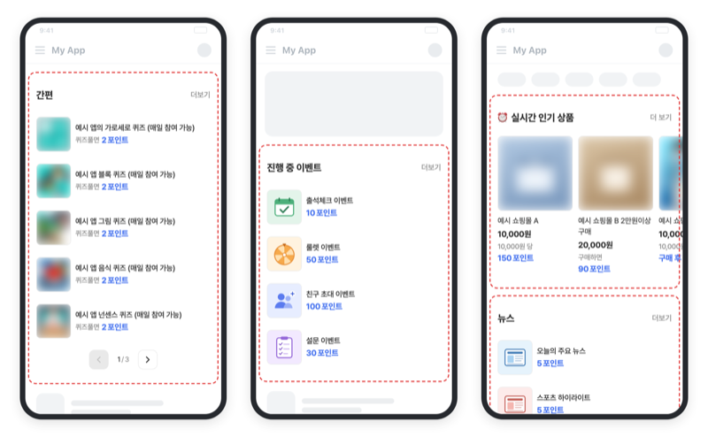<figcaption><p>앱 화면 안에 지면을 넣은 예시입니다(빨간 점선이 지면 영역). 지면 하나가 곧 TnkPlacementView 하나입니다. 지면은 Android·iOS 가 같은 모양으로 그려집니다. 주변 앱 화면은 예시이고, 광고 이름·포인트는 예시 값이며 광고 이미지는 흐리게 처리했습니다. 뉴스 지면의 행에 보이는 포인트는 읽어도 적립되지 않습니다(아래 '6. 지면 유형' 참고).</p></figcaption></figure>

---

## 언제 필요한가

**선택 사항**입니다. 오퍼월 전체가 아니라 **지면(플레이스먼트) 하나의 광고 묶음만** 앱 화면 일부에 보여 주고 싶은 개발사에 필요합니다. 기존 네이티브(V3) SDK 의 `AdPlacementView` 를 쓰던 앱은 이 뷰로 바꿀 수 있습니다. iOS SDK 1.0.7 이상에서 사용할 수 있습니다.

- 기존 네이티브(V3) SDK 에서 옮기는 경우 이 페이지 끝의 '기존 네이티브(V3) SDK 에서 옮겨 오기'와 [네이티브(V3) SDK 에서 이관](migration.md)의 해당 패턴을 먼저 보세요. 같은 앱에 등록된 지면 ID 는 그대로 씁니다. 오래 전에 만든 지면이 보이지 않으면 담당자에게 확인해 주세요.
- 지면은 앱 ID 마다 등록됩니다. Android·iOS 또는 디버그용 앱 ID 가 다르면 앱 ID 별로 지면 ID 를 받아 주세요.
- 지면 ID 는 TnkFactory 담당자에게 받은 값을 그대로 넣으세요. 지면 ID 와 지면 설정(제목·더보기 문구 등)은 앱 코드로 바꿀 수 없으니 담당자에게 요청해 주세요.
- 앱 ID 설정과 `setUserName` 호출을 마친 뒤에 불러오세요. ([3. 초기화](initialize.md) 참고)
- 오퍼월 전체를 앱 화면 안에 넣으려면 [4. 오퍼월 띄우기](offerwall.md)의 `TnkOfferwallView` 를 사용하세요.
- 하이브리드(V4) SDK 의 다른 API 와 같이 Swift 에서 호출하세요.

---

## 1. 화면에 배치

`TnkPlacementView` 를 코드로 만들어 화면에 넣는 방법을 권장합니다. **폭과 위치만 정하고 높이 제약을 주지 않으면** 광고가 불러와진 뒤 내용 높이에 맞춰 늘어납니다.

```swift
import UIKit
import TnkPpiHyb

final class HomeViewController: UIViewController, TnkPlacementViewDelegate {

    private let placementView = TnkPlacementView()   // 강하게 보관합니다 (delegate 는 weak 참조)

    override func viewDidLoad() {
        super.viewDidLoad()

        // 폭만 정하면 높이는 내용에 맞춰 정해집니다. (불러오기 전·광고 0개·실패면 0)
        placementView.delegate = self

        let stack = UIStackView(arrangedSubviews: [
            // ... 앱의 다른 뷰 ...
            placementView,
        ])
        stack.axis = .vertical
        stack.spacing = 16
        stack.translatesAutoresizingMaskIntoConstraints = false

        let scrollView = UIScrollView()
        scrollView.translatesAutoresizingMaskIntoConstraints = false
        view.addSubview(scrollView)
        scrollView.addSubview(stack)
        NSLayoutConstraint.activate([
            scrollView.topAnchor.constraint(equalTo: view.safeAreaLayoutGuide.topAnchor),
            scrollView.bottomAnchor.constraint(equalTo: view.safeAreaLayoutGuide.bottomAnchor),
            scrollView.leadingAnchor.constraint(equalTo: view.leadingAnchor),
            scrollView.trailingAnchor.constraint(equalTo: view.trailingAnchor),
            stack.topAnchor.constraint(equalTo: scrollView.contentLayoutGuide.topAnchor, constant: 24),
            stack.bottomAnchor.constraint(equalTo: scrollView.contentLayoutGuide.bottomAnchor, constant: -24),
            stack.leadingAnchor.constraint(equalTo: scrollView.frameLayoutGuide.leadingAnchor, constant: 24),
            stack.trailingAnchor.constraint(equalTo: scrollView.frameLayoutGuide.trailingAnchor, constant: -24),
        ])

        placementView.load(placementId: "담당자에게 받은 지면 ID")
    }
}
```

- 지면 뷰 자체의 배경은 투명합니다. 카드와 행은 테마색으로 그려집니다(`BOX` 는 회색 카드 위에 행이 놓이고, 라이트 테마에서 흰 행).
- 한 화면에 `TnkPlacementView` 를 여러 개 둘 수 있습니다. 콜백의 `placementId` 로 구분하세요.

---

## 2. 델리게이트 등록 후 불러오기 (`load`)

`delegate` 와 옵션(`layoutKey`, `verticalScrollEnabled`, `maxHeight`, `theme`, `filterIds`, `dataOnly`)을 먼저 정하고 **마지막에** `load(placementId:)` 를 호출합니다. 성공하면 뷰가 스스로 그려지므로 따로 표시 함수를 부를 필요가 없습니다.

```swift
placementView.layoutKey = "BOX"              // 선택. nil 이면 서버·지면 유형에 따른 기본 레이아웃
placementView.verticalScrollEnabled = false  // 선택. 기본 false
placementView.load(placementId: "담당자에게 받은 지면 ID")
```

```swift
extension HomeViewController {

    func onLoaded(placementId: String, count: Int, customData: String) {
        // count == 0 이면 광고가 없습니다(실패 아님). 뷰는 저절로 접힙니다.
    }

    func onFailed(placementId: String, code: Int) {
        // -2: 5초 안에 응답 없음, -1: 네트워크 등 기타. 그 밖의 값은 서버가 알려 준 코드
    }

    func onItemClicked(placementId: String, appId: Int64, appName: String) {
        // 화면 통지용입니다. 보상·과금 판단에 쓰지 마세요.
        // 일반 광고는 이 콜백 뒤 SDK 가 오퍼월을 엽니다.
    }

    func onItemClosed(placementId: String, appId: Int64) {
        // 항목을 눌러 연 화면이 닫혔습니다. 필요하면 여기서 refresh() 를 호출하세요.
    }

    func onMoreClicked(placementId: String) -> Bool {
        return false   // false: SDK 가 오퍼월 첫 화면을 엽니다. true: 직접 처리
    }

    func onHeightChanged(placementId: String, height: Double) {
        // 지면 높이(pt). maxHeight 를 쓰면 maxHeight 를 넘지 않습니다. 접힘 판단은 onLoaded(count 0)·onFailed 로 하세요.
    }
}
```

- `load` 와 `cleanup()` 은 **메인 스레드**에서 호출하세요. 델리게이트 콜백도 메인 스레드에서 옵니다. SDK 가 호출 스레드를 검사해 주지 않으니 직접 지켜 주세요.

> ⚠️ `delegate` 는 weak 참조라 화면(ViewController)처럼 앱이 붙잡고 있는 객체여야 합니다. 프로토콜이 `NSObjectProtocol` 을 상속하므로 `NSObject` 하위 클래스만 채택할 수 있습니다.
>
> ⚠️ 모든 델리게이트 메서드는 선택 구현입니다. **메서드 이름·인자 레이블·인자 타입(예: `appId` 를 `Int64` 가 아니라 `Int` 로 둔 경우)이 다르면 컴파일 오류 없이 호출만 되지 않으니** 위 형태 그대로 쓰세요.

- 지면 ID 가 비었거나 공백뿐이면 `onFailed` 로 끝날 수 있으니 빈 값을 넘기지 마세요.
- 같은 뷰에 `load` 를 다시 부르면 새로 불러오고, 이전 `load` 의 결과는 무시됩니다. 이미 보이던 뷰는 새 결과가 올 때까지 높이 0 으로 접혔다가 결과에 따라 다시 펼쳐집니다(접혀 있던 뷰도 다시 보이는 상태가 됩니다). 접지 않고 목록만 새로 받으려면 `refresh()` 를 쓰세요. 탭 전환이나 화면이 보일 때마다 부르지 마세요.
- `delegate` 를 지정하지 않아도 동작은 같습니다. 광고를 누르면 해당 화면(일반 광고는 상세 화면)이 열리고, 더보기를 누르면 오퍼월이 열립니다.
- 마지막으로 불러온 지면 ID 는 읽기 전용 `placementId` 로 확인할 수 있습니다.

---

## 3. 델리게이트 콜백 6종

| 콜백 | 인자 | 호출 시점 |
|---|---|---|
| `onLoaded` | `placementId: String`, `count: Int`, `customData: String` | 불러오기에 성공했을 때. `count` 는 불러온 광고 수입니다. `adList` 와 같은 전체 목록의 수이며, 레이아웃마다 정해진 수까지만 그리므로(`SIMPLE_LIST` 20개, `FEED` 10개 등) 지면에 그리는 수보다 많을 수 있습니다. **0 이면 실패가 아니라 광고 없음**이며 뷰는 높이 0 + `isHidden = true` 로 접힙니다. `customData` 는 TnkFactory 가 그 지면에 설정한 값이며 없으면 빈 문자열입니다 |
| `onFailed` | `placementId: String`, `code: Int` | 불러오지 못했을 때. 뷰는 높이 0 + `isHidden = true` 로 접힙니다. `onLoaded` 를 받은 뒤 표시 중 오류가 나도 올 수 있습니다 |
| `onItemClicked` | `placementId: String`, `appId: Int64`, `appName: String` | 사용자가 지면 안의 광고를 **누른 즉시 1번**(오퍼월을 열기 전, 개인정보 동의 팝업보다 먼저). 일반 광고는 이 콜백 뒤에 SDK 가 그 광고의 상세 화면을 전체 화면 오퍼월로 엽니다. 뉴스·이벤트 행은 그 페이지가 열립니다. `appName` 은 누른 행의 이름(광고 이름·이벤트 제목·기사 제목)이며 알 수 없으면 빈 문자열입니다. 지면이나 항목에 따라 다른 화면(웹 페이지 등)이 열릴 수 있으며, 이때 `appId` 는 광고 ID 가 아닐 수 있으니 `adDetail` 등에 그대로 넘기지 마세요. 오퍼월은 뷰가 속한 화면(그 위에 이미 띄운 화면이 있으면 맨 위 화면)에서 띄우며, 뷰가 화면 계층에 없으면 열리지 않습니다 |
| `onItemClosed` | `placementId: String`, `appId: Int64` | 항목을 눌러 SDK 가 연 화면(전체 화면 오퍼월 또는 앱 안에서 열린 페이지)이 닫혔을 때 1번. 외부 브라우저로 연 링크·더보기·뷰가 정리된 뒤에는 호출하지 않습니다. 오퍼월 위에 다른 전체 화면이 올라간 채 그 화면들이 한꺼번에 닫혀도 1번 호출합니다(다른 화면이 덮고 있는 동안에는 호출하지 않습니다) |
| `onMoreClicked` | `placementId: String` → `Bool` | 지면의 '더보기'(레이아웃에 따라 머리글 또는 아래쪽 버튼)를 눌렀을 때. `true` 를 돌려주면 SDK 는 아무것도 하지 않습니다(앱이 직접 처리). `false` 이거나 구현하지 않으면 SDK 가 전체 화면 오퍼월 첫 화면을 엽니다 |
| `onHeightChanged` | `placementId: String`, `height: Double` | 지면 내용의 높이(pt)가 바뀔 때마다. 값이 같으면 다시 오지 않고, 소수점은 올림하며 0 이상 5000 이하로 맞춥니다. `maxHeight` 가 0 이면 고정 높이에서도 뷰 높이가 아니라 내용 높이를 알리고, `maxHeight` 를 쓰면 내용 높이와 `maxHeight` 중 작은 값을 알립니다 |

- 콜백의 `placementId` 는 `load` 에 넘긴 문자열 그대로입니다.
- **`onItemClicked` 는 동의 여부와 관계없이 탭 즉시 1번 호출됩니다.** 사용자가 열린 오퍼월에서 개인정보 동의를 거절해도 이미 호출된 뒤입니다. 기존 네이티브(V3) SDK 는 iOS 가 동의 뒤에만, Android 가 동의 전후로 두 번 호출했으므로 클릭 수를 집계하던 앱은 수치가 달라질 수 있습니다.
- **iOS 는 뷰가 접힐 때 `onHeightChanged(0)` 도 보냅니다.** 보이던 지면이 광고 없음으로 바뀌거나(불러온 상태 → 0건), 실패하거나, 새 `load` 를 시작하거나, `cleanup()` 을 부를 때이며 직전 높이가 0 보다 컸을 때만 옵니다. Android 는 0 을 보내지 않으므로, 접힘 여부는 두 플랫폼 모두 `onLoaded`(`count` 가 0) 또는 `onFailed` 로 판단하세요.
- 성공할 때는 `pubInfo` · `adList` 가 먼저 설정되고, `onLoaded` 가 오고, 그다음에 `onHeightChanged` 가 옵니다. Android 도 같은 순서이며, `onLoaded` 안에서 `pubInfo` 와 `adList` 를 읽을 수 있습니다. 다만 `onLoaded` 와 `onHeightChanged` 의 호출 순서에 기대는 코드는 만들지 마세요.
- `dataOnly` 일 때는 `onHeightChanged` 가 오지 않습니다.
- 불러온 뒤에도 `onHeightChanged` 가 여러 번 올 수 있습니다. 테이블·컬렉션 셀에 넣었다면 이 값으로 셀 높이를 다시 계산하세요.

> ⚠️ `onItemClicked` 는 **화면 통지용**입니다. 보상 지급이나 과금 판단에 쓰지 마세요. 보상은 [5. 보상 지급 수신](reward.md)과 [서버 보상 콜백 URL](../common/server-callback.md)으로 처리합니다.

### 더보기를 앱이 직접 처리하기

```swift
func onMoreClicked(placementId: String) -> Bool {
    tabBarController?.selectedIndex = 1   // 예: 앱의 오퍼월 탭으로 이동
    return true                           // SDK 는 아무것도 하지 않습니다
}
```

특정 탭·필터로 보내려면 `handleScheme` 에 딥링크를 넘기고 `true` 를 돌려주세요.

```swift
func onMoreClicked(placementId: String) -> Bool {
    TnkPpiHybSdk.shared.handleScheme("tnkscheme://select_menu?cat_id=3&filter_id=12", from: self)   // 오퍼월의 특정 탭·필터로 엽니다
    return true
}
```

`cat_id` 는 꼭 넣어야 합니다. 앱 화면 안에 넣은 오퍼월이 이미 불러와져 있으면 그 오퍼월로 이동합니다. ([6. 딥링크](deeplink.md) 참고)

'더보기' 는 TnkFactory 가 그 지면에 더보기 문구를 설정한 경우에만 보입니다. 레이아웃 `SIMPLE_LIST` 에는 머리글이 없어 더보기가 표시되지 않습니다. 더보기를 누르면 기본으로 오퍼월 첫 화면이 열립니다. 다른 화면으로 보내려면 `onMoreClicked` 에서 `true` 를 돌려주고 직접 처리하세요.

---

## 4. 실패 코드 (`onFailed`)

| `code` | 뜻 | 확인할 것(진단용) |
|---|---|---|
| `-2` | `load` 뒤 5초 안에 결과가 없었습니다 | 네트워크를 확인하고 필요하면 `load` 를 다시 호출합니다 |
| `-1` | 네트워크 오류, 지원하지 않는 지면 유형 등 기타 실패입니다 (코드가 없는 실패도 `-1`) | 네트워크와 지면 ID 가 비어 있지 않은지 확인합니다 |
| 그 밖의 값 | 서버가 알려 준 코드를 그대로 전달한 값입니다 (예: `17`) | 담당자에게 받은 지면 ID 와 앱 ID 가 맞는지 확인하고, 계속되면 담당자에게 문의해 주세요 |

- 5초는 뷰가 화면(window)에 붙어 있는 동안만 셉니다. 붙이기 전에 `load` 해도 되며, 붙는 순간부터 세기 시작합니다. 떨어지면 남은 시간을 기억했다가 다시 붙을 때 이어서 셉니다.
- 네트워크 오류가 나도 오퍼월의 재시도 안내 팝업은 뜨지 않고, 뷰가 접힌 뒤 `onFailed(-1)` 로만 알립니다. 다시 시도하려면 `load` 를 다시 호출하세요.
- 한 번의 `load` 에서 실패 뒤에 오는 결과는 모두 무시됩니다.

---

## 5. 레이아웃 키 (`layoutKey`)

지면을 어떤 모양으로 그릴지 정하는 문자열입니다. 선택 사항이며 **`load` 전에** 설정합니다. 설정한 값은 그 `load` 에 적용되고, `load` 뒤에 바꾸면 다음 `load` 부터 반영됩니다.

키는 아래 9개이고, 같은 키가 일반 지면과 쇼핑 지면에서 다르게 그려지므로 고를 수 있는 모양은 일반 지면 9가지와 쇼핑 지면 9가지, 모두 18가지입니다. `SIMPLE_LIST` 는 두 지면이 같은 모양이고 첫 줄에 보이는 문구만 다릅니다.

같은 키라도 **지면 종류에 따라 모양이 다릅니다(`SIMPLE_LIST` 제외).** 일반 지면(일반 광고·퀴즈·이벤트·뉴스)과 쇼핑 지면(쇼핑·제휴몰)은 아래 표의 해당 열을 보세요. 쇼핑 지면의 `FEED_SWIPE` · `FEED_SWIPE_DOUBLE` · `ING_CAMPAIGN` 은 이름과 모양이 다르니 특히 주의하세요.

| 키 | 일반 지면 | 쇼핑 지면 |
|---|---|---|
| `DEFAULT` | 기본 큐레이션. 세로 목록, 5개씩 이전·다음 페이지로 넘김 | 세로 목록에 가격·할인율이 붙습니다. 5개씩 페이지 이동 |
| `BOX` | 박스형. 회색 카드 안에 행이 놓이고(라이트 테마에서 흰 행) 썸네일이 오른쪽, 5개씩 페이지 이동 | 같음(가격·할인율 포함) |
| `FEED_DOUBLE` | 피드 2열. 2열 카드 6개씩 페이지 이동 | 같음 |
| `FEED_SWIPE` | 작은 가로형 카드 한 줄을 가로로 스와이프 | **스와이프가 아니라** 큰 상품 2개씩 보여 주고 이전·다음으로 페이지 이동 |
| `FEED_SWIPE_DOUBLE` | 작은 가로형 카드 두 줄을 가로로 스와이프 | **상품 3열 × 2줄(최대 6개)**만 보이고 페이지 이동은 없습니다. 나머지 상품은 지면에 보이지 않습니다. 아래쪽 '더보기' 버튼은 기본으로 오퍼월 첫 화면을 엽니다(`onMoreClicked` 로 바꿀 수 있습니다. 머리글에는 더보기가 없고, 지면에 더보기 문구가 없으면 이 버튼도 없습니다) |
| `ING_CAMPAIGN` | 진행 중 캠페인. **아이콘만** 한 줄로 가로 스와이프(광고 이름·포인트 없음. 머리글은 있습니다) | 큰 상품 카드를 가로로 스와이프 |
| `FEED` | 큰 카드를 세로로 나열(최대 10개) | 같음 |
| `SIMPLE_LIST` | 심플 리스트. 머리글 없이 행을 세로로 나열(최대 20개). 행의 첫 줄에 광고 설명 문구, 둘째 줄에 참여 조건(예: 퀴즈풀면), 오른쪽에 포인트가 보입니다 | 일반 지면과 같은 심플 리스트. 머리글 없이 행을 세로로 나열(최대 20개)하고, 행의 첫 줄에 캠페인 이름(없으면 광고 이름), 둘째 줄에 참여 조건(예: 구매하면), 오른쪽에 포인트가 보입니다. 가격·할인율은 보이지 않습니다 |
| `ADAPTIVE` | 어댑티브. 썸네일 색을 닮은 카드를 가로로 스와이프 | 같음 |

> ⚠️ 표의 '5개씩'·'6개씩' 같은 개수는 지면을 제공하는 화면이 정한 값이라 앱 코드로 바꿀 수 없습니다. 지면에는 `SIMPLE_LIST` 가 최대 20개, `FEED` 가 최대 10개까지 그리므로, 자동 높이에서는 그리는 광고 수만큼 길어집니다. 불러올 광고 수는 지면 설정에서 담당자가 정하며, 더 많이 불러와도 지면에는 위 개수까지만 그립니다. `onLoaded` 의 `count` 와 `adList` 는 그린 수가 아니라 불러온 전체 목록입니다. 태블릿처럼 화면이 넓은 기기에서는 `FEED` 카드가 더 높아지므로 `FEED` 에는 `maxHeight` 를 함께 설정하세요(아래 '최대 높이').

| 키 | 일반 지면 | 쇼핑 지면 |
|---|---|---|
| `DEFAULT` | 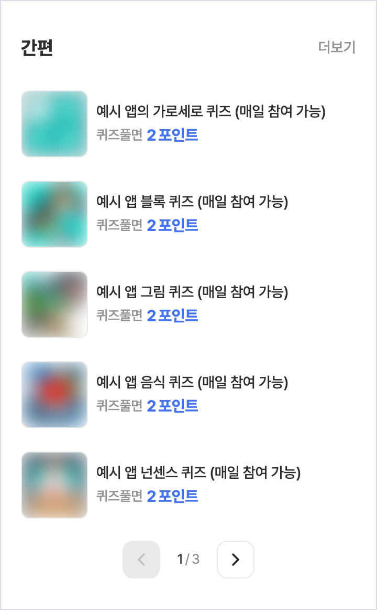 | 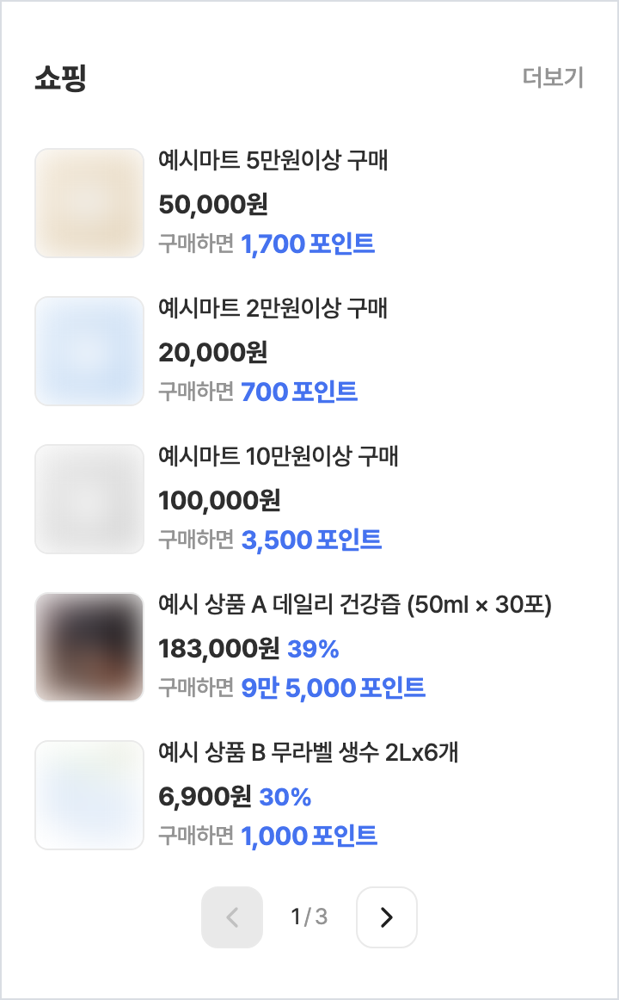 |
| `BOX` | 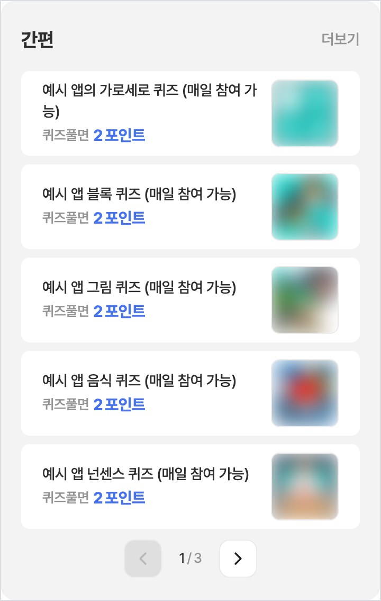 | 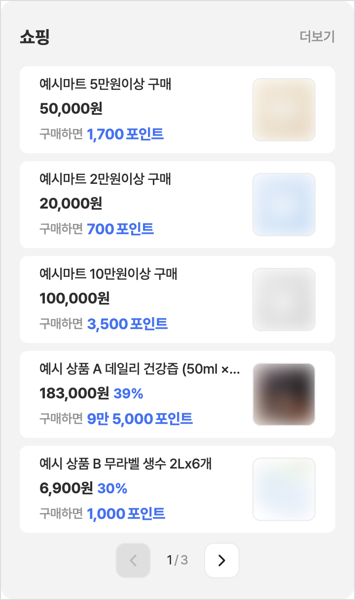 |
| `FEED_DOUBLE` | 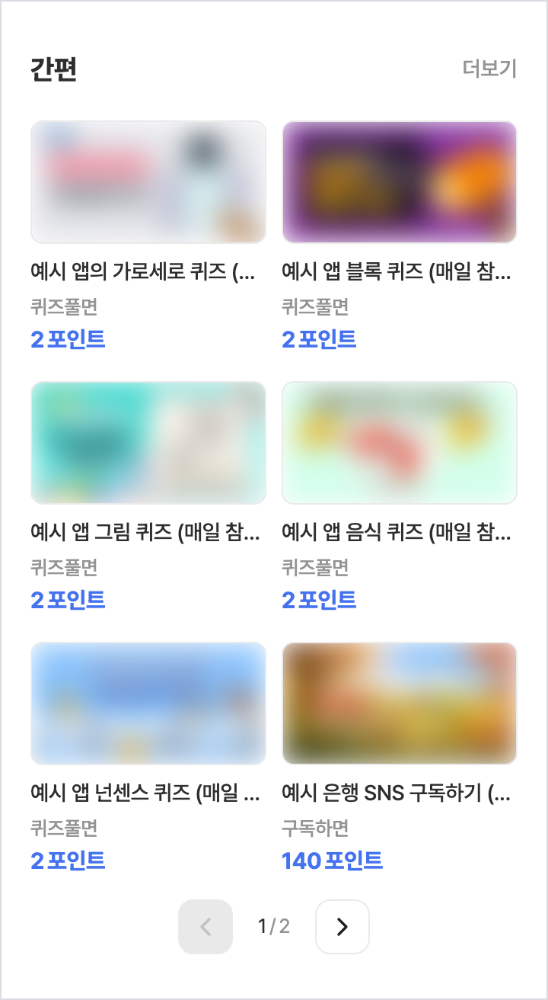 | 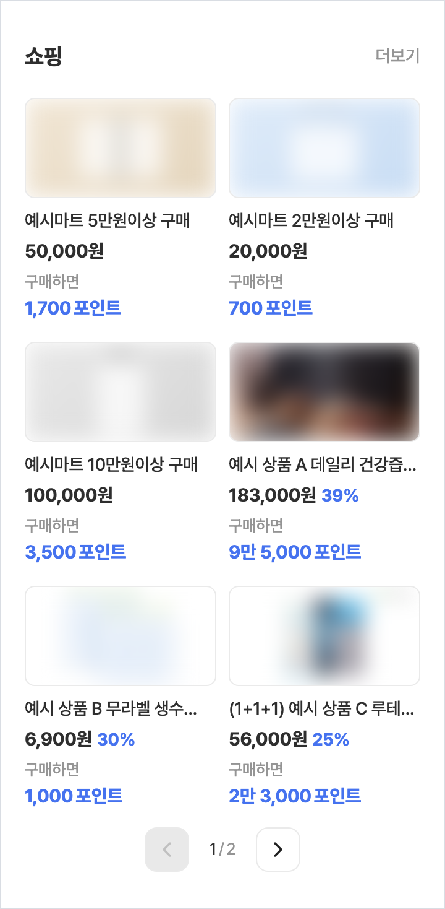 |
| `FEED_SWIPE` | 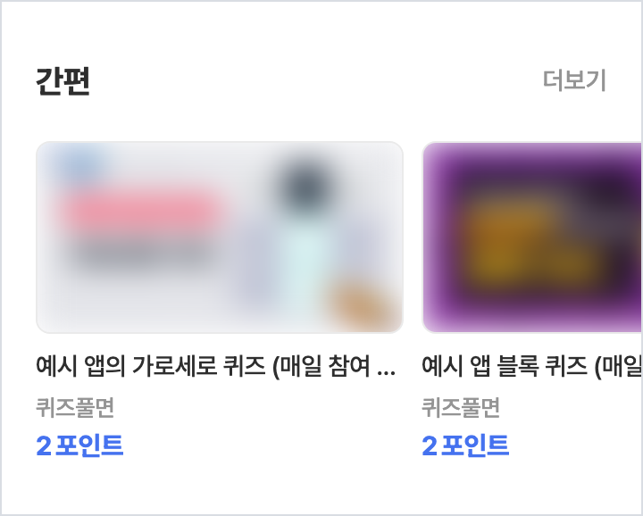 | 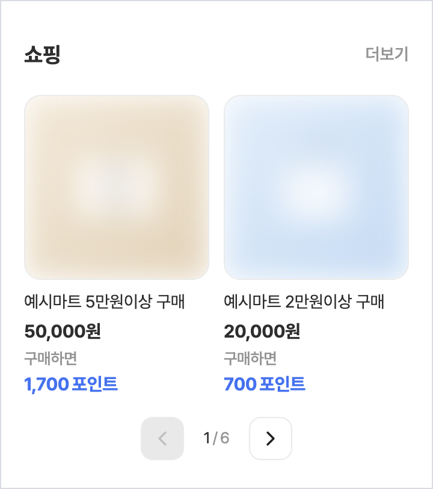 |
| `FEED_SWIPE_DOUBLE` | 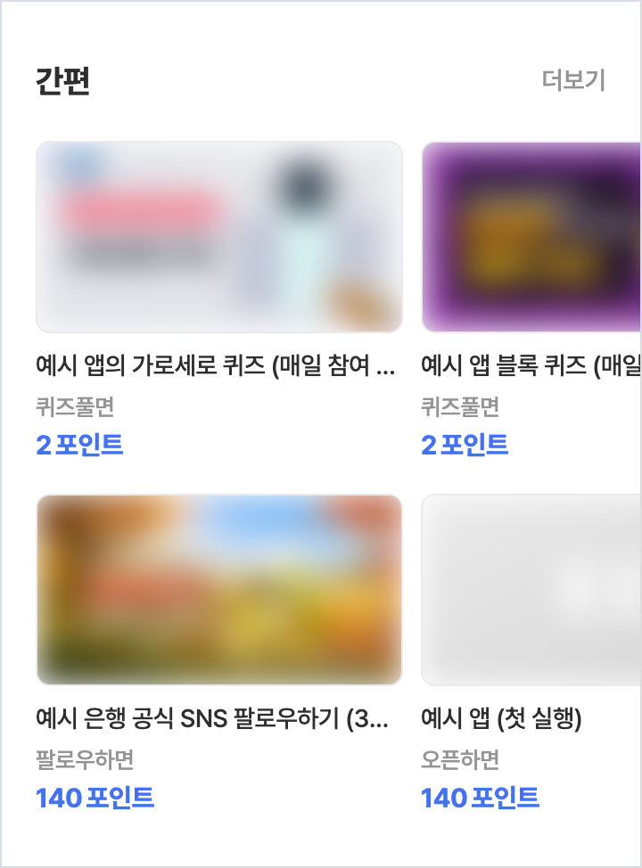 | 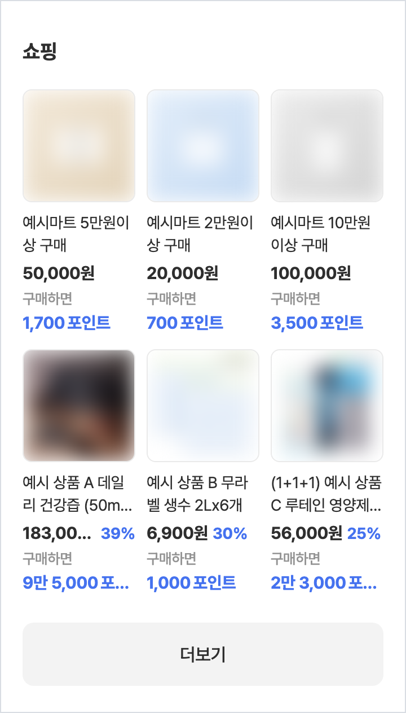 |
| `ING_CAMPAIGN` | 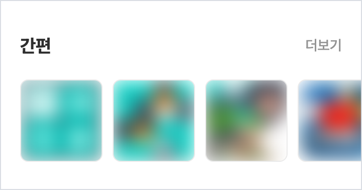 | 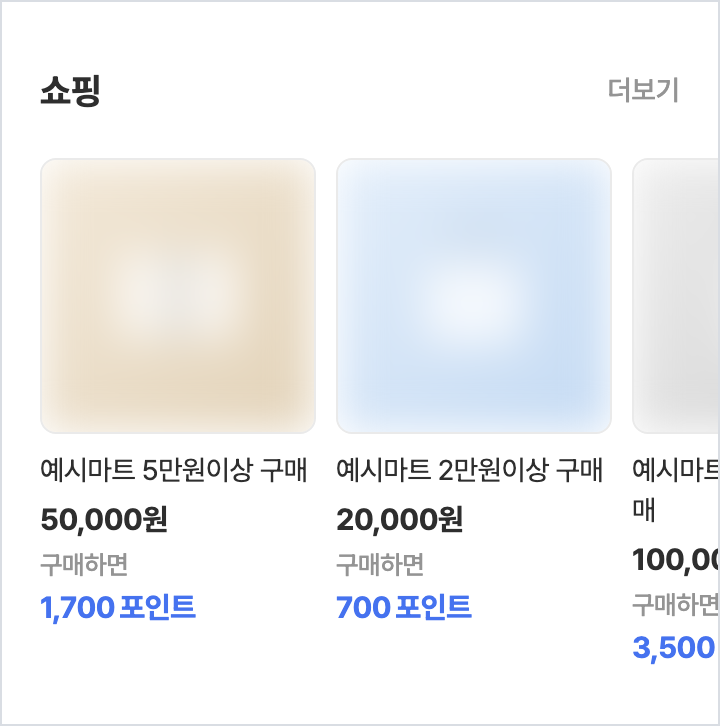 |
| `FEED` | 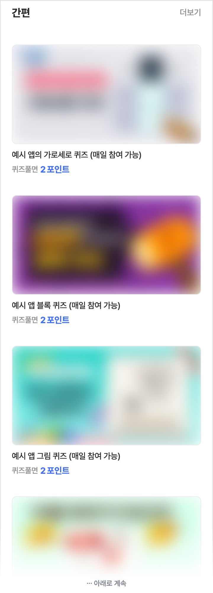 | 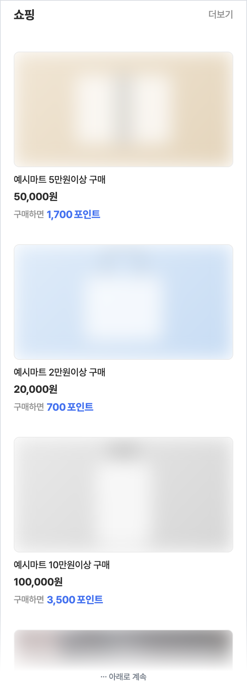 |
| `SIMPLE_LIST` | 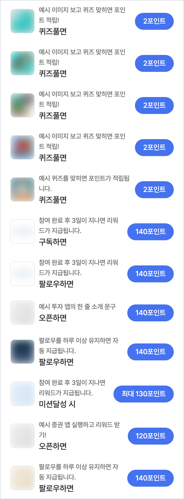 | 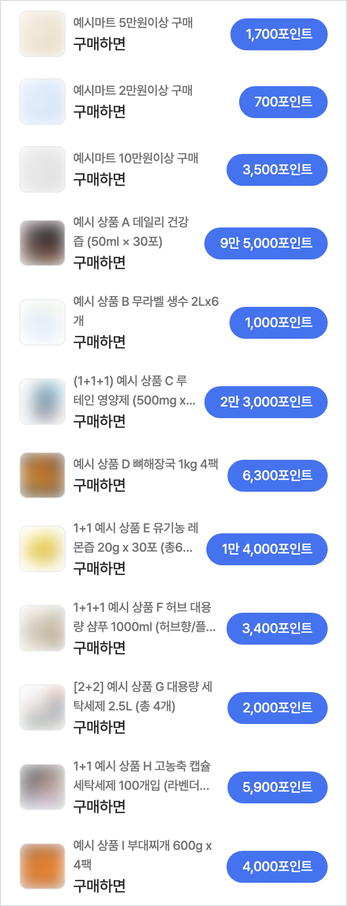 |
| `ADAPTIVE` | 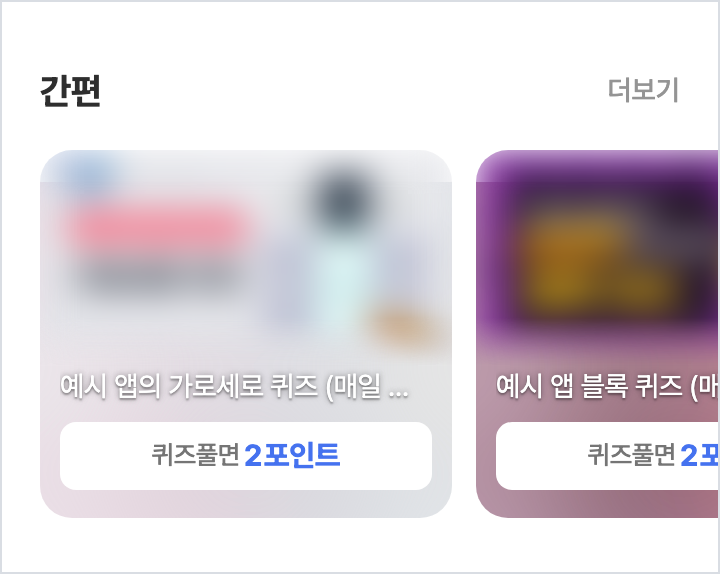 | 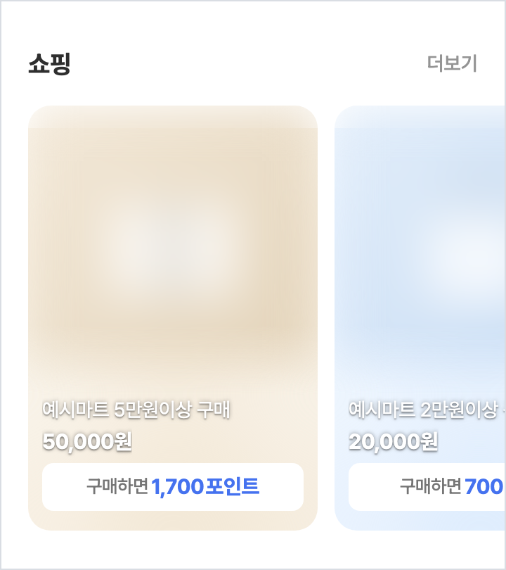 |

그림은 같은 키를 일반 지면(왼쪽)과 쇼핑 지면(오른쪽)에서 그린 모양입니다.

- 옅은 회색 테두리는 지면 범위를 보여 주려고 그린 것이며 실제 화면에는 없습니다.
- 광고 이름·포인트·가격은 예시 값이고, 광고 이미지는 흐리게 처리했으며 일부는 예시 그림으로 바꿨습니다.
- `FEED` 는 매우 길어 위쪽만 보여 주고 '아래로 계속'으로 표시했습니다(실제로는 최대 10개까지 이어집니다).
- 가로로 스와이프하는 지면은 오른쪽 카드가 화면 끝에서 잘려 보이는 것이 정상입니다. `FEED_SWIPE`·`FEED_SWIPE_DOUBLE` 의 일반 지면 카드는 `FEED` 카드보다 작은 가로형 카드입니다.

| 설정 | 사용자가 보는 것 | 언제 쓰나 |
|---|---|---|
| 위 키 중 하나 | 해당 모양으로 그려집니다. 대소문자는 구분하지 않고 앞뒤 공백은 무시합니다 | 앱 화면에 맞는 모양을 고를 때 |
| 모르는 키·오타 | 오류 없이 기본 레이아웃으로 그려집니다 | - |
| 빈 문자열 · `nil` | 지정하지 않은 것으로 봅니다 | 기본 모양을 쓸 때 |
| 호출하지 않음 | 기본 레이아웃으로 그려집니다 | 기본 모양을 쓸 때 |

- 9개 키는 일반 지면과 쇼핑 지면 모두에서 쓸 수 있습니다. 모르는 키는 기본 모양으로 그려집니다.
- 실제로 그려진 키는 `pubInfo` 의 `layoutKey` 로 확인할 수 있습니다. (아래 '지면 정보' 참고)
- TnkFactory 에서 지면 레이아웃을 정해 둔 경우에는 그 설정이 먼저 적용되어 이 키가 쓰이지 않을 수 있습니다. 지면 레이아웃 설정은 담당자에게 문의해 주세요.
- 가로로 넘기는 레이아웃(일반 지면의 `FEED_SWIPE`·`FEED_SWIPE_DOUBLE`·`ING_CAMPAIGN`·`ADAPTIVE`, 쇼핑 지면의 `ING_CAMPAIGN`·`ADAPTIVE`)은 `verticalScrollEnabled` 와 관계없이 늘 가로로 스크롤됩니다.
- 광고별로 내려오는 레이아웃 값이 쓸 수 없는 값이어도 지면이 접히지 않고 지정한 키(없으면 기본 모양)로 그려집니다. 다만 TnkFactory 의 지면 레이아웃 설정 자체가 잘못된 경우에는 `onFailed(-1)` 로 끝날 수 있으니 담당자에게 문의해 주세요.

### 기존 레이아웃에서 옮길 때 고르는 키

기존 네이티브(V3) SDK 에서는 앱이 셀 클래스·열 수·페이지당 행 수를 정했습니다. 하이브리드(V4) SDK 의 지면은 TnkFactory 가 제공하는 화면이 그리므로(이 페이지 끝의 '지면을 그리는 방식' 참고) 모양을 키로만 고릅니다. 대체되는 키는 다음과 같습니다.

| 기존에 쓰던 모양 (클래스) | 대체되는 모양 (클래스) | 달라지는 점 |
|---|---|---|
| `FeedAdListItemView` + `PlacementFeedViewLayout` (피드. 레이아웃을 등록하지 않은 지면의 기본 모양) | `FEED_SWIPE` (일반 지면) · `ING_CAMPAIGN` · `ADAPTIVE` (쇼핑 지면) | 카드가 화면 폭보다 작아 옆 카드가 보이고, 한 장씩 멈추지 않고 넘어갑니다. 전체 폭으로 한 장씩 넘기는 모양은 현재 지원하지 않습니다(이 페이지 끝의 '하이브리드(V4)에서 빠진 것'). 쇼핑 지면의 `FEED_SWIPE` 는 가로로 넘기지 않고 2개씩 페이지를 넘기므로, 쇼핑 지면에서는 `ING_CAMPAIGN` · `ADAPTIVE` 를 쓰세요 |
| 큰 카드를 세로로 나열 | `FEED` | 광고 수만큼 길어집니다(최대 10개). 넓은 화면에서는 `maxHeight` 를 함께 설정하세요 |
| 2열 그리드 | `FEED_DOUBLE` | 6개씩 페이지로 넘깁니다 |
| `IconOnlyAdListItemView` + `PlacementIconViewLayout` (아이콘 가로 스크롤) | `ING_CAMPAIGN` (일반 지면) | 아이콘만 보입니다. **쇼핑 지면에는 작은 아이콘 띠가 없고**, `ING_CAMPAIGN` 이 큰 상품 카드로 그려집니다 |
| `DefaultAdListItemView` + `PlacementListViewLayout` (리스트 + 이전·다음 화살표) | `DEFAULT` 또는 `BOX` | 5개씩 페이지로 넘깁니다. 썸네일을 오른쪽에 두려면 `BOX` |
| `FeedOnlyAdListItemView` + `PlacementFeedOnlyViewLayout` (이미지만 보여 주는 카드 · 전체 폭 한 장씩 넘기는 캐러셀) | 현재 지원하지 않음 | `FEED` 를 쓰면 큰 카드를 세로로 나열하며 이미지 아래에 광고 이름·포인트가 함께 보이고(최대 10개) 한 장씩 넘기지 않습니다. 한 줄로 가로로 넘기려면 `FEED_SWIPE`(작은 가로형 카드)를 쓰세요 (이 페이지 끝의 '하이브리드(V4)에서 빠진 것') |
| 페이지당 행 수 · 열 수 지정 | 현재 지원하지 않음 | 열·행 수는 레이아웃 키마다 정해져 있습니다. 세로 1열 5개씩 `DEFAULT` · `BOX`, 2열 6개씩 `FEED_DOUBLE` 중에서 고르세요 |
| `PlacementFixedSizeFeedViewLayout` (부모 크기에 맞춰 그리기) | `FEED` · `FEED_SWIPE` · `FEED_DOUBLE` 중 하나 | 높이를 고정하면 내용을 줄이지 않고 위쪽 기준으로 잘립니다. 아래 '높이와 세로 스크롤' 참고 |

기존 iOS 는 레이아웃을 등록하지 않으면 피드 모양(한 장씩 넘기는 카드)으로 그렸지만, 하이브리드(V4) SDK 는 `layoutKey` 를 정하지 않으면 `DEFAULT`(세로 목록, 5개씩 페이지 이동)로 그립니다. 기존 피드 모양은 `layoutKey` 를 `FEED_SWIPE`(일반 지면) · `ING_CAMPAIGN` · `ADAPTIVE`(쇼핑 지면)로 직접 정해 대체합니다(위 표 참고).

---

## 6. 지면 유형

지면은 TnkFactory 가 등록할 때 유형을 정합니다. 유형에 따라 그려지는 모양과 행을 눌렀을 때 일어나는 일이 다릅니다. 앱 코드에서 유형을 고를 필요는 없고, 어떤 유형인지는 `pubInfo` 의 `adType` 으로 알 수 있습니다.

| 지면 유형 (`adType`) | 그려지는 모양 | 행을 누르면 | 알아둘 점 |
|---|---|---|---|
| 일반 (`0`, 기존 가이드의 보상형) | 위 표의 '일반 지면' 열 | `onItemClicked` 뒤에 광고 상세가 전체 화면 오퍼월로 열립니다 | - |
| 쇼핑 (`1`) · 제휴몰 (`2`) | 위 표의 '쇼핑 지면' 열. 가격·할인율이 보입니다(`SIMPLE_LIST` 제외) | `onItemClicked` 뒤에 해당 화면이 열립니다 | `SIMPLE_LIST` 는 일반 지면과 같은 심플 리스트로 그려지며 가격·할인율은 보이지 않습니다 |
| 뉴스 (`3`) | 일반 지면과 같은 키. 기사 행으로 보입니다 | `onItemClicked` 가 먼저 오고, 그 뒤 기사 페이지가 열립니다 (앱 안 화면 또는 외부 브라우저) | `appId` 는 기사 ID, `appName` 은 기사 제목입니다. 기사 읽기 보상은 현재 지원하지 않습니다. 행에 포인트가 보일 수 있지만 읽어도 적립되지 않습니다 |
| 이벤트 (`4`) | 일반 지면과 같은 키. 이벤트 행으로 보입니다 | `onItemClicked` 가 먼저 오고, 그 뒤 이벤트 페이지가 열립니다 (앱 안 화면 또는 외부 브라우저) | `appId` 는 이벤트 ID, `appName` 은 이벤트 제목입니다 |
| 퀴즈 (`5`) | 일반 광고와 같은 모양 | 일반 광고와 같습니다 | - |

- 지면 유형 값이 오지 않으면(광고 0건 응답 등) `adType` 은 `-1` 입니다. 이 SDK 가 지원하지 않는 지면 유형이면 지면을 그리지 않고 `onFailed(placementId, -1)` 로 끝납니다.
- 뉴스·이벤트 행의 `appId` 는 광고 ID 가 아니므로 `adDetail` 등에 그대로 넘기지 마세요. `onItemClicked` 의 `appName` 으로 어떤 행인지 구분할 수 있습니다.
- 뉴스 행에 포인트가 보일 수 있지만 기사 읽기 보상(읽은 시간에 따른 적립)은 현재 지원하지 않습니다. 뉴스 지면을 쓰던 앱은 이관 전에 담당자에게 확인하세요.
- 지면의 이벤트 행에는 '참여 완료' 표시가 없습니다(현재 지원하지 않습니다). 참여 뒤 서버 목록을 다시 받으려면 `onItemClosed` 에서 `refresh()` 를 부르세요. `refresh()` 로 받은 목록이 화면에 있는 목록과 같으면 보던 페이지와 가로 스크롤 위치가 그대로 유지되고, 달라졌으면 목록을 1페이지부터 새로 그립니다. (아래 '다시 불러오기' 참고)
- 앱 안에서 열린 이벤트 페이지는 확인 창을 띄우거나 스스로 닫힐 수 있습니다.
- 이벤트 행의 링크는 `https` 주소만 열립니다. 그 밖의 주소로 된 이벤트는 열리지 않으니 담당자에게 확인하세요.
- 외부 브라우저로 열린 이벤트 페이지는 닫혀도 `onItemClosed` 가 오지 않습니다. 이때는 `onItemClicked` 에서 이벤트 행을 눌렀다고 표시해 두고 `onItemClosed` 가 오면 지운 뒤, 앱이 다시 앞으로 올 때(`UIApplication.willEnterForegroundNotification` 또는 `sceneWillEnterForeground`) 표시가 남아 있으면 `refresh()` 를 한 번만 호출하고 표시를 지우세요. 화면이 보일 때마다 부르지는 마세요.
- 광고 순서는 서버가 보낸 순서입니다.
- 광고를 설치한 뒤 받는 보상은 지면이 아니라 **오퍼월 화면에 들어갈 때** 처리됩니다. 사용자가 오퍼월을 닫은 채 설치만 마치면 오퍼월을 다시 열 때까지 보상이 늦어질 수 있으니, 앱에 오퍼월로 들어가는 길(더보기 등)을 두세요. '보상이 안 들어왔다'는 문의에는 오퍼월을 한 번 열어 보도록 안내하세요.

<figure><figcaption><p>일반 광고 행을 누르면 열리는 전체 화면 광고 상세 예시입니다. 지면이 아니라 오퍼월 화면이며 개인정보 동의 팝업도 이 화면에서 나옵니다. 닫으면 원래 앱 화면으로 돌아옵니다. 광고 이름과 이미지는 흐리게 처리했습니다.</p></figcaption></figure>

<figure>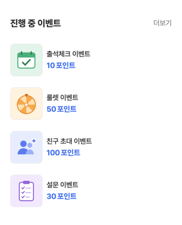<figcaption><p>이벤트 지면 예시. 행을 누르면 이벤트 페이지가 열립니다. 이벤트 이름과 포인트는 예시 값이고 썸네일은 예시 그림입니다. 실제 이벤트 종류는 지면 설정에 따라 다릅니다.</p></figcaption></figure>

<figure>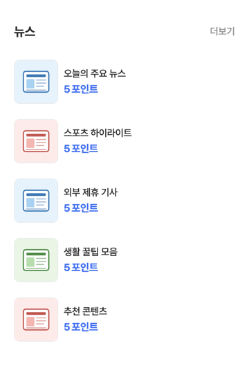<figcaption><p>뉴스 지면 예시. 행을 누르면 기사 페이지가 열립니다. 기사 제목과 포인트는 예시 값이고 썸네일은 예시 그림입니다. 기사 읽기 보상은 현재 지원하지 않습니다. 행에 포인트가 보일 수 있지만 읽어도 적립되지 않습니다. 뉴스 지면을 쓰던 앱은 이관 전에 담당자에게 확인해 주세요.</p></figcaption></figure>

<figure>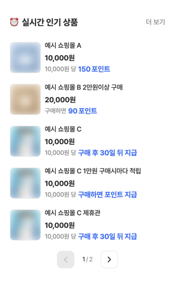<figcaption><p>쇼핑 지면 예시. 가격과 포인트(또는 지급 안내 문구)가 함께 보입니다. 상품명·가격·포인트는 예시 값이고 광고 이미지는 흐리게 처리했습니다.</p></figcaption></figure>

---

## 7. 머리글(헤더: 제목과 더보기)

머리글(제목·더보기)은 TnkFactory 가 그 지면에 설정한 값으로 그려집니다. 앱 코드로 문구를 바꾸거나 숨길 수 없습니다.

| 지면 설정 | 사용자가 보는 것 |
|---|---|
| 제목 + 더보기 문구 | 제목과 '더보기' 가 한 줄로 보입니다 |
| 더보기 문구만 | 제목 자리는 비고 '더보기' 만 보입니다. 머리글 줄 높이는 그대로입니다 |
| 제목만 | 제목만 보이고 '더보기' 는 없습니다(쇼핑 `FEED_SWIPE_DOUBLE` 의 아래쪽 더보기 버튼도 없습니다) |
| 둘 다 없음 | 머리글 줄이 없습니다 |
| 레이아웃 `SIMPLE_LIST` | 설정과 관계없이 머리글이 없고 '더보기' 도 보이지 않습니다 |

<figure>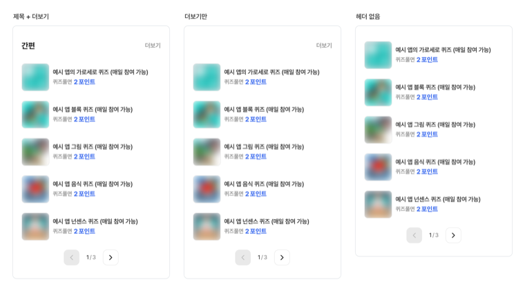<figcaption><p>머리글 비교. 왼쪽부터 제목 + 더보기, 더보기만, 머리글 없음(그림의 '헤더 없음'과 같은 뜻)입니다. 그림의 회색 테두리는 지면 범위를 보여 주려고 그린 것이며 실제 화면에는 없습니다. 광고 이름·포인트는 예시 값이고 광고 이미지는 흐리게 처리했습니다.</p></figcaption></figure>

- 일부 레이아웃은 더보기를 머리글이 아니라 아래쪽 버튼으로 보여 줍니다(쇼핑 지면의 `FEED_SWIPE_DOUBLE`).
- 머리글을 없애고 싶다면 담당자에게 제목·더보기 문구를 비워 달라고 요청하거나 `SIMPLE_LIST` 를 쓰세요(일반 지면·쇼핑 지면 모두 가능). 기존 네이티브(V3) SDK 의 iOS 는 제목이 비어도 머리글 영역이 남았지만, 하이브리드(V4) SDK 는 머리글 줄 자체를 그리지 않습니다. 이렇게 머리글을 없애면 `pubInfo` 의 `title`·`moreLabel` 도 빈 문자열이 됩니다. 머리글을 숨기고 앱이 제목을 직접 그리려면 제목 문구를 앱에 두세요.
- 더보기를 눌렀을 때 동작은 `onMoreClicked` 로 정합니다. (위 '더보기를 앱이 직접 처리하기' 참고)

---

## 8. 높이와 세로 스크롤

### 높이

| 높이 | 사용자가 보는 것 | 언제 쓰나 |
|---|---|---|
| 높이 제약 없음 (자동, 권장) | 뷰 높이가 내용 높이(`contentHeight`)와 같아집니다. 불러오기 전·로딩 중·광고 0개·실패면 0 이고 로딩 표시는 없습니다. 지면 안 세로 스크롤은 없습니다 | 스크롤 화면 안에 자연스럽게 이어 붙일 때 |
| 높이 제약 또는 고정 frame 높이 | 그 높이를 유지합니다. 내용이 더 크면 위쪽 기준으로 잘리고, 더 작으면 남는 영역은 투명합니다 | 지면 영역 크기를 정해 두고 싶을 때 |
| 높이 제약 없음 + `maxHeight` | 내용 높이에 맞춰지다가 `maxHeight` 에서 멈춥니다. 내용이 더 크면 뷰 안에서 세로로 스크롤됩니다 | 광고가 많아도 지면 높이에 상한을 두고 싶을 때 (아래 '최대 높이') |

- `contentHeight` 는 지금 그려진 내용의 높이(pt)를 읽는 읽기 전용 값입니다. 불러오기 전·광고 0개·실패면 0 입니다. `maxHeight` 를 써도 내용 높이 그대로이고, `onHeightChanged` 는 `maxHeight` 를 넘지 않는 값을 알립니다. 값이 바뀌면 `onHeightChanged` 로 받으세요.
- 폭과 위치만 제약하는 자동 높이에서는 `UIStackView` 의 항목으로 넣는 것이 가장 간단합니다.

### 접힐 때 자리 정리

광고가 0개이거나 실패하면 뷰는 높이 0 + `isHidden = true` 가 됩니다. `isHidden` 은 SDK 가 관리하므로(새 `load` 를 시작하면 다시 `false`, `dataOnly` 는 예외) 직접 바꾸지 마세요. `refresh()` 로 0건이던 지면에 광고가 생기면 뷰가 다시 펼쳐집니다. `onLoaded`(`count` 가 0)에서 감싼 뷰를 숨겼다면 `count` 가 0 보다 클 때 다시 보이게 하세요.

- `UIStackView` 안에서는 숨겨진 항목의 자리가 저절로 접힙니다.
- 스택 밖에서 높이 제약을 줬다면 숨겨져도 그 높이만큼 자리가 남습니다. `onLoaded`(`count` 가 0)와 `onFailed` 에서 제약을 끄거나 감싼 뷰를 숨기세요.

```swift
// 화면(ViewController) 안에 둡니다
private lazy var placementHeight = placementView.heightAnchor.constraint(equalToConstant: 300)

func setupFixedHeight() {
    placementView.translatesAutoresizingMaskIntoConstraints = false
    containerView.addSubview(placementView)
    NSLayoutConstraint.activate([
        placementView.topAnchor.constraint(equalTo: containerView.topAnchor),
        placementView.leadingAnchor.constraint(equalTo: containerView.leadingAnchor),
        placementView.trailingAnchor.constraint(equalTo: containerView.trailingAnchor),
        placementHeight,   // 넘치는 부분은 잘립니다
        placementView.bottomAnchor.constraint(equalTo: containerView.bottomAnchor),
    ])
}

func onLoaded(placementId: String, count: Int, customData: String) {
    placementHeight.isActive = (count > 0)   // 광고가 없으면 자리를 비웁니다
}

func onFailed(placementId: String, code: Int) {
    placementHeight.isActive = false
}
```

다시 `load` 하기 전에는 제약을 켜 두세요. (`containerView` 는 예시 이름입니다.)

### 고정 높이였던 컨테이너는 자동 높이로 바꾸세요

> ⚠️ 기존 네이티브(V3) SDK 예제처럼 지면을 **높이가 정해진 컨테이너**(네 변을 컨테이너에 고정한 영역 등)에 넣었다면 하이브리드(V4) SDK 에서는 **고정 높이**로 동작합니다. 내용이 컨테이너보다 크면 아래쪽이 잘리고, 작으면 남는 영역이 비어 보입니다. 기존 iOS 피드는 주어진 높이에 맞춰 이미지를 줄여 그렸지만 하이브리드(V4) SDK 는 내용을 줄이지 않습니다.
>
> 옮길 때는 높이를 정하는 코드·제약을 지우고 **자동 높이**를 쓰세요. 일정 높이 안에서 스크롤해야 한다면 고정 높이와 `verticalScrollEnabled` 를 함께 쓰거나, 내용에 맞춰 늘어나다가 일정 높이에서 멈추게 하려면 높이를 고정하지 말고 `maxHeight` 를 쓰세요.

<figure>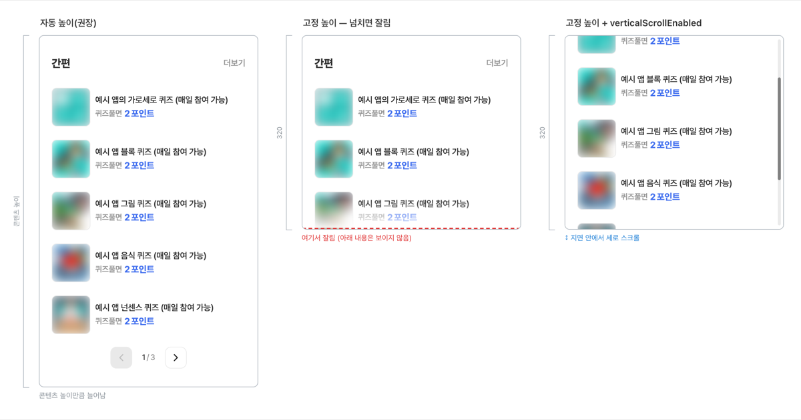<figcaption><p>높이 방식 비교. 왼쪽 자동 높이(권장), 가운데 고정 높이(넘치면 잘림), 오른쪽 고정 높이 + verticalScrollEnabled. 오른쪽 그림의 스크롤 막대는 설명용으로 그린 것이며 iOS 에서는 보이지 않습니다. 그림의 회색 테두리는 지면 범위를 보여 주려고 그린 것이며 실제 화면에는 없습니다. 광고 이름·포인트는 예시 값이고 광고 이미지는 흐리게 처리했습니다.</p></figcaption></figure>

### 최대 높이 (`maxHeight`)

지면 높이에 상한을 두는 속성입니다. 단위는 pt(`CGFloat`)이고 기본값 0 은 제한 없음입니다. `load` 전에 설정하세요(바꾸면 다음 `load` 부터 반영됩니다).

```swift
// 높이 제약은 주지 않고 폭과 위치만 제약합니다
placementView.maxHeight = 400   // pt 값. load 전에. 내용이 400pt 보다 길면 뷰 안에서 스크롤됩니다
placementView.layoutKey = "FEED"
placementView.load(placementId: "담당자에게 받은 지면 ID")
```

- `maxHeight` 가 0 보다 크면 지면은 내용 높이만큼 늘어나다가 `maxHeight` 에서 멈춥니다. 내용이 `maxHeight` 보다 크면 지면 안에서 세로로 스크롤되고, 맨 위나 맨 아래에서 더 드래그하면 앱의 스크롤로 이어집니다. `verticalScrollEnabled` 가 꺼져 있어도 같습니다.
- `onHeightChanged` 는 내용 높이와 `maxHeight` 중 작은 값을 알립니다.
- **`maxHeight` 를 쓸 때는 지면 높이를 고정하지 마세요.** 높이 제약 없이 폭과 위치만 제약하세요.
- 높이를 고정했더라도 지면은 그 칸 안에 그려지고, 내용이 칸보다 크면 칸 안에서 스크롤됩니다. 이때도 `onHeightChanged` 는 `maxHeight` 를 기준으로 한 값(내용 높이와 `maxHeight` 중 작은 값)을 알립니다.
- `maxHeight` 는 화면에 보이는 높이보다 한참 작게 정하세요. 지면이 화면 대부분을 차지하면 그 위에서 시작한 드래그를 지면이 먼저 받아 앱을 스크롤하기 어렵습니다.
- `dataOnly` 일 때는 지면을 그리지 않으므로 무시됩니다.
- `SIMPLE_LIST` 와 `FEED` 는 광고 수만큼 길어지므로 `maxHeight` 를 쓰기 좋습니다. 태블릿처럼 화면이 넓은 기기에서는 `FEED` 카드가 더 높아지므로 `FEED` 에는 `maxHeight` 를 함께 설정하세요.

### 페이지를 넘겨도 높이는 그대로입니다

이전·다음으로 페이지를 넘기는 레이아웃은 마지막 페이지처럼 행이 적은 페이지에서도 지면 높이와 이전·다음 버튼 위치가 바뀌지 않습니다. 페이지를 넘길 때마다 아래 화면이 위아래로 흔들리지 않습니다.

<figure>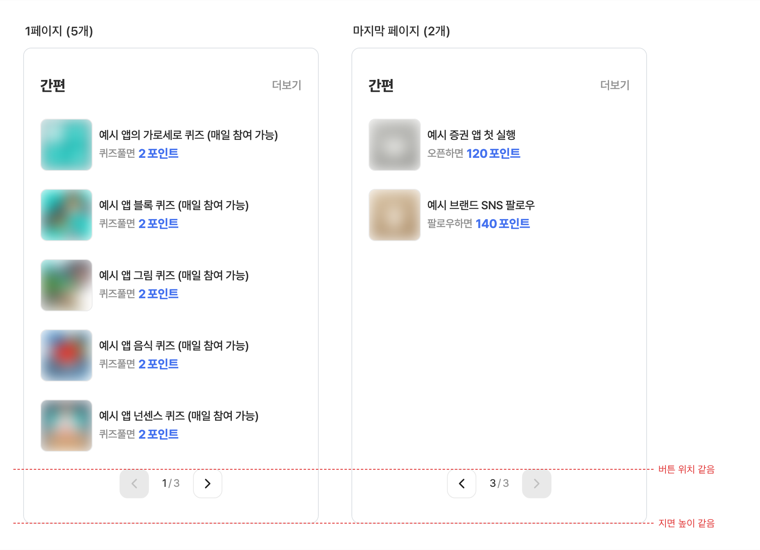<figcaption><p>첫 페이지(왼쪽)와 마지막 페이지(오른쪽). 버튼 위치와 지면 높이가 같습니다. 그림의 회색 테두리는 지면 범위를 보여 주려고 그린 것이며 실제 화면에는 없습니다. 광고 이름·포인트는 예시 값이고 광고 이미지는 흐리게 처리했습니다.</p></figcaption></figure>

### 표시 시점 정하기

기존 네이티브(V3) SDK 는 `loadAdList`(`loadData`) 와 `showAdList` 가 나뉘어 있어서, 미리 불러 두고 원하는 때(바텀시트를 열 때, 조건을 채웠을 때)에만 보여 줄 수 있었습니다. 하이브리드(V4) SDK 는 `load` 가 불러오기와 표시를 함께 하고, 성공하면 뷰가 스스로 펼쳐집니다. 접힘·펼침은 SDK 가 관리하므로 **뷰 자체를 숨겨 두는 방식은 동작하지 않습니다.**

- 표시 시점을 늦추려면 지면을 **감싼 뷰(컨테이너)를 숨겨 두었다가**, 보여 줄 때 보이게 하세요. 광고가 있는지는 `onLoaded` 의 `count` 로 확인합니다.
- 화면에 광고를 그리지 않고 데이터만 받고 싶다면 아래 '광고 목록 직접 받기'의 `dataOnly` 를 쓰세요.
- 노출 수가 중요하면 보여 주기 직전에 `load` 를 호출하세요.
- 숨긴 채 불러올 때는 `onLoaded` 가 숨긴 상태에서도 오는지, 보여 준 뒤 높이가 내용에 맞는지를 실기기에서 확인한 뒤 쓰세요. ([네이티브(V3) SDK 에서 이관](migration.md)의 '이관 뒤 확인할 것')

```swift
// 화면(ViewController)의 저장 프로퍼티
private var loadedCount = 0
private var showRequested = false

// viewDidLoad 등에서
containerView.isHidden = true   // 감싼 뷰를 숨겨 둡니다

// TnkPlacementViewDelegate 메서드 (화면의 extension 안)
func onLoaded(placementId: String, count: Int, customData: String) {
    loadedCount = count   // 개수를 저장하고, 이미 보여 달라고 했다면 지금 적용합니다
    if showRequested { applyPlacementVisibility() }
}

// 사용자가 시트를 여는 등 보여 줄 때
func showPlacement() {
    showRequested = true
    applyPlacementVisibility()
}

private func applyPlacementVisibility() {
    containerView.isHidden = (loadedCount == 0)
}
```
> ⚠️ `TnkPlacementView` 자체의 `isHidden` 은 SDK 가 관리하므로 직접 바꾸지 마세요.

### 세로 스크롤 (`verticalScrollEnabled`)

고정 높이에서 내용이 뷰보다 클 때 뷰 안 세로 스크롤을 켭니다. `load` 전에 설정하세요.

```swift
// 높이 제약을 고정한 지면입니다 (위 '접힐 때 자리 정리' 예시의 300pt 제약)
placementView.verticalScrollEnabled = true   // load 전에. 내용이 넘칠 때만 뷰 안에서 세로로 스크롤됩니다
placementView.load(placementId: "담당자에게 받은 지면 ID")
```

| 설정 | 사용자가 보는 것 | 언제 쓰나 |
|---|---|---|
| `true` | 높이가 고정이고 내용이 뷰보다 높을 때만 뷰 안에서 세로로 스크롤됩니다 (튕김 효과 없음) | 고정 높이 안에 긴 목록을 보여 줄 때 |
| `false` | 넘치는 부분이 잘립니다 | 기본값 |
| 호출하지 않음 | `false` 와 같습니다 | - |

자동 높이에서는 스크롤할 내용이 없어 `true` 로 해도 효과가 없습니다. `maxHeight` 를 쓰면 이 값과 관계없이 내용이 넘칠 때 뷰 안에서 스크롤됩니다.

---

## 9. 테마 (`theme`)

지면을 라이트·다크 중 하나로 고정하려면 `theme` 를 정합니다. **`load` 전에** 설정하세요.

```swift
placementView.theme = "dark"   // "light" · "dark" · 지정하지 않으려면 nil
placementView.load(placementId: "담당자에게 받은 지면 ID")
```

| 설정 | 사용자가 보는 것 | 언제 쓰나 |
|---|---|---|
| `"light"` · `"dark"` | 지면이 그 테마로 그려집니다. 이 지면에서 SDK 가 여는 전체 화면 오퍼월(광고 상세·더보기 기본 동작)도 같은 테마로 열립니다. 대소문자와 앞뒤 공백은 무시합니다 | 앱이 라이트나 다크로 고정되어 있을 때 |
| 그 밖의 값 · 빈 문자열 · `nil` | 지정하지 않은 것으로 봅니다 | - |
| 호출하지 않음 | 기기(앱)의 다크 모드 설정을 따릅니다 | 기본값 |

- **지면 뷰 자체의 배경은 투명**합니다(고정 높이에서 남는 영역 등). 각 레이아웃은 지면 안에 테마색 카드를 그리며, 라이트 테마에서 대부분은 흰 카드이고 `BOX` 는 회색 카드 위에 흰 행입니다. 카드와 행은 테마색으로 그려지므로 앱 화면과 어울리는 테마를 고르세요.
- 아래 그림은 흰 배경과 어두운 배경 위에 같은 지면을 놓은 예시입니다.

<figure>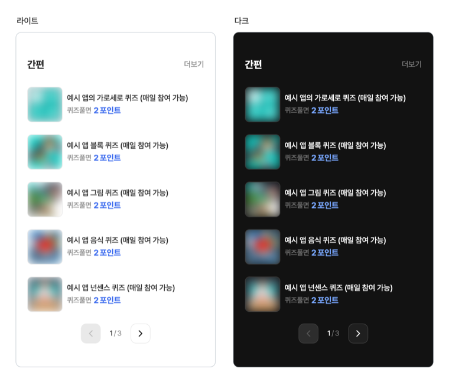<figcaption><p>같은 지면의 라이트(왼쪽)와 다크(오른쪽). 같은 지면을 흰 배경과 어두운 배경 위에 놓은 합성 그림입니다. 그림의 회색 테두리는 지면 범위를 보여 주려고 그린 것이며 실제 화면에는 없습니다. 광고 이름·포인트는 예시 값이고 광고 이미지는 흐리게 처리했습니다.</p></figcaption></figure>

---

## 10. 지면 정보 · 앱 이름 · 다시 불러오기 · 항목 고르기

기존 네이티브(V3) SDK 에 있던 기능입니다. 모두 **선택 사항**입니다.

### 지면 정보 (`pubInfo`)

`onLoaded` 가 호출되기 직전에 설정되는 읽기 전용 속성입니다. 광고가 0개여도 설정됩니다. 새 `load` 를 시작하거나 `onFailed` 가 오거나 뷰가 정리되면 `nil` 이 됩니다.

```swift
func onLoaded(placementId: String, count: Int, customData: String) {
    guard let info = placementView.pubInfo else { return }
    titleLabel.text = info.title          // 지면 제목
    if info.adType == 4 { /* 이벤트 지면 */ }
    print("그려진 레이아웃: \(info.layoutKey)")
}
```

| 필드 | 뜻 |
|---|---|
| `placementId` | 마지막으로 `load` 한 지면 ID |
| `adType` | 지면 유형 `0`~`5` (위 '지면 유형' 참고). 값이 오지 않으면 `-1` |
| `title` | 지면 제목. 없으면 빈 문자열. 레이아웃 `SIMPLE_LIST` 로 그려졌으면 지면에 설정이 있어도 빈 문자열입니다 |
| `moreLabel` | '더보기' 문구. 없으면 빈 문자열. 레이아웃 `SIMPLE_LIST` 로 그려졌으면 지면에 설정이 있어도 빈 문자열입니다 |
| `customData` | 지면에 설정된 값. `onLoaded` 의 `customData` 와 같습니다 |
| `pointUnit` | 매체 포인트 명칭. 없으면 빈 문자열 |
| `layoutKey` | **실제로 그려진** 레이아웃의 키(예: `"BOX"`). 광고가 0개이거나 키 표에 없는 레이아웃이면 빈 문자열 |

- 기존 `TnkPlacementPubInfo` 필드 대응: `ad_type` → `adType`(퀴즈 `5` 추가), `title` → `title`, `more_lbl` → `moreLabel`, `cust_data` → `customData`, `pnt_unit` → `pointUnit`. 기존의 매체 설정 지면 ID 필드는 `placementId` 로 읽습니다. `ctype_surl` 은 제공하지 않습니다.
- 광고가 없는 지면(서버가 광고 0건으로 응답)은 `title` 등이 빈 문자열이고 `adType` 이 `-1` 일 수 있습니다.
- 값은 화면을 꾸미는 용도입니다. **보상·권한 판단에 쓰지 마세요.** 제목 같은 문자열을 앱의 HTML 이나 웹 화면에 넣을 때는 이스케이프하세요.

### 클릭한 항목 이름 (`appName`)과 닫힘 (`onItemClosed`)

- `onItemClicked` 의 세 번째 인자 `appName` 은 누른 행의 이름입니다. 광고는 광고 앱 이름, 이벤트 행은 이벤트 제목, 뉴스 행은 기사 제목이고 알 수 없으면 빈 문자열입니다. 화면 표시·로그용이며 보상·보안 판단에 쓰지 마세요.
- `onItemClosed` 는 지면의 **항목 클릭으로 SDK 가 연 화면이 닫힐 때** 1회 호출됩니다. 광고 행이면 전체 화면 오퍼월이, 뉴스·이벤트 행이면 앱 안에서 열린 페이지 화면이 닫힐 때입니다. `appId` 는 그 클릭의 ID 입니다.
- 다음 경우에는 호출하지 않습니다. 외부 브라우저로 연 링크, '더보기'(앱이 `onMoreClicked` 에서 직접 처리한 화면 포함), 뷰가 이미 정리된 뒤.
- 연 화면 위에 다른 전체 화면이 올라가 있는 동안에는 호출하지 않고, 그 화면들이 한꺼번에 닫히면(화면 스택 전체가 닫힘) 닫힌 직후 1번 호출합니다.
- SDK 가 목록을 자동으로 새로 받지는 않습니다. 참여 결과를 목록에 반영하고 싶다면 `onItemClosed` 에서 `refresh` 를 호출하세요.

```swift
func onItemClicked(placementId: String, appId: Int64, appName: String) {
    // 화면 통지용입니다. 클릭 수 집계 등에 쓸 수 있지만 보상·과금 판단에는 쓰지 마세요
}

func onItemClosed(placementId: String, appId: Int64) {
    placementView.refresh()   // 서버에서 최신 목록을 다시 받습니다
}
```

### 다시 불러오기 (`refresh`)

같은 지면을 **접지 않고** 다시 불러옵니다. 기존 네이티브(V3) SDK 의 `refreshPlacementView()` 에 해당하지만, 이쪽은 서버에서 목록을 다시 받아 옵니다. 참여를 마친 광고처럼 서버 목록이 바뀐 것을 지면에 반영하고 싶을 때 쓰세요. 메인 스레드에서 호출합니다.

| 상태 | `refresh()` 를 부르면 |
|---|---|
| 한 번도 `load` 하지 않았거나 정리된 뷰 | 무시합니다 |
| 불러오는 중 | 무시합니다 |
| 불러오기에 성공(광고 있음·없음)한 상태 | 응답이 올 때까지 높이와 표시를 유지하고, 응답이 오면 `onLoaded` 를 다시 호출합니다. `pubInfo` · `adList` 도 갱신됩니다. `refresh()` 로 받은 목록이 화면에 있는 목록과 같으면 보던 페이지와 가로 스크롤 위치가 그대로 유지되고, 달라졌으면 목록을 1페이지부터 새로 그립니다. 새 목록이 0건이면 `count` 0 과 함께 뷰가 접힙니다(높이 0 + `isHidden = true`). 0건이던 지면에 광고가 생기면 `onLoaded`(`count` 가 0 보다 큼) 뒤에 뷰가 다시 펼쳐지고 `onHeightChanged` 로 새 높이가 옵니다. 실패하면 기존 목록을 그대로 두고 아무 알림도 보내지 않습니다 |
| 실패한 상태 | `load(현재 지면 ID)` 와 같습니다. 접혔다가 펼쳐지며, 그때의 `layoutKey` · `filterIds` · `theme` 같은 현재 속성 값으로 불러옵니다 |

- 처음 보이는 광고는 노출로 집계하고, 이미 집계한 광고는 모양이 바뀌지 않으면 다시 집계하지 않습니다.
- 권장 흐름인 `onItemClosed` → `refresh()` 에서도 목록이 그대로이면 사용자가 보던 페이지에 머뭅니다. 참여를 마친 광고가 빠져 목록이 달라졌으면 1페이지부터 다시 보입니다.
- `layoutKey` · `filterIds` · `theme` · `verticalScrollEnabled` · `maxHeight` · `dataOnly` 를 바꾼 것은 `refresh` 로 반영되지 않습니다. 바꾼 뒤에는 `load` 를 다시 호출하세요.
- 화면이 보일 때마다(`viewWillAppear` 등) 부르지 마세요. 서버 호출이 늘어납니다. 항목을 눌러 연 화면이 닫힌 뒤(`onItemClosed`)에 부르는 것을 권장합니다.

### 항목 고르기 (`filterIds`)

보여 줄 항목을 `filter_id` 로 고릅니다. `filter_id` 는 항목에 붙은 번호이며 담당자에게 받거나 `adList` 의 `filterId` 로 확인합니다. `adList` 는 불러온 뒤에야 알 수 있으므로 번호는 앱에 저장해 두었다가 다음 `load` 전에 `filterIds` 로 넘기세요. 기존 네이티브(V3) SDK iOS 의 `setFilteringIDs` 에 해당합니다. **`load` 전에** 설정하며 다음 `load` 부터 적용됩니다.

```swift
placementView.filterIds = [11, 12, 13]   // load 전에. 이 순서로 보여 줍니다
placementView.load(placementId: "담당자에게 받은 지면 ID")
```

- 목록 순서대로 각 id 마다 `filter_id` 가 같은 **첫 항목 1건**을 골라 그 순서로 보여 줍니다. 없는 id 는 건너뜁니다. 기존 SDK 는 같은 `filter_id` 중 어느 항목이 나올지 정해져 있지 않았지만, 하이브리드(V4) SDK 는 서버가 준 순서의 첫 항목입니다.
- 1~999999999 범위의 정수만 쓰이고 그 밖의 값은 버립니다. 중복은 처음 값만, 최대 50개까지입니다.
- 고른 뒤의 개수가 `onLoaded` 의 `count` 입니다. 하나도 남지 않으면 `count` 가 0 이고 뷰는 접힙니다.
- `nil`/빈 목록이거나 쓸 수 있는 값이 없으면 고르지 않고 모든 광고를 보여 줍니다.

---

## 11. 광고 목록 직접 받기 (`dataOnly` · `adList` · `clickItem`)

앱이 광고 목록을 받아 **자기 화면을 직접 그리고 싶을 때** 쓰는 기능입니다. 기존 네이티브(V3) SDK 의 `getAdList()` · `getAdListJson()` · `onItemClick` 에 해당합니다. 선택 사항입니다.

### 데이터만 받기 (`dataOnly`)

`dataOnly` 를 `true` 로 하고 `load` 하면 지면을 그리지 않고 광고 목록만 받습니다. **`load` 전에** 설정하며 다음 `load` 부터 적용됩니다.

```swift
// viewDidLoad 등에서
placementView.dataOnly = true          // load 전에. 뷰는 화면 계층에 두세요 (높이 0 으로 접힌 채 유지됩니다)
placementView.delegate = self
placementView.load(placementId: "담당자에게 받은 지면 ID")

// TnkPlacementViewDelegate 메서드 (화면의 extension 안)
func onLoaded(placementId: String, count: Int, customData: String) {
    showMyList(placementView.adList)   // 앱이 직접 그리는 화면
}
```

| 설정 | 사용자가 보는 것 | 언제 쓰나 |
|---|---|---|
| `true` | 지면이 그려지지 않습니다. 뷰는 `load` 를 시작할 때부터 광고 수와 관계없이 높이 0 + `isHidden = true` 이고, 이 상태가 유지되며 `onHeightChanged` 도 오지 않습니다. `onLoaded` · `onFailed` · `pubInfo` · `adList` 는 평소처럼 갱신됩니다 | 앱이 직접 목록 화면을 그릴 때 |
| `false` | 평소처럼 지면이 그려집니다 | 기본값 |
| 호출하지 않음 | `false` 와 같습니다 | - |

> ⚠️ `dataOnly` 여도 **뷰는 화면 계층(뷰 계층) 안에 있어야** 합니다. 숨겨져 있어도 계층에서 빼거나, 만들기만 하고 화면에 붙이지 않으면 5초 시간 초과도 세지 않으므로 `onLoaded`·`onFailed` 가 오지 않을 수 있습니다. 뷰는 숨긴 채로 화면 계층에 두세요. `dataOnly` 로 쓰는 뷰에는 높이 제약을 주지 마세요. `UIStackView` 밖에서 높이 제약을 주면 숨겨져도 그 높이만큼 자리가 남습니다. 화면 수명도 지면과 같은 규칙입니다.
>
> 지면을 그리지 않으므로 SDK 가 지면 노출을 기록하지 않습니다. 이 방식의 노출·클릭은 지면 지표에 잡히지 않습니다. 지표가 필요하면 담당자에게 문의하세요.

### 광고 목록 (`adList` · `adListJson`)

`onLoaded` 가 호출되기 직전에 설정되는 읽기 전용 값입니다. 서버가 준 순서입니다. `filterIds` 를 쓰면 `filterIds` 를 적용한 뒤의 목록이고 `filterIds` 의 순서를 따릅니다. 항목 수는 `count` 와 같고(레이아웃의 표시 상한 적용 전), 아래처럼 잘못된 항목이 빠졌다면 더 적을 수 있습니다. 새 `load` 를 시작하거나 실패하거나 뷰가 정리되면 빈 목록이 됩니다.

```swift
@objc public final class TnkPlacementAdItem: NSObject {   // 모든 프로퍼티는 읽기 전용(let)
    @objc public let appId: Int64
    @objc public let actionId: Int
    @objc public let appName: String
    @objc public let imageUrl: String
    @objc public let iconUrl: String
    @objc public let point: Int64
    @objc public let originalPoint: Int64
    @objc public let pointUnit: String
    @objc public let pointText: String
    @objc public let price: Int64
    @objc public let originalPrice: Int64
    @objc public let discountRate: Int
    @objc public let isMultiMission: Bool
    @objc public let campaignType: Int
    @objc public let campaignTypeName: String
    @objc public let actionDesc: String
    @objc public let likeYn: String
    @objc public let filterId: Int
    @objc public let isLink: Bool
}

@objc public private(set) var adList: [TnkPlacementAdItem]   // TnkPlacementView 의 읽기 전용 속성
@objc public private(set) var adListJson: String            // 같은 목록의 JSON 배열 문자열
```

| 필드 | 뜻 |
|---|---|
| `appId` | 광고 ID. 뉴스·이벤트 행이면 기사·이벤트 ID |
| `actionId` | 참여 방식 ID |
| `appName` | 광고 이름 (이벤트 행은 이벤트 제목, 뉴스 행은 기사 제목) |
| `imageUrl` · `iconUrl` | 이미지·아이콘 주소 |
| `point` · `originalPoint` | 적립 포인트 · 포인트 배율 이벤트 적용 전 포인트(없으면 0) |
| `pointUnit` · `pointText` | 포인트 단위 · 포인트 문구 |
| `price` · `originalPrice` | 상품 가격 · 할인 전 가격 (쇼핑 지면) |
| `discountRate` | 할인율(%). 없으면 0 |
| `isMultiMission` | 여러 미션 광고 여부 |
| `campaignType` · `campaignTypeName` | 캠페인 유형 번호 · 화면에 보이는 유형 이름(없으면 빈 문자열) |
| `likeYn` | 좋아요 여부 `"Y"` · `"N"` · `""` |
| `filterId` | 항목 고르기(`filterIds`)에 넘기는 번호 (없으면 0). 어떤 번호를 쓸지는 담당자에게 받거나 불러온 `adList` 의 `filterId` 로 확인합니다 |
| `isLink` | 뉴스·이벤트처럼 **링크로 열리는 행**이면 `true` |
| `actionDesc` | 참여 방식을 설명하는 문구. 없으면 빈 문자열 |

- 숫자가 아닌 값은 `0`, 문자열이 아닌 값은 빈 문자열입니다. `app_id` 가 양의 정수가 아닌 항목은 목록에서 빠집니다.
- 광고 상세 주소나 타게팅 정보 같은 내부 값은 넣지 않습니다.
- `adListJson` 는 같은 목록을 JSON 배열 문자열로 돌려줍니다(없으면 `"[]"`). 키는 모두 19개이며 이름은 아래와 같습니다. 키 순서와 공백은 플랫폼마다 다를 수 있으니 문자열로 비교하지 말고 파싱해서 쓰세요.

| JSON 키 | 필드 | JSON 키 | 필드 |
|---|---|---|---|
| `app_id` | `appId` | `multi_yn` | `isMultiMission` (`true`/`false`) |
| `actn_id` | `actionId` | `cmpn_type` | `campaignType` |
| `app_nm` | `appName` | `cmpn_type_name` | `campaignTypeName` |
| `img_url` | `imageUrl` | `like_yn` | `likeYn` |
| `icon_url` | `iconUrl` | `filter_id` | `filterId` |
| `pnt_amt` | `point` | `prd_price` | `price` |
| `org_pnt_amt` | `originalPoint` | `org_price` | `originalPrice` |
| `pnt_unit` | `pointUnit` | `sale_dc_rate` | `discountRate` |
| `pnt_txt` | `pointText` | `is_link` | `isLink` |
| `actn_desc` | `actionDesc` | | |

**기존 광고 목록과 비교**

기존 `getAdListJson()` 의 키와 `TnkPlacementAdItem` 필드를 새 이름과 맞춰 본 표입니다. 기존 필드 이름은 snake_case(`app_id` 등)였고 새 필드는 camelCase 입니다. **옛 키로 읽는 코드는 오류 없이 값을 놓치므로 '바뀜' 을 꼭 확인하세요.** 기존 `getAdListJson()` 과 새 `adListJson` 모두 JSON 배열 문자열입니다. 새 JSON 에는 옛 키의 별칭이 없어서, 옛 키(`org_amt` · `org_prd_price` · `filterID`)로 읽으면 오류 없이 값을 찾지 못하고 아무것도 돌려받지 못합니다. 새 키로 바꿔야 합니다.

| 기존 키 · 필드 | 새 JSON 키 | 새 필드 | 구분 |
|---|---|---|---|
| `app_id` | `app_id` | `appId` | 키 같음 |
| `app_nm` | `app_nm` | `appName` | 키 같음 |
| `img_url` | `img_url` | `imageUrl` | 키 같음 |
| `icon_url` | `icon_url` | `iconUrl` | 키 같음 |
| `pnt_amt` | `pnt_amt` | `point` | 키 같음 |
| `org_amt` | **`org_pnt_amt`** | `originalPoint` | **바뀜** |
| `pnt_unit` | `pnt_unit` | `pointUnit` | 키 같음 |
| `prd_price` | `prd_price` | `price` | 키 같음 |
| `org_prd_price` | **`org_price`** | `originalPrice` | **바뀜** |
| `sale_dc_rate` | `sale_dc_rate` | `discountRate` | 키 같음 |
| `multi_yn` | `multi_yn` | `isMultiMission` | 키 같음 |
| `cmpn_type` | `cmpn_type` | `campaignType` | 키 같음 |
| `cmpn_type_name` | `cmpn_type_name` | `campaignTypeName` | 키 같음 |
| `like_yn` | `like_yn` | `likeYn` | 키 같음 |
| `filterID` | **`filter_id`** | `filterId` | **바뀜** |
| (없음) | `actn_id` | `actionId` | 추가 |
| (없음) | `pnt_txt` | `pointText` | 추가 |
| (없음) | `is_link` | `isLink` | 추가 |
| (없음) | `actn_desc` | `actionDesc` | 추가 |

**옛 키 → 새 키**: 바뀐 키는 `org_amt` → `org_pnt_amt`, `org_prd_price` → `org_price`, `filterID` → `filter_id` 세 개입니다. 옛 키는 별칭을 두지 않았으므로 옛 키로 읽는 코드는 값을 찾지 못합니다. 새 키로 바꾸세요. 나머지 키는 그대로입니다.

기존 `getAdList()` 는 이벤트 지면의 항목을 돌려주지 않았지만, 지금은 이벤트·뉴스 행이 `isLink` 가 `true` 인 항목으로 `adList` 에 들어 있습니다. 그 `appId` 는 광고 ID 가 아니니 `adDetail` 등에 넘기지 마세요. 또 `appId` 는 `Int` 에서 `Int64` 로 바뀌었습니다.

> ⚠️ `adList` 는 **화면 표시용**입니다. 보상 지급이나 과금 판단에 쓰지 마세요. 문자열을 앱 화면(HTML 등)에 넣을 때는 이스케이프하세요.
>
> 기존 네이티브(V3) SDK 의 `getADInfo(appId:)`(iOS)처럼 한 건만 조회하는 함수는 없습니다. `adList` 에서 `appId` 가 같은 항목을 찾으세요. 기존 `getPubInfoJson()` 은 `pubInfo` 로 대신합니다.

### 코드로 클릭 실행 (`clickItem`)

열리는 화면은 사용자가 그 행을 누른 것과 같습니다. **사용자의 동작(앱이 그린 목록의 버튼 탭 등)에 대한 응답으로만 호출하세요.** 화면이 뜰 때나 목록을 받은 직후처럼 사용자 동작 없이 자동으로 부르지 마세요. 광고 행이면 `onItemClicked` 뒤에 광고 상세가 열리고, 링크 행(뉴스·이벤트)이면 `onItemClicked` 뒤에 그 페이지가 열립니다. `dataOnly` 일 때도 같습니다. 메인 스레드에서 호출하세요.

```swift
// 앱이 그린 목록의 항목을 눌렀을 때
placementView.clickItem(appId: ad.appId) { success, code in
    if !success { print("클릭 실패: \(code)") }
}
```

결과 콜백은 정확히 1번, 메인 스레드에서 옵니다. **동작은 `success` 로 나누세요.** `code`(`Int`)는 원인을 기록하거나 진단하는 용도이며 값이 늘어날 수 있으니 `code` 값으로 동작을 나누지 마세요. 기존 `onItemClick` 의 `TnkError?` 는 `Int` 로 바뀌었습니다(아래 '기존 `onItemClick` 의 결과와 대응').

| `code` | 뜻 | 확인할 것(진단용) |
|---|---|---|
| `0` (`success` 가 `true`) | 화면 열기를 **시작했습니다** | - |
| `1003` | 목록에 없는 `appId` 입니다 | 최신 `adList` 에서 다시 고릅니다 |
| `1004` | 앞서 요청한 `clickItem` 을 아직 처리하는 중입니다 | 끝난 뒤 다시 호출합니다 |
| `-1` | 그 밖의 실패. 아직 불러오지 않았거나 실패한 상태, 링크 주소가 올바르지 않은 경우 등 | `onLoaded` 뒤에 호출했는지 확인합니다 |
| `-2` | 3초 안에 응답이 없었습니다 | 필요하면 다시 호출합니다 |

> ⚠️ 성공(`0`)은 "화면 열기를 시작했다"는 뜻이지 **참여나 보상이 끝났다는 뜻이 아닙니다.** 보상은 [5. 보상 지급 수신](reward.md)과 서버 보상 콜백으로 확인하세요.

- `onItemClicked` · `onItemClosed` 는 사용자가 누른 것과 똑같이 호출되며, `clickItem` 으로 실행했는지는 구분하지 않습니다.
- 진행 중인 `clickItem` 이 있을 때 새 `load` 를 하거나 뷰가 정리되면 그 요청은 바로 `(false, -1)` 로 끝납니다.

### 기존 `onItemClick` 의 결과와 대응 (기존 가이드의 오류 코드 기준)

기존 `onItemClick(appId:completion:)` 은 `(Bool, TnkError?)` 를 줬고 실패 원인을 `TnkError` 의 `errorCode` 로 구분했습니다. `clickItem` 은 `(Bool, Int)` 이고, 개인정보 동의·추적 허용 안내·로그인·참여 가능 여부 확인 같은 단계가 열린 전체 화면 오퍼월 안으로 옮겨졌기 때문에 그 결과는 이쪽으로 돌아오지 않습니다. 기존 코드를 지금 결과에 맞추면 다음과 같습니다.

| 기존 결과 (`errorCode`) | 지금 |
|---|---|
| 성공 | `success` 가 `true`, `code` 는 `0` (화면 열기를 시작했다는 뜻) |
| 목록에 없는 `appId` (1003) | 같은 번호 `1003` |
| 이전 요청을 처리하는 중 호출 (1004) | 같은 번호 `1004` |
| 개인정보 동의 거절 · 추적 허용 안내 취소 (1001) | 실패로 오지 않습니다. 동의 창은 열린 오퍼월 안에서 나오므로 거절해도 `clickItem` 의 결과는 `0` 입니다 |
| 안내 창을 띄울 수 없음 (1002) · SDK 세션 없음 (1101) · 로그인 필요 (1102) · 추적 허용 필요 (1103) | 결과로 오지 않습니다. 해당 단계가 오퍼월 안으로 옮겨졌습니다. 그 밖의 실패(아직 불러오지 않음 등)는 `-1` 입니다 |
| 참여할 수 없는 광고 (99) · 잘못된 URL (109) · 서버 호출 실패 (200) · 서버가 참여를 거절 (서버 코드 2·4·12) · 뉴스 항목의 이미 참여함·콘텐츠 URL 없음 (4·113) | 결과로 오지 않습니다. 참여 가능 여부는 전체 화면 광고 상세가 보여 줍니다. 링크 행의 주소가 올바르지 않으면 `-1` 입니다 |
| (없음) | `-2` — 3초 안에 응답이 없음 (새로 생겼습니다) |

`TnkCode` 의 값으로 분기하던 코드는 `success` 로 분기하도록 바꾸세요. `code` 는 기록·진단용입니다. 클릭 뒤의 세부 오류 코드는 현재 지원하지 않습니다. 화면을 연 뒤의 결과(동의 거절, 참여 불가 등)는 앱으로 돌아오지 않으므로, 동의 거절을 실패로 세던 앱은 그 수치가 달라집니다.

---

## 12. 화면 종료와 재사용

- 뷰가 해제되면 SDK 가 스스로 정리하므로 `cleanup()` 호출은 **선택 사항**입니다. 먼저 정리하려면 `cleanup()` 을 호출하세요. 정리하면 높이가 0 이 되고 진행 중이던 `load` 결과는 무시됩니다. 직전 높이가 0 보다 컸다면 `onHeightChanged(0)` 이 옵니다.
- `cleanup()` 뒤에도 `load(placementId:)` 를 다시 부르면 다시 불러옵니다. (`TnkOfferwallView` 는 `cleanup()` 뒤 다시 쓸 수 없습니다.)
- 시트(`UISheetPresentationController` 등)로 띄운 화면 안에서도 쓸 수 있습니다. 광고를 누르면 오퍼월은 그 시트 위에 열립니다.
- 뷰가 화면(window)에서 빠져도(탭 전환, 화면 push 등) 지면은 그대로 남습니다. 다시 붙어도 새로 불러오지 않고 콜백도 다시 오지 않습니다.
- 테이블·컬렉션 셀에서 재사용하는 뷰에 다른 지면을 보여야 하면 `load(placementId:)` 를 다시 호출하세요. 이전 결과는 무시됩니다. 셀 높이 갱신은 `onHeightChanged` 로 하되, 실기기에서 확인하세요.
- 이 뷰는 앱의 뒤로가기를 가로채지 않고, `tnkscheme://` 딥링크도 받지 않습니다. 딥링크는 오퍼월이 받습니다. ([6. 딥링크](deeplink.md) 참고)
- 로그아웃 뒤 다른 계정으로 로그인했다면 `setUserName` 뒤에 `load` 를 다시 호출하세요. 이미 떠 있는 지면은 이전 사용자 기준 내용을 그대로 보여 줍니다.
- 지면 안에서는 개인정보 수집 동의 팝업이 뜨지 않습니다. 광고나 더보기를 눌러 열린 오퍼월에서 필요하면 나올 수 있습니다.

---

## Android 와 다른 점

| 항목 | iOS | Android |
|---|---|---|
| 이벤트 받는 곳 | `delegate` 속성 (`TnkPlacementViewDelegate`, weak 참조, 모든 메서드 선택 구현) | `listener` 속성 (`TnkPlacementListener` · `TnkPlacementListenerAdapter`) |
| 높이 콜백 인자 | `height: Double` (pt) | `heightCssPx: Int` (dp) |
| `maxHeight` | `CGFloat` (pt) | `Int` (dp) |
| 접힐 때 `onHeightChanged(0)` | 광고 없음으로 바뀜·실패·새 `load` 시작·`cleanup()` 때 보냄 | 보내지 않음 |
| 접힌 상태 | 높이 0 + `isHidden = true` | `GONE` |
| `appId` 인자 타입 | `appId: Int64` | `appId: Long` |
| 화면에 넣는 방법 | 코드로 만들어 넣기(권장) | XML 레이아웃 또는 코드 |
| 실패 코드 상수 | 상수 없이 `-2`·`-1` 숫자 사용 | `TnkPlacementView.CODE_TIMEOUT`(-2) · `CODE_UNKNOWN`(-1) |
| 읽기 전용 속성 | `placementId` · `pubInfo` · `adList` · `contentHeight` | `placementId` · `pubInfo` · `adList` |
| 에뮬레이터·가상 기기 | 이 차단 없음 | 지면이 표시되지 않고 `onFailed` 로 끝남 |
| 정리 | 뷰가 해제될 때 자동. 먼저 정리하려면 `cleanup()` 호출 | 화면 생명주기에 따라 자동 (공개 정리 함수 없음) |
| 정보·목록 속성 | `pubInfo` · `adList` · `adListJson` · `filterIds: [Int]?` | `pubInfo` · `adList` · `getAdListJson()` · `filterIds: List<Int>?` |
| `clickItem` | `clickItem(appId: Int64, completion:)` | `clickItem(appId: Long, onResult)` |
| `onItemClosed` | 선택 구현 메서드 | 기본 구현이 빈 함수(재정의 선택) |
| `dataOnly` 일 때 접힌 상태 | `load` 시작부터 높이 0 + `isHidden = true` (`onHeightChanged` 없음) | `load` 시작부터 `GONE` (`onHeightChanged` 없음) |

두 플랫폼 모두 접힘 여부는 `onLoaded`(`count` 가 0) 또는 `onFailed` 로 판단하세요.

---

## 기존 네이티브(V3) SDK 에서 옮겨 오기

기존 네이티브(V3) SDK(`TnkRwdSdk2`)의 `AdPlacementView` 를 쓰던 앱은 아래 표로 무엇이 **같고, 바뀌고, 추가되고, 빠졌는지** 확인하세요. 코드 전/후 비교는 [네이티브(V3) SDK 에서 이관](migration.md)의 '패턴 10' 과 '패턴 11' 에 있습니다.

### 먼저 알아둘 것: 지면을 그리는 방식

기존 네이티브(V3) SDK 는 앱이 셀 클래스와 열·행 수를 정해 지면을 앱 코드로 그렸습니다. 하이브리드(V4) SDK 의 지면은 **TnkFactory 가 제공하는 화면을 앱 안에 띄워 그립니다.** 그래서 앱은 모양을 `layoutKey` 로 고르기만 하고, 셀 클래스를 끼우거나 열·행 수를 지정하는 코드는 없습니다. 아래 표의 '제공하는 화면'은 이것을 뜻합니다.

### 기존 API 와 대응

구분: **같음** · **이름 바뀜**(이름만 바꾸면 됨) · **바뀜**(동작이나 인자가 다름) · **추가** · **빠짐**

| 기존 네이티브(V3) SDK | 하이브리드(V4) SDK | 구분 | 이유 | 바꾸는 방법 |
|---|---|---|---|---|
| 지면 등록 · 기존 지면 ID | 담당자에게 받은 지면 ID | 같음 | 기존 iOS 와 같이 담당자를 통해 등록합니다 | 같은 앱에 등록된 지면 ID 는 그대로 씁니다. 오래 전에 만든 지면이 보이지 않으면 담당자에게 확인해 주세요. |
| `AdPlacementView(frame:viewController:)` | `TnkPlacementView()` · `TnkPlacementView(frame:)` | 바뀜 | `viewController` 인자가 없어졌습니다. 오퍼월을 띄울 화면은 SDK 가 뷰가 속한 화면에서 찾으므로, 뷰가 화면 계층에 없으면 광고를 눌러도 화면이 열리지 않습니다 | `viewController` 인자를 지우고 화면 계층에 넣습니다. Storyboard·XIB 에서도 쓸 수 있습니다 |
| `placementListener` (`PlacementEventListener`) | `delegate` (`TnkPlacementViewDelegate`) | 바뀜 | 메서드 이름이 모두 바뀌었습니다. weak 참조입니다 | `delegate` 에 화면(ViewController)을 지정합니다 |
| `loadData(placementId:)` + `showAdList()` | `load(placementId:)` | 바뀜 | 불러오기와 표시를 SDK 가 한 번에 처리합니다 | 두 호출을 `load` 하나로 바꾸고 `showAdList()` 호출은 지웁니다. 미리 불러 두었다가 나중에 보여 주던 코드는 위 '표시 시점 정하기'를 보세요 |
| `showAdList()` 반환값(`CGSize`) · `getItemViewSize()` | `contentHeight` · `onHeightChanged` | 바뀜 | 결과를 비동기로 받습니다 | 높이는 `onHeightChanged(placementId:height:)` 로 받습니다 |
| `didAdDataLoaded(placementId:customData:)` | `onLoaded(placementId:count:customData:)` | 바뀜 | `count` 가 추가되었습니다. `customData` 는 값이 없으면 빈 문자열이고, 기존의 미설정 기본값(`"__default_custom_data__"`)은 오지 않습니다 | 그 문자열과 비교하던 코드는 빈 문자열 비교로 바꿉니다. `showAdList()` 호출은 지웁니다 |
| `didFailedToLoad(placementId:)` | `onFailed(placementId:code:)` | 바뀜 | 실패 이유(`code`)를 알려 줍니다. 광고 0개는 실패가 아니라 `onLoaded` 의 `count` 0 입니다 | 0건 처리를 `onLoaded` 로 옮깁니다 |
| `didAdItemClicked(placementId:appId:appName:)` | `onItemClicked(placementId:appId:appName:)` | 바뀜 | 델리게이트 메서드 이름이 `did…` 에서 `on…` 으로 바뀌고 `appId` 가 `Int` 에서 `Int64` 로 바뀌었습니다. 모두 선택 구현이라 옛 이름을 그대로 두면 컴파일 오류 없이 호출되지 않습니다. 탭 즉시 1번, 동의 팝업보다 먼저 호출됩니다(기존 iOS 는 동의 뒤에만) | 메서드 이름을 `onItemClicked` 로 바꾸고 `appId` 타입을 `Int` 에서 `Int64` 로 바꿉니다 |
| `didAdItemClosed(placementId:appId:)` | `onItemClosed(placementId:appId:)` | 바뀜 | 이름이 바뀌고 `appId` 가 `Int` 에서 `Int64` 로 바뀌었습니다. 항목 클릭으로 SDK 가 연 화면이 닫힐 때 1회 호출됩니다. 옛 이름을 그대로 두면 호출되지 않습니다 | 메서드 이름을 `onItemClosed` 로, `appId` 를 `Int64` 로 바꿉니다. 필요하면 여기서 `refresh()` 를 부릅니다 |
| `didMoreLinkClicked(placementId:)` | `onMoreClicked(placementId:) -> Bool` | 바뀜 | `true` 면 앱이 처리, `false` 면 SDK 가 오퍼월을 엽니다 | 기존에 오퍼월을 열던 코드는 지우고 `false` 를 돌려줍니다(지우지 않으면 오퍼월이 두 번 열립니다). 특정 탭·필터로 보내려면 `handleScheme` 으로 `tnkscheme://select_menu?cat_id=..&filter_id=..` 를 넘기고 `true` 를 돌려줍니다 (이관 가이드 패턴 8) |
| `refreshPlacementView()` | `refresh()` | 바뀜 | 기존은 불러 둔 목록을 다시 그리기만 했습니다. `refresh()` 는 서버 응답으로 목록을 바꿀 뿐 SDK 가 항목을 직접 빼지는 않습니다. 참여를 마친 광고는 서버가 더 이상 보내지 않을 때 목록에서 사라집니다. `refresh()` 로 받은 목록이 화면에 있는 목록과 같으면 보던 페이지와 가로 스크롤 위치가 그대로 유지되고, 달라졌으면 목록을 1페이지부터 새로 그립니다. | `refreshPlacementView()` 를 `refresh()` 로 바꿉니다. 참여를 마친 광고가 계속 남아 있으면 담당자에게 문의하세요. 앱이 목록을 직접 그리는 경우(`dataOnly`)에는 `adList` 에서 앱이 거를 수 있습니다. 화면이 보일 때마다 부르지 마세요 |
| `TnkLayout.shared.registerPlacementViewLayout(...)` · 셀 클래스 | `layoutKey` (키 9종) | 바뀜 | 지면을 제공하는 화면이 그리므로 셀 클래스를 등록하지 않습니다 | 대체되는 키를 고릅니다 (위 '기존 레이아웃에서 옮길 때 고르는 키') |
| 레이아웃 속성(여백·폰트·열 수 등) | 코드로 설정할 수 없음 | 빠짐 | 현재 지원하지 않습니다. 열·행 수는 레이아웃 키마다 정해져 있습니다. 다크 모드는 기기를 따르고 `theme` 로 고정할 수 있습니다 | `layoutKey` 와 `theme` 를 씁니다. 세로 1열 5개씩 `DEFAULT` · `BOX`, 2열 6개씩 `FEED_DOUBLE`. 바꾸고 싶은 화면 구성은 담당자에게 요청해 주세요 |
| `didAdDataLoaded` 에서 `customData` 로 레이아웃을 고르던 코드 | `load` 전에 `layoutKey` 지정 | 바뀜 | 같은 `load` 안에서는 레이아웃을 바꿀 수 없습니다. `onLoaded` 에서 `layoutKey` 를 바꾸고 `load` 를 다시 부르면 지면이 접혔다 펼쳐지고 서버 조회와 노출 기록이 한 번 더 생깁니다 | `onLoaded` 의 `customData` 를 저장해 두었다가(UserDefaults 등) **다음** `load` 전에 `layoutKey` 로 씁니다. `customData` 는 `load` 가 끝난 뒤에 오므로 처음 실행할 때는 기본 모양으로 그려집니다. 처음부터 정하려면 앱의 원격 설정(Firebase Remote Config 등)을 쓰거나, `dataOnly = true` 로 먼저 `load` 해 `onLoaded` 에서 키를 고른 뒤 `dataOnly = false` 와 `layoutKey` 를 정하고 다시 `load` 하세요(서버 요청이 두 번 생깁니다). TnkFactory 에서 레이아웃을 정해 둔 지면은 그 설정이 먼저입니다 |
| `sectionHeaderViewClass = nil` 등으로 헤더 숨기기 | 코드로 숨길 수 없음 | 빠짐 | 머리글은 지면 설정으로 정해집니다. 앱 코드로 숨기는 방법은 없습니다. 기존에는 제목이 비어도 머리글 영역이 남았습니다 | 담당자에게 제목·더보기 문구를 비워 달라고 하거나 `SIMPLE_LIST` 를 씁니다. 이렇게 머리글을 없애면 `pubInfo` 의 `title`·`moreLabel` 도 빈 문자열이 됩니다 |
| `getAdList()` | `adList` (`[TnkPlacementAdItem]`) | 바뀜 | 함수 대신 읽기 전용 속성이고, 기존 `TnkPlacementAdItem` 의 snake_case 필드(`app_id` 등)가 camelCase 로 바뀌고 일부는 다른 이름이 되었습니다. 이벤트·뉴스 행이 이제 목록에 들어 있고 `isLink` 로 구분하며 그 `appId` 는 광고 ID 가 아닙니다(기존에는 이벤트 지면의 항목을 돌려주지 않았습니다) | 위 '광고 목록' 의 '기존 광고 목록과 비교' 표로 필드를 바꿉니다. `dataOnly` 와 함께 씁니다. 광고만 쓰려면 `isLink` 가 `false` 인 항목만 고르세요 |
| `getAdListJson()` | `adListJson` | 바뀜 | 속성으로 바뀌었고 JSON 키 3개가 바뀌었으며 새 키(`actn_id` · `pnt_txt` · `is_link` · `actn_desc`)가 추가되었습니다 | 옛 키(`org_amt` · `org_prd_price` · `filterID`)는 별칭이 없어 값을 찾지 못합니다. 새 키로 바꾸세요. 위 '기존 광고 목록과 비교' 표를 보세요. 배열 문자열입니다 |
| `getADInfo(appId:)` | `adList` 에서 찾기 | 빠짐 | `adList` 에서 찾으면 되어 따로 만들지 않았습니다 | `adList.first { $0.appId == id }` |
| `onItemClick(appId:completion:)` | `clickItem(appId:completion:)` | 바뀜 | 결과가 `(Bool, TnkError?)` 에서 `(Bool, Int)` 로 바뀌었고, 기존 오류 코드 대부분은 결과로 오지 않습니다 | `completion` 의 `success` 로 분기합니다. 두 번째 인자 `code` 는 기록·진단용입니다. 기존 코드와 지금 결과의 대응은 위 '기존 `onItemClick` 의 결과와 대응' 표를 보세요 |
| `getPubInfo()` · `getHeaderTitle()` · `getCustomData()` | `pubInfo` (`TnkPlacementPubInfo`) | 바뀜 | 여러 함수를 속성 하나로 모았습니다 | `pubInfo?.title`·`pubInfo?.customData` 처럼 읽습니다. 필드 이름이 camelCase 로 바뀌었습니다(`ad_type` → `adType`, `more_lbl` → `moreLabel`, `cust_data` → `customData`, `pnt_unit` → `pointUnit`). `layoutKey` 가 추가되었습니다 |
| `getPubInfoJson()` | 없음 | 빠짐 | 같은 값을 `pubInfo` 필드로 읽을 수 있어 뺐습니다 | `pubInfo` 필드를 읽습니다 |
| `ctype_surl` | 없음 | 빠짐 | 유형 목록을 받아 오는 서버 주소라 앱에 제공하지 않습니다. 각 항목의 `campaignTypeName` 에 유형 이름이 들어 있습니다 | 불러온 항목의 유형 이름은 `campaignTypeName` 으로 읽습니다 |
| `setFilteringIDs(_:)` | `filterIds` | 바뀜 | 함수에서 속성으로 바뀌었습니다. 같은 `filter_id` 중 첫 항목 1건을 고르는 의미는 같고, 서버 순서의 첫 항목으로 정해집니다 | `filterIds = [11, 12]` 를 `load` 전에 설정합니다. 번호는 담당자에게 받거나 `adList` 의 `filterId` 로 확인합니다 |
| Objective-C 에서 호출 | Swift 에서 호출 | 바뀜 | 하이브리드(V4) SDK 는 Swift 에서 호출하는 API 를 제공합니다 | Objective-C 파일에서 바로 부르지 말고 Swift 파일에 호출을 모아 두세요. 이관 가이드의 'Objective-C 앱이라면' 을 보세요 |
| 앱 다크 모드를 따르는 지면 셀 | 지면은 기기(앱)의 다크 모드를 따르고, `theme` 로 고정할 수 있음 | 추가 | 지면에서 연 전체 화면 오퍼월과 테마를 맞출 수 있습니다 | 라이트·다크로 고정한 앱은 `theme` 를 설정합니다 |
| 지면 위에서 바로 열리던 상세 다이얼로그 · 개인정보 동의 팝업 · 추적 허용 안내 | 광고를 누르면 전체 화면 오퍼월 광고 상세가 열림. 동의 팝업은 그 화면에서 | 바뀜 | 참여를 전체 화면 오퍼월에서 처리하도록 한 설계입니다 | 별도 코드는 필요 없습니다. 닫으면 원래 앱 화면으로 돌아옵니다 |
| 광고를 설치한 뒤 받는 보상 | 지면이 아니라 오퍼월에 들어갈 때 처리됨 | 바뀜 | 설치 보상은 오퍼월 화면에 들어갈 때 처리됩니다 | 설치 보상은 오퍼월에 들어갈 때 처리되므로 오퍼월로 들어가는 길(더보기 등)을 남겨 두세요 |
| 이벤트 기능 (출석체크 · 행운의 룰렛 · 가위바위보) | 이벤트 지면(유형 `4`)의 이벤트 행 | 바뀜 | 이벤트 행도 다른 지면처럼 레이아웃 키 모양으로 보이고, 행을 누르면 이벤트 페이지가 열립니다 | 바꿀 코드는 없습니다. 이벤트 종류는 지면 설정에 따릅니다. 이벤트를 쓰던 지면이면 담당자에게 같은 이벤트가 켜져 있는지 확인하세요 |
| 뉴스 읽기 타이머 보상 | 현재 지원하지 않음 | 빠짐 | 현재 지원하지 않습니다. 뉴스 행은 페이지를 여는 것까지만 처리하며 행에 포인트가 보일 수 있지만 읽어도 적립되지 않습니다 | 뉴스 지면을 쓰던 앱은 이관 전에 담당자에게 확인하세요 |
| 이벤트 행의 '참여 완료' 표시 | 현재 지원하지 않음 | 빠짐 | 현재 지원하지 않습니다. 이벤트 행에는 참여 완료 표시가 없습니다 | 바꿀 코드는 없습니다. 참여 뒤 서버 목록을 다시 받으려면 `onItemClosed` 에서 `refresh()` 를 부르세요. `refresh()` 로 받은 목록이 화면에 있는 목록과 같으면 보던 페이지와 가로 스크롤 위치가 그대로 유지되고, 달라졌으면 목록을 1페이지부터 새로 그립니다. |

### 하이브리드(V4)에서 빠진 것

| 빠진 기능 | 이유 | 대신 쓸 것 |
|---|---|---|
| 셀 클래스 등록 | 기술 제한. 앱 코드의 셀을 제공하는 화면에 끼울 수 없습니다 | `layoutKey` 18가지 모양 |
| 이미지만 보여 주는 피드 (`FeedOnlyAdListItemView`) | 현재 지원하지 않음 | `FEED`. 큰 카드를 세로로 나열하며 이미지 아래에 광고 이름·포인트가 함께 보이고(최대 10개), 이미지만 보이게 할 수는 없습니다 |
| 전체 폭으로 한 장씩 넘기는 피드 (`FeedAdListItemView` + `PlacementFeedViewLayout`) | 현재 지원하지 않음 | 일반 지면은 `FEED_SWIPE`(작은 가로형 카드를 가로로 스와이프. 카드 폭이 화면보다 작고 한 장씩 멈추지 않습니다). 세로로 큰 카드를 나열하려면 `FEED` |
| 열·행 수 · 레이아웃 속성(여백·폰트 등) | 현재 지원하지 않습니다. 열·행 수는 레이아웃 키마다 정해져 있습니다 | 열·행 수가 정해진 `layoutKey`(세로 1열 5개씩 `DEFAULT` · `BOX`, 2열 6개씩 `FEED_DOUBLE`)와 `theme`. 바꾸고 싶은 화면 구성은 담당자에게 요청해 주세요 |
| 코드로 머리글 숨기기 | 머리글은 지면 설정으로 정해집니다 | 담당자에게 문구 비우기, `SIMPLE_LIST` |
| `getPubInfoJson()` | 같은 값을 `pubInfo` 필드로 읽을 수 있어 따로 제공하지 않습니다 | `pubInfo` 필드 |
| `ctype_surl` | 유형 목록을 받아 오는 서버 주소라 앱에 제공하지 않습니다. 각 항목의 `campaignTypeName` 에 유형 이름이 들어 있습니다 | 항목의 `campaignTypeName` |
| `getADInfo(appId:)` | `adList` 에서 찾으면 되어 따로 만들지 않았습니다 | `adList` 에서 `appId` 로 찾기 |
| `onItemClick` 의 세부 오류 코드(1001·1002·1101~1103·99·109·200·서버 코드·113) | 현재 지원하지 않습니다. 화면을 연 뒤의 결과(동의 거절, 참여 불가 등)는 앱으로 돌아오지 않습니다 | `clickItem` 의 `0`·`1003`·`1004`·`-1`·`-2` |
| 뉴스 읽기 타이머 보상 · 이벤트 '참여 완료' 표시 | 현재 지원하지 않습니다. 뉴스 행에 포인트가 보일 수 있지만 읽어도 적립되지 않고, 이벤트 행에는 완료 표시가 없습니다 | 뉴스 지면을 쓰던 앱은 이관 전에 담당자에게 확인 |

이미지만 피드나 전체 폭 캐러셀이 필요하면 담당자에게 문의해 주세요.

### 하이브리드(V4)에서 새로 생긴 것

| 새로 생긴 것 | 설명 | 쓰는 법 |
|---|---|---|
| `verticalScrollEnabled` | 고정 높이 안의 세로 스크롤을 켜고 끕니다. 기존 iOS 는 목록형에서 고정 높이일 때 늘 세로로 스크롤됐지만 하이브리드(V4) 기본값은 꺼짐(잘림)입니다. 고정 높이 안에서 스크롤하려면 고정 높이 + `verticalScrollEnabled`, 내용에 맞춰 늘어나다가 일정 높이에서 스크롤하려면 `maxHeight` 로 옮깁니다 (위 '높이와 세로 스크롤') | 높이 제약을 고정하고 `load` 전에 `placementView.verticalScrollEnabled = true` |
| `maxHeight` | 지면 높이에 상한을 둡니다. 내용에 맞춰 늘어나다가 이 높이에서 멈추고, 넘치면 뷰 안에서 스크롤됩니다 (위 '최대 높이') | 높이 제약 없이 `load` 전에 `placementView.maxHeight = 400` (pt) |
| 레이아웃 키 18가지 모양 | 일반 지면 9종과 쇼핑 지면 9종(`SIMPLE_LIST` 외에는 가격·할인율 표시). `BOX` · `FEED_SWIPE_DOUBLE` · `ADAPTIVE` · `SIMPLE_LIST` 는 기존에 없던 모양입니다 (위 '레이아웃 키') | `layoutKey = "BOX"` 처럼 `load` 전에 설정합니다. 대체되는 키는 위 '기존 레이아웃에서 옮길 때 고르는 키' 표를 보세요 |
| 자동 높이 · `onHeightChanged` | 높이 제약 없이 내용 높이에 맞춰지고, 페이지를 넘겨도 높이가 유지됩니다 (위 '높이와 세로 스크롤') | 폭과 위치만 제약합니다 |
| 퀴즈 지면 · `pubInfo.adType` | 퀴즈 지면(유형 `5`)을 새로 넣을 수 있고, 지면 유형을 `pubInfo.adType` 으로 확인할 수 있습니다. 일반·쇼핑·제휴몰·뉴스·이벤트 지면은 기존에도 있었습니다 (위 '지면 유형') | `onLoaded` 에서 `pubInfo?.adType` |
| 머리글 규칙 | 제목·더보기 유무에 따라 머리글이 달라집니다 (위 '머리글') | 담당자에게 제목·더보기 문구를 요청합니다 |
| 실패 코드 · 5초 시간 초과 | `onFailed` 에 이유가 오고, 광고 0개·실패면 뷰가 자동으로 접혀 빈 영역이 남지 않습니다 | `onFailed(placementId:code:)` |
| `onMoreClicked` 의 반환값 | 더보기를 앱이 처리할지 SDK 가 오퍼월을 열지 정합니다. 기본은 오퍼월 열기입니다 | `true` 를 돌려주면 앱이 처리합니다 |
| `theme` | 지면과 지면에서 연 오퍼월의 테마를 고정합니다. 지면 뷰 자체의 배경은 투명하고 카드와 행은 테마색으로 그려집니다(`BOX` 는 회색 카드) | `theme = "dark"` 를 `load` 전에 |
| 자동 정리 · 같은 지면을 다른 모양으로 | 화면이 끝나면 SDK 가 정리하고, 같은 지면 ID 를 뷰마다 다른 `layoutKey` 로 함께 보여 줄 수 있습니다 | 뷰마다 `layoutKey` 를 따로 정하고 `load` |
| 노출 기록 | 지면을 그리면 SDK 가 알아서 기록합니다. 앱 코드가 필요 없습니다 | 필요 없음 |
| `dataOnly` | 지면을 그리지 않고 데이터만 받습니다. 기존 `onItemClick` 에 대응하는 코드 클릭은 `clickItem` 입니다 (위 '광고 목록 직접 받기') | `dataOnly = true` 를 `load` 전에 설정하고 `adList` 를 읽습니다 |

---

지원 기능은 순차적으로 확대하고 있습니다.

다음: [공개 API 목록](api.md)
