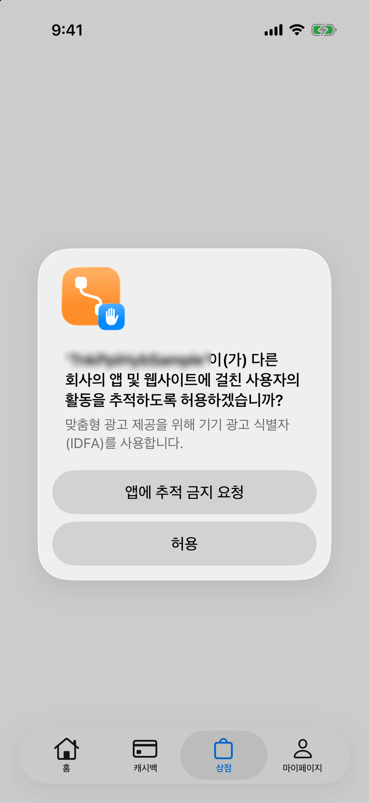

# 2. Info.plist 설정

이 페이지에서 하는 일: SDK 가 쓰는 권한 안내 문구(추적 허용·사진·카메라)와 앱 ID(선택), 딥링크(선택)를 `Info.plist` 에 넣습니다.

---

## 언제 필요한가

iOS 앱에 SDK 를 붙이는 모든 개발사에게 필요합니다.
추적 허용(ATT)·사진·카메라 문구는 **필수**이고, 앱 ID(`tnkad_app_id`)와 딥링크 설정은 **선택**입니다.

---

## 필요한 키

| 키 | 필수 | 이 문구가 쓰이는 때 | 문구가 없으면 |
|---|:-:|---|---|
| `NSUserTrackingUsageDescription` | ✅ | 코드에서 `requestTrackingAuthorization` 을 호출하면 iOS 가 띄우는 **추적 허용(ATT) 팝업** | 추적 허용(ATT) 팝업이 뜨지 않거나, 요청하는 순간 앱이 종료될 수 있습니다. 팝업이 뜨지 않으면 광고 식별자(IDFA)를 사용할 수 없습니다 |
| `NSPhotoLibraryUsageDescription` | ✅ | 오퍼월의 **문의하기**에서 캡처 이미지를 첨부하려고 사진 보관함을 열 때 | 공개 샘플 앱처럼 항상 넣어 두세요 |
| `NSCameraUsageDescription` | ✅ | 같은 첨부 화면에서 **카메라로 촬영**을 선택할 때 | 그 순간 앱이 종료됩니다. iOS 는 사용 목적 문구 없이 카메라에 접근하는 앱을 종료시킵니다 |
| `NSMicrophoneUsageDescription` | 선택 | 현재 오퍼월 화면은 마이크를 사용하지 않습니다. 공개 샘플 앱에는 이 문구가 들어 있습니다 | — |
| `tnkad_app_id` | 선택 | 개발사 앱 ID. 코드로 `configure(appId:)` 를 호출하면 생략할 수 있습니다 | 아래 '앱 ID' 를 보세요 |

문의하기는 오퍼월의 **문의/내역** 화면에서 **문의하기** 탭으로 들어갑니다. 첨부할 수 있는 파일은 JPEG·PNG 이미지입니다.
광고 참여 중 열리는 웹 페이지가 사진 첨부를 요구하는 경우에도 같은 문구가 쓰일 수 있습니다.

<figure><figcaption><p>앱이 추적 허용을 요청하면 iOS 가 이 팝업을 보여 줍니다. 회색 안내 문구는 Info.plist 의 NSUserTrackingUsageDescription 값이고, 앱 이름은 앱마다 다릅니다.</p></figcaption></figure>

> ⚠️ 사용자가 추적을 허용하지 않으면 IDFA 가 0 으로만 채워져 전달됩니다. 오퍼월은 그대로 열리지만 참여할 수 있는 광고가 줄어들 수 있습니다.

---

## 작성 예시

```xml
<key>NSUserTrackingUsageDescription</key>
<string>맞춤형 광고 제공을 위해 기기 광고 식별자(IDFA)를 사용합니다.</string>

<key>NSPhotoLibraryUsageDescription</key>
<string>문의하기에 캡처 이미지를 첨부하기 위해 사진 보관함을 사용합니다.</string>

<key>NSCameraUsageDescription</key>
<string>문의하기에 첨부할 사진을 촬영하기 위해 카메라를 사용합니다.</string>

<key>tnkad_app_id</key>
<string>발급받은-앱-아이디</string>
```

권한 문구는 **심사 반려 사유가 되기 쉬운 항목**입니다. "왜 필요한지"가 드러나게 쓰세요.

---

## 앱 ID — Info.plist 와 코드

앱 ID 는 두 가지 방법 중 하나로 넣습니다.

| 방법 | 코드 |
|---|---|
| Info.plist | `tnkad_app_id` 키 |
| 코드 | `TnkPpiHybSdk.shared.configure(appId: "발급받은-앱-아이디")` |

값에 하이픈(`-`)이 들어 있어도 SDK 가 처리합니다. 한 번 정해진 앱 ID 는 앱이 실행되는 동안 바뀌지 않습니다.
두 방법을 함께 쓰면 **호출 순서**에 따라 적용되는 값이 달라집니다.

| 상황 | 적용되는 앱 ID |
|---|---|
| `configure(appId:)` 를 다른 SDK 함수보다 먼저 호출 | 코드로 넘긴 값 (Info.plist 값보다 우선) |
| Info.plist 에 `tnkad_app_id` 가 있고, `setUserName`·`openOfferwall` 같은 SDK 함수를 먼저 호출한 뒤 `configure(appId:)` 호출 | Info.plist 의 값. 나중에 넘긴 값은 무시됩니다 |
| Info.plist 에 `tnkad_app_id` 가 없음 | `configure(appId:)` 로 넘긴 값 |
| Info.plist 에도 없고 `configure(appId:)` 도 호출하지 않음 | 앱 ID 없음 — 오퍼월이 정상적으로 열리지 않을 수 있습니다 |

> 💡 Info.plist 와 코드를 함께 쓰는 경우, `configure(appId:)` 를 앱 시작 시 **가장 먼저** 호출하세요.
> 적용된 값은 SDK 가 초기화된 뒤에 `TnkPpiHybSdk.shared.getAppId()` 로 확인할 수 있습니다(하이픈이 빠진 형태).
> `configure(appId:)` 를 호출하지 않고 Info.plist 만 쓴다면, `setUserName` 이나 `openOfferwall` 같은 SDK 함수를 처음 호출한 뒤부터 값이 나옵니다.

---

## 딥링크를 쓰는 경우

`tnkscheme://` 링크를 앱 밖(웹 페이지 등)에서 받을 때만 필요합니다. 자세한 내용은 [6. 딥링크](deeplink.md)를 참고하세요.

```xml
<key>CFBundleURLTypes</key>
<array>
  <dict>
    <key>CFBundleURLName</key>
    <string>com.example.app.tnk</string>
    <key>CFBundleURLSchemes</key>
    <array><string>tnkscheme</string></array>
  </dict>
</array>
```

> 💡 앱 안(푸시·배너 등)에서 SDK 로 직접 넘길 때는 `handleScheme` 에 문자열을 그대로 전달하면 되므로 위 설정이 필요 없습니다. 다만 앱이 시작되거나 백그라운드에서 돌아오는 시점에 부를 때는 `from:` 으로 오퍼월을 띄울 화면을 함께 넘기세요 ([6. 딥링크](deeplink.md)).
> `tnkscheme` 는 TNK 오퍼월을 붙인 앱이 함께 쓰는 이름입니다. 같은 스킴을 등록한 앱이 한 기기에 여러 개 있으면 iOS 는 어느 앱이 열릴지 보장하지 않습니다.

---

다음: [3. 초기화](initialize.md)
