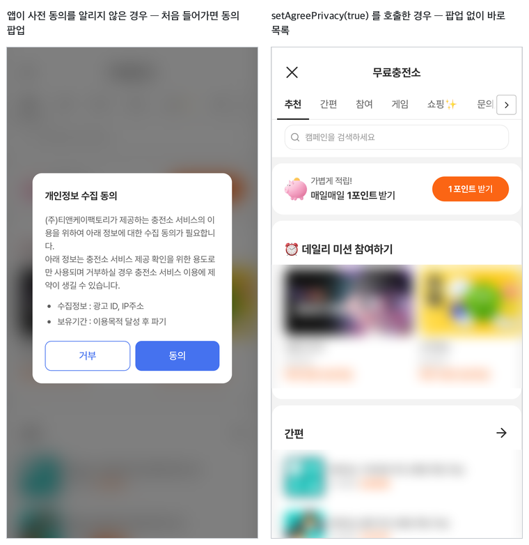
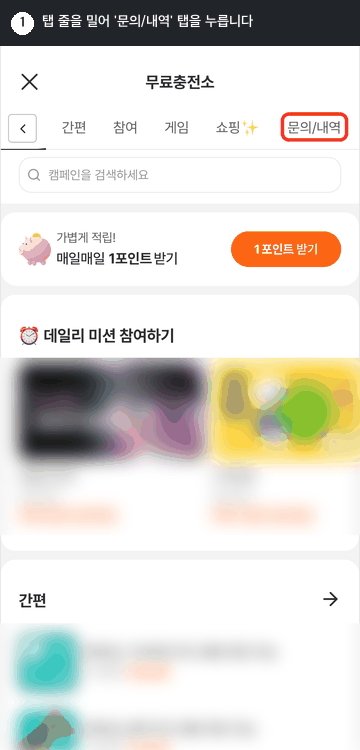
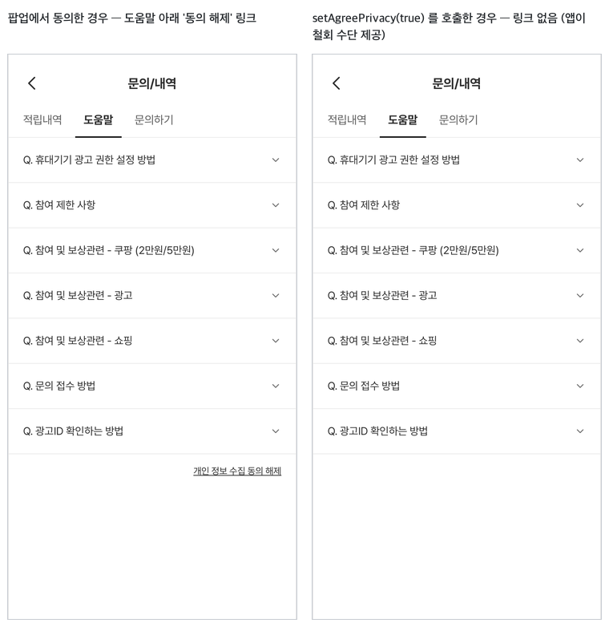
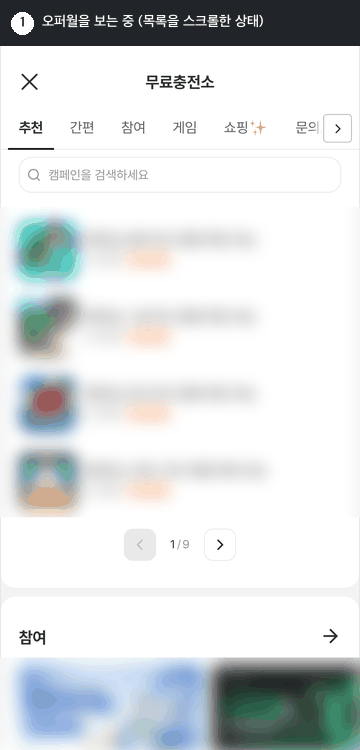

# 7. 개인정보 설정

이 페이지에서 하는 일: 오퍼월의 **개인정보 수집 동의**가 사용자에게 어떻게 보이는지 알아보고, 앱에서 동의를 직접 받는 경우 그 결과를 SDK 에 알립니다. COPPA · GDPR 값도 여기서 설정합니다.

```swift
let sdk = TnkPpiHybSdk.shared
```

---

## 언제 필요한가

모두 **선택 사항**입니다. 필요한 항목만 사용하세요.

- 앱에서 동의를 따로 받지 않는다면 아무것도 호출하지 않아도 됩니다. 오퍼월이 동의 팝업으로 직접 받습니다.
- 가입 약관 등에서 이미 동의를 받았다면 SDK 에 알려 오퍼월의 동의 팝업을 건너뛸 수 있습니다.
- 만 13세 미만(COPPA)이나 GDPR 대상 사용자가 있는 앱은 해당 값을 설정합니다.

이 페이지는 iOS SDK 1.0.5 이상 기준입니다. 이전 버전과 다른 점은 페이지 끝의 '이전 버전에서는' 을 참고하세요.

---

## 우리 앱은 어떤 경우인가

| | 우리 앱의 경우 | 앱에서 호출할 것 | 사용자가 보는 것 |
|:-:|---|---|---|
| **A** | 앱이 동의를 직접 받지 않는다 | 없음 (`setUserName` 만 평소대로) | 오퍼월에 처음 들어가면 **개인정보 수집 동의 팝업**이 나옵니다. [동의] 하면 광고 목록이 보이고, 그 뒤로는 팝업이 나오지 않습니다. 동의한 사용자에게는 오퍼월 도움말에 **'개인 정보 수집 동의 해제'** 메뉴가 보입니다 |
| **B** | 앱이 동의를 직접 받는다 | `setUserName` 다음에 `setAgreePrivacy(true)`. 철회 버튼은 앱이 제공 | 동의 팝업 없이 바로 광고 목록이 보입니다. 도움말에 '개인 정보 수집 동의 해제' 메뉴가 **보이지 않습니다** |
| **C** | 사용자가 앱에서 동의를 철회한다 | 앱의 철회 버튼에서 `revokePrivacyConsent()` | 열려 있던 오퍼월이 첫 화면부터 다시 열리며 **동의 팝업**이 나옵니다. 이후 오퍼월에 들어갈 때도 팝업부터 시작합니다 |

### A. 앱이 동의를 직접 받지 않는 경우

아무것도 호출하지 않아도 됩니다. 사용자가 오퍼월에 처음 들어가면 동의 팝업이 나옵니다.

- **[동의]** 를 누르면 광고 목록이 보이고, 이후에는 팝업이 나오지 않습니다. `isAgreePrivacy()` 가 `true` 가 됩니다.
- **[거부]** 를 누르면 "개인정보 수집 동의를 하면 캠페인을 참여하고 리워드를 받을 수 있습니다" 안내 화면이 나옵니다. 전체 화면으로 연 오퍼월에서는 왼쪽 위 **X** 를 누르면 오퍼월이 닫히고, 다음에 들어가면 팝업이 다시 나옵니다.

> 💡 앱 화면 안에 넣은 오퍼월에서는 X 를 눌렀을 때 `onCloseRequested` 에 등록한 동작이 실행됩니다. 등록하지 않으면 아무 일도 일어나지 않습니다. 자세한 내용은 [4. 오퍼월 띄우기](offerwall.md) 의 '닫기 요청 처리' 항목을 참고하세요.

> ⚠️ 탭 안에 넣은 오퍼월은 [거부] 뒤 X 를 눌러도 거부 안내 화면이 그대로 남아, 앱을 다시 시작하기 전까지 다시 동의할 방법이 없습니다. 앱 화면 안에 넣은 오퍼월은 다시 불러와야 동의 팝업이 다시 나옵니다. 탭을 떠났다가 돌아왔을 때(`viewWillAppear`) `isAgreePrivacy()` 가 `false` 이면 `buildOfferwallURL()` 로 주소를 다시 만들어 `loadOfferwall(_:)` 을 호출하세요. 처음 표시될 때는 `viewDidLoad` 에서 이미 불러왔으므로 건너뜁니다 — [4. 오퍼월 띄우기](offerwall.md)의 '탭에 넣을 때 주의' 항목

```swift
// 오퍼월(TnkOfferwallView)을 탭에 넣은 화면 안에 둡니다. offerwall 은 그 화면의 TnkOfferwallView 입니다.
private var isFirstAppearance = true   // 첫 표시는 viewDidLoad 에서 이미 불러왔으므로 건너뜁니다

override func viewWillAppear(_ animated: Bool) {
    super.viewWillAppear(animated)
    if isFirstAppearance {
        isFirstAppearance = false
        return
    }
    // 탭을 떠났다가 돌아왔을 때, 동의하지 않은 상태이면 동의 팝업이 다시 나오도록 새로 불러옵니다.
    if !TnkPpiHybSdk.shared.isAgreePrivacy(),
       let url = TnkPpiHybSdk.shared.buildOfferwallURL() {
        offerwall.loadOfferwall(url)
    }
}
```

<figure><figcaption><p>왼쪽은 앱이 사전 동의를 알리지 않은 경우의 첫 화면(동의 팝업)입니다. 오른쪽은 아래 B 처럼 setAgreePrivacy(true) 를 호출한 경우로, 팝업 없이 바로 목록이 보입니다. 오퍼월 화면은 Android·iOS 가 같습니다.</p></figcaption></figure>

<figure><figcaption><p>[거부] 를 누르면 목록 대신 이 안내가 나옵니다. 닫기(X)를 누르면 오퍼월이 닫힙니다.</p></figcaption></figure>

동의한 사용자는 오퍼월 안에서 직접 동의를 해제할 수 있습니다. SDK 호출은 필요 없습니다.

1. 오퍼월 위쪽 탭 줄의 맨 끝에 있는 **문의/내역** 을 누릅니다. 탭 줄을 왼쪽으로 밀거나 탭 줄 끝의 `>` 버튼을 누르면 '문의/내역' 탭이 보입니다. 문의/내역이 보이지 않는 화면에서는 오른쪽 아래의 문의 버튼을 누릅니다.
2. **도움말** 탭을 선택하고 맨 아래로 내려갑니다.
3. 오른쪽 아래의 **'개인 정보 수집 동의 해제'** 를 누르면 동의 팝업이 다시 나옵니다.
4. [동의] 를 누르면 "개인정보 수집에 동의되었습니다." 안내와 함께 그대로 이용합니다. [거부] 를 누르면 동의가 해제되고 안내 화면이 나옵니다.

<figure><figcaption><p>사용자가 오퍼월 안에서 직접 동의를 해제하는 전체 순서입니다.</p></figcaption></figure>

### B. 앱이 동의를 직접 받는 경우

가입 약관 등 앱의 화면에서 사용자에게 TNK 오퍼월 이용에 필요한 개인정보 수집 동의를 직접 받은 경우에만 `setAgreePrivacy(true)` 를 호출하세요. 동의를 받지 않은 사용자에게는 호출하지 마세요.

```swift
// 앱 시작 시, 로그인한 사용자가 정해진 뒤에 호출합니다.
sdk.setUserName("개발사-사용자-식별값")   // 1) 사용자 식별값을 먼저
if myDefaults.agreedInApp && !myDefaults.consentRevoked {   // 앱에서 동의를 받았고 철회하지 않은 사용자만 (직접 구현)
    sdk.setAgreePrivacy(true)            // 2) 그 다음 동의 상태
}
```

이렇게 하면 오퍼월에 동의 팝업과 '개인 정보 수집 동의 해제' 메뉴가 나오지 않습니다. 동의 내용 안내와 **철회 수단 제공은 앱이 맡습니다.** 철회 방법은 아래 'C' 를 참고하세요.

<figure><figcaption><p>도움말 아래 '개인 정보 수집 동의 해제' 링크는 앱이 setAgreePrivacy(true) 로 동의를 알린 경우 보이지 않습니다. 이때 철회 수단은 앱이 제공해야 합니다.</p></figcaption></figure>

**동의를 직접 받을 때 포함할 내용** — 오퍼월 동의 팝업에는 아래 내용이 표시됩니다. 앱에서 받는 동의에도 최소한 같은 내용을 포함해 주세요.

| 항목 | 팝업 표시 내용 |
|---|---|
| 수집 주체 | (주)티앤케이팩토리 |
| 수집 정보 | 광고 ID, IP 주소 |
| 이용 목적 | 충전소(오퍼월) 서비스 제공 확인 |
| 보유 기간 | 이용 목적 달성 후 파기 |

> ⚠️ 이 표는 오퍼월 팝업에 표시되는 최소 항목입니다. 앱의 개인정보 처리방침에는 SDK 가 사용하는 정보 전체를 반영해 주세요 — [1. 설치](install.md)의 'App Store 제출 때 — 개인정보 항목'

> 💡 위 내용은 현재 팝업 화면 기준이며 바뀔 수 있습니다. 문구 확정이 필요하면 담당자에게 문의해 주세요.

> ⚠️ 철회한 사용자에게는 `true` 로 다시 설정하지 마세요. 위 코드처럼 앱에서 철회 여부를 기억해 두고, 철회한 사용자는 건너뛰어야 합니다. 앱 시작 때마다 `true` 로 설정하면 철회가 취소됩니다.

> 💡 ATT 동의(`requestTrackingAuthorization`)와는 별개입니다. ATT 는 광고 ID(IDFA) 사용에 대한 애플의 동의 절차이고, 이 페이지의 동의는 오퍼월 서비스 이용에 대한 동의입니다.

### C. 사용자가 앱에서 동의를 철회하는 경우

앱의 "동의 철회" 버튼 처리 안에서 `revokePrivacyConsent` 를 호출하세요.

```swift
// 앱의 "동의 철회" 버튼 처리 안에서
sdk.revokePrivacyConsent()
myDefaults.consentRevoked = true      // 앱이 철회 여부를 기억합니다 (직접 구현)
```

호출하면 열려 있던 오퍼월이 첫 화면부터 다시 열리며 동의 팝업이 나옵니다. 사용자가 팝업에서 다시 동의하면 오퍼월을 계속 이용할 수 있습니다.

사용자가 앱에서 다시 동의하면 `consentRevoked` 를 `false` 로 되돌리고 `setAgreePrivacy(true)` 를 호출합니다.

`consentRevoked` 와 `agreedInApp` 같은 기억 장치는 B(앱에서 `setAgreePrivacy(true)` 를 호출하는 앱)에만 필요합니다. A 앱은 오퍼월 안에 이미 동의 해제 메뉴가 있어 앱 화면의 철회 버튼이 필수는 아닙니다. 그래도 A 앱이 앱 화면에 '동의 철회' 버튼을 두려면 `revokePrivacyConsent()` 만 호출하면 되고, 철회 여부를 따로 기억할 필요는 없습니다.

<figure><figcaption><p>오퍼월이 열려 있을 때 앱이 revokePrivacyConsent 를 호출하면, 오퍼월은 첫 화면부터 다시 열리며 동의 팝업이 먼저 나옵니다(가운데 장면은 설명을 위한 그림).</p></figcaption></figure>

---

## 값별 동작

### `setAgreePrivacy`

| 호출 | 사용자가 오퍼월을 열면 | 도움말의 '동의 해제' 메뉴 | `isAgreePrivacy()` |
|---|---|---|---|
| `setAgreePrivacy(true)` | 동의 팝업 없이 바로 광고 목록이 보입니다 | 보이지 않음 | `true` |
| `setAgreePrivacy(false)` | 다음에 열 때 동의 팝업이 나옵니다 | 사용자가 팝업에서 [동의] 한 뒤부터 보임 | `false` (사용자가 팝업에서 동의하면 `true`) |
| 호출하지 않음 | 처음 열 때 동의 팝업이 나옵니다. [동의] 하면 광고 목록이 보이고 그 뒤로는 팝업이 없습니다. [거부] 하면 안내 화면이 나오고 다음에 열 때 팝업이 다시 나옵니다 | 사용자가 [동의] 한 뒤부터 보임 | 처음에는 `false`. [동의] 하면 `true`, [거부] 하면 `false` |

> ⚠️ `setAgreePrivacy` 는 이미 열려 있는 오퍼월에는 반영되지 않고, **다음에 오퍼월을 열 때부터** 적용됩니다. 열려 있는 화면에도 바로 반영해야 하는 철회는 `revokePrivacyConsent` 를 사용하세요.

현재 동의 여부는 `isAgreePrivacy` 로 읽습니다.

```swift
let agreed = sdk.isAgreePrivacy()   // Bool
```

사용자가 오퍼월에서 동의하거나 거부해도 SDK 가 따로 알려 주지는 않습니다. 오퍼월을 닫고 앱 화면으로 돌아왔을 때(`viewWillAppear` 등) 읽어서 확인하세요.

### 동의 철회 (`revokePrivacyConsent`)

iOS SDK 1.0.5 이상입니다. 파라미터도 반환값도 없고, 별도 화면을 띄우지 않습니다. 호출하기 전의 동의 상태와 관계없이 아래처럼 동작합니다.

| 시점 | 사용자가 보는 것 | `isAgreePrivacy()` |
|---|---|---|
| 호출 직후, 오퍼월이 열려 있을 때 | 오퍼월이 **첫 화면부터 다시 열리고 동의 팝업**이 나옵니다. 보던 위치(스크롤·상세 화면 등)는 초기화되고, 뒤로 가기(스와이프 포함)로 철회 전 화면에 돌아갈 수 없습니다. 특정 광고로 바로 진입해 있었어도 첫 화면으로 돌아갑니다 | `false` |
| 호출 직후, 오퍼월이 닫혀 있을 때 | 화면 변화 없음 | `false` |
| 그 뒤 오퍼월에 들어갈 때 | 동의 팝업부터 시작합니다. 동의하면 이용하고, 거부하면 안내 화면이 나옵니다 | 동의하면 `true` |

`openOfferwall`, 특정 광고 진입(`adDetail` 등), `TnkOfferwallView` 로 연 오퍼월에 모두 즉시 반영됩니다. `buildOfferwallURL` 로 만든 주소를 `TnkOfferwallView.loadOfferwall(_:)` 나 `TnkOfferwall.show` 에 넘겨 연 화면도 같습니다.

> ⚠️ **사용자의 철회 동작에서만 호출하세요.** 화면 표시(`viewDidAppear`)나 앱 활성화(`sceneDidBecomeActive` 등)에서 부르면 오퍼월이 그때마다 첫 화면으로 돌아갑니다. 메인 스레드에서 호출하는 것을 권장합니다.

> ⚠️ **철회한 사용자에게 `setAgreePrivacy(true)` 를 다시 호출하면 철회가 취소됩니다.** 사용자가 앱에서 다시 동의했을 때만 호출하세요.

> 💡 동의 상태는 서버가 아닌 이 기기에만 보관합니다. 다른 기기나 앱을 다시 설치한 뒤에는 이어진다고 보장되지 않으며, 보관 기간은 SDK 가 관리하지 않습니다.

> 💡 **테스트할 때** 동의 팝업을 처음 상태로 다시 보려면 앱을 삭제한 뒤 다시 설치하세요.

### `setUserName` 과 동의 상태

사용자 식별값이 바뀌면 동의 상태가 초기화됩니다. 그래서 항상 **`setUserName` → `setAgreePrivacy`** 순서로 호출해야 합니다. `setAgreePrivacy(true)` 를 먼저 호출한 뒤 `setUserName` 으로 다른(또는 처음) 사용자를 지정하면 동의 상태가 지워집니다.

| `setUserName` 호출 | 동의 상태 | 사용자가 보는 것 |
|---|---|---|
| 이전과 **같은** 식별값 | 그대로 유지 | 변화 없음 |
| 이전과 **다른** 식별값 (계정 전환) | 초기화 (`isAgreePrivacy()` 가 `false`) | 다음에 오퍼월을 열 때 동의 팝업이 나옵니다. 이어서 `setAgreePrivacy(true)` 를 호출했다면 팝업 없이 열립니다 |
| **처음** 호출 (저장된 식별값 없음) | 초기화 | 위와 같음 |

**기존 네이티브 SDK(`TnkRwdSdk2`)에서 받은 동의**는 사용자 식별값이 같을 때만 이어집니다(iOS SDK 1.0.5 이상).

| 하이브리드 SDK 의 `setUserName` 에 넘긴 값 | 기존 동의 | 사용자가 보는 것 |
|---|---|---|
| 기존 SDK 에서 쓰던 **같은 사용자 식별값** | 유지 | 동의 팝업이 다시 나오지 않습니다 |
| 다른 식별값, 또는 기존 SDK 에서 식별값을 지정하지 않았던 경우 | 첫 `setUserName` 에서 초기화 | 다음에 오퍼월에 들어갈 때 동의 팝업이 나옵니다 |

하이브리드 SDK 에 이미 저장된 동의 상태가 있는 기기에서는 그 값을 그대로 쓰고, 기존 SDK 의 동의를 다시 가져오지 않습니다.

> ⚠️ 기존 SDK 에서 앱이 직접 동의를 받아 `setAgreePrivacyPolicy` 를 썼다면, 하이브리드 SDK 에서도 `setUserName` 다음에 `setAgreePrivacy(true)` 를 호출하세요. 호출하지 않으면 동의는 유지되지만 오퍼월에 '개인 정보 수집 동의 해제' 메뉴가 나타납니다.

---

## COPPA (만 13세 미만)

```swift
sdk.setCOPPA(1)   // 1 = 만 13세 미만
```

Android 는 `Boolean` 을 받지만 **iOS 는 `Int`** 입니다. 크로스 플랫폼으로 코드를 옮길 때 주의하세요.

| 호출 | 의미 |
|---|---|
| `setCOPPA(1)` | 이 사용자를 만 13세 미만으로 표시합니다 |
| `setCOPPA(0)` | 해당하지 않습니다. 앞에서 `1` 로 설정했다면 해제됩니다 |
| 호출하지 않음 | `0` 과 같습니다 (기본값) |

`1` 과 `0` 만 사용하세요. 설정한 값은 앱에 저장되어 계속 유지되며, **다음에 여는 오퍼월부터** 적용됩니다. 이미 열려 있는 오퍼월에는 반영되지 않습니다. 같은 기기에서 계정이 바뀌어도 값이 남아 있으므로, 계정을 바꾸는 앱은 그때마다 `0` 또는 `1` 로 다시 설정하세요.

---

## GDPR

```swift
sdk.setGDPR(1)    // 1 = 동의함
```

| 값 | 의미 |
|---|---|
| `1` | 동의함. 기존 네이티브 SDK 의 `setGDPRConsent(true)` 와 같은 값입니다 |
| `0` | 동의하지 않음. 기존 `setGDPRConsent(false)` 와 같은 값입니다 |
| `-1` | 지정하지 않음 |
| 호출하지 않음 | iOS 는 `0` 으로 처리됩니다 |

설정한 값은 앱에 저장되어 계속 유지되며, **다음에 여는 오퍼월부터** 적용됩니다. 계정을 바꾸는 앱은 그때마다 다시 설정하세요.

> ⚠️ 호출하지 않았을 때의 기본값이 iOS 는 `0`, Android 는 `-1`(지정하지 않음)로 서로 다릅니다. GDPR 대상 사용자가 있는 앱은 두 플랫폼 모두에서 값을 직접 지정하세요.

---

## 이전 버전에서는

위 내용은 최신 버전 기준입니다. 이전 버전에서는 다음이 다르며, 각 줄은 그 버전 이하에 모두 해당합니다.

| iOS SDK | 달라지는 점 |
|---|---|
| 1.0.4 이하 | `revokePrivacyConsent` 가 없습니다. 철회는 `setAgreePrivacy(false)` 로 저장만 하며, 열려 있는 오퍼월에는 반영되지 않습니다. 기존 네이티브 SDK 에서 받은 동의도 이어받지 못합니다 |
| 1.0.2 이하 | SDK 에 저장된 동의를 기준으로 팝업 여부를 정하는 동작이 1.0.3 부터라서, `setAgreePrivacy(false)` 와 이전에 저장된 동의의 화면 표시가 위 표와 다를 수 있습니다 |
| 1.0.1 이하 | 오퍼월에서 한 동의·거부가 `isAgreePrivacy` 에 반영되지 않고, `setUserName` 값이 바뀌어도 동의 상태가 초기화되지 않습니다 |

가능하면 최신 버전을 사용하세요.

---

다음: [8. 특정 광고 진입](ad-entry.md)
