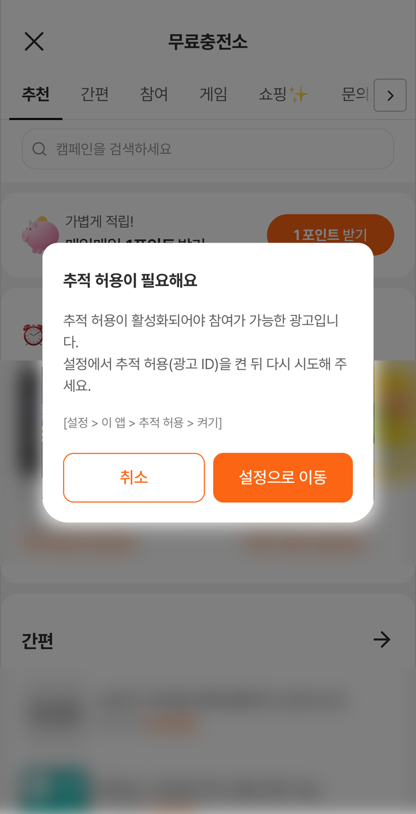

# 문제 해결

연동 중 자주 겪는 증상을 **증상 → 원인 → 해결** 순서로 정리했습니다.
해결되지 않으면 맨 아래의 문의처로 연락해 주세요.

---

## 먼저 로그를 켜세요

```swift
#if DEBUG
TnkPpiHybSdk.shared.enableLogging(true)   // 개발 빌드에서만 켭니다
#endif
```

| 설정 | 보이는 것 |
|---|---|
| `enableLogging(true)` | Xcode 콘솔에 `[TnkPpiHyb]` 로 시작하는 SDK 로그가 나옵니다. 오류는 `[TnkPpiHyb][ERROR]` 로 시작합니다 |
| `enableLogging(false)` 또는 호출하지 않음 | SDK 로그가 나오지 않습니다 (기본값) |

> ⚠️ 출시 빌드에서는 끄세요. 로그에 사용자 정보가 담긴 값이 포함될 수 있습니다.

iOS 는 오퍼월 화면 쪽 로그까지 모두 `enableLogging(true)` 일 때만 나옵니다. 아래 안내의 콘솔 문구도 이 설정을 켠 상태에서 보입니다.

초기화 직후 아래를 찍어 보면 대부분의 설정 문제가 바로 드러납니다.

```swift
#if DEBUG
let sdk = TnkPpiHybSdk.shared
print("version=\(TnkPpiHybSdk.version)",
      "initialized=\(sdk.isInitialized)",
      "appId=\(sdk.getAppId() ?? "nil")",
      "userName=\(sdk.getUserName() ?? "nil")")
#endif
```

확인이 끝나면 이 코드는 지우세요. 출시 빌드에서 사용자 식별값을 로그로 남기지 마세요.

> 💡 `getAppId()` 와 `isInitialized` 는 값을 읽기만 하고 초기화하지 않습니다. `Info.plist` 의 `tnkad_app_id` 만 쓰고 `configure(appId:)` 를 부르지 않았다면, `setUserName(_:)` 이나 `openOfferwall` 같은 다른 SDK 호출 뒤에 찍어 보세요. 그 전에는 `nil` · `false` 로 나올 수 있으며 정상입니다.

---

## 시뮬레이터에서 테스트하고 있습니다

iOS 시뮬레이터에서도 오퍼월 화면을 확인할 수 있습니다.
광고 참여·적립 확인은 실기기에서 하는 것을 권장합니다.

> 💡 Android 는 에뮬레이터·가상 기기에서 오퍼월이 열리지 않습니다 — [지원 범위](../common/support-matrix.md)의 '플랫폼별 차이'

---

## 빌드 · 설치

### `No such module 'TnkPpiHyb'`

- **증상**: `import TnkPpiHyb` 에서 빌드가 중단됩니다.
- **원인 · 해결**:
  - CocoaPods: `.xcodeproj` 가 아니라 **`.xcworkspace`** 로 여셨는지 확인하세요.
  - SPM: File → Packages → Reset Package Caches 후 다시 받아 보세요.

### 배포 타깃 오류

- **증상**: 앱의 배포 타깃(Minimum Deployments) 때문에 빌드가 중단됩니다.
- **원인**: SDK 는 **iOS 15.0** 이상입니다. 앱의 최소 지원 버전이 이보다 낮습니다.
- **해결**: 앱의 Minimum Deployments 를 15.0 이상으로 올리세요 — [1. 설치](install.md)

### 시뮬레이터에서 링크 실패

- **증상**: 시뮬레이터용으로 빌드할 때 링크 단계에서 실패합니다.
- **원인**: 배포된 xcframework 는 실기기 `arm64` 와 시뮬레이터 `arm64`·`x86_64` 를 모두 포함합니다. 이전 빌드 결과가 남아 있거나 앱 타깃의 아키텍처 설정이 원인일 수 있습니다.
- **해결**: Derived Data 를 지우고 다시 빌드해 보세요. 그래도 같으면 담당자에게 문의해 주세요.

### `'initInstance(appId:)' is unavailable: …` 같은 빌드 오류가 납니다

- **증상**: 기존 네이티브 SDK 에서 옮긴 뒤 `is unavailable` 또는 `has been renamed to` 가 들어간 빌드 오류가 납니다.
- **원인**: 기존 네이티브 SDK(`TnkRwdSdk2`)에서 쓰던 이름을 그대로 쓴 곳입니다. 이름이 바뀐 API 는 새 이름을 알려 주는 오류로 표시됩니다.
- **해결**: 오류 메시지가 알려 주는 새 이름으로 바꾸세요. `has been renamed to` 오류는 Xcode 의 Fix 버튼으로 바로 바꿀 수 있습니다. 전체 대조표는 [네이티브 SDK 에서 이관](migration.md)을 참고하세요.

> 하이브리드 SDK 에서 제공하지 않는 API(포인트 조회 등)는 대부분 새 이름을 알려 주지 않고 일반적인 컴파일 오류로 나옵니다. 이관 문서의 대조표에서 '제거' 또는 '현재 미제공(문의)' 로 표시된 항목입니다.

---

## ATT 팝업이 뜨지 않습니다

> `requestTrackingAuthorization` 은 앱이 활성 상태가 될 때까지 기다렸다가 팝업을 띄웁니다. 호출 시점 때문에 팝업이 빠지지는 않습니다. 권장 호출 위치는 `sceneDidBecomeActive` 에서 한 번입니다 — [3. 초기화](initialize.md)

### 기기 설정에서 추적 요청이 꺼져 있습니다

- **증상**: 팝업이 뜨지 않고 `requestTrackingAuthorization` 의 completion 에 바로 `false` 가 옵니다.
- **원인**: 설정 → 개인정보 보호 및 보안(iOS 15 는 개인정보 보호) → 추적에서 '앱이 추적을 요청하도록 허용'이 꺼져 있으면, 팝업 없이 바로 거부로 처리됩니다.
- **해결**: 테스트 기기에서 '앱이 추적을 요청하도록 허용'을 켜 주세요. 사용자의 기기 설정은 앱이 바꿀 수 없습니다.

### 이미 한 번 응답했습니다

- **증상**: 팝업이 뜨지 않고 이전에 고른 결과가 그대로 전달됩니다.
- **원인**: ATT 팝업은 앱에서 한 번만 뜹니다. 허용이나 거부로 응답한 뒤에는 다시 뜨지 않습니다.
- **해결**: 다시 확인하려면 앱을 삭제한 뒤 다시 설치해 보세요. 설정 → 개인정보 보호 및 보안 → 추적에서 이 앱의 상태를 바꿀 수도 있습니다.

### `NSUserTrackingUsageDescription` 이 없습니다

- **증상**: ATT 팝업이 뜨지 않거나, `requestTrackingAuthorization` 을 부르는 순간 앱이 종료됩니다.
- **원인**: 이 문구가 없으면 추적 허용(ATT) 팝업이 뜨지 않거나, 요청하는 순간 앱이 종료될 수 있습니다.
- **해결**: [2. Info.plist 설정](plist.md)을 확인하고 키를 추가하세요.

---

## 오퍼월이 비어 있거나 뜨지 않습니다

### 앱 ID 가 적용되지 않았습니다

```swift
print(TnkPpiHybSdk.shared.getAppId() ?? "nil")
```

- **증상**: 값이 `nil` 이거나, 코드로 넣은 앱 ID 와 다른 값입니다.
- **원인 1** (`nil`): `configure(appId:)` 를 호출하지 않았고 `Info.plist` 에도 `tnkad_app_id` 가 없습니다.
- **원인 2** (`nil`): `Info.plist` 값만 쓰는 경우, `setUserName(_:)` 같은 다른 SDK 호출 전에는 아직 `nil` 입니다.
- **원인 3** (코드로 넣은 값과 다름): `Info.plist` 에 `tnkad_app_id` 가 있는데 `configure(appId:)` 를 다른 SDK 호출보다 늦게 불렀습니다. 먼저 불린 호출이 `Info.plist` 값으로 초기화를 마치면 그 뒤의 `configure` 는 적용되지 않고, `getAppId()` 는 `Info.plist` 의 값을 돌려줍니다.
- **해결**: 앱 ID 는 한 곳에서만 정하세요. 코드로 넣는다면 `configure(appId:)` 를 앱 시작 때 **가장 먼저** 호출합니다.

### 사용자 식별값이 없습니다

- **증상**: `getUserName()` 이 `nil` 입니다.
- **원인**: `setUserName(_:)` 을 호출하지 않았습니다. 사용자 식별값은 보상 지급의 기준값입니다.
- **해결**: 오퍼월을 열기 전에 `setUserName("개발사-사용자-식별값")` 을 호출하세요.

### 번들 ID 가 등록한 값과 다릅니다

- **증상**: 앱 ID 와 사용자 식별값은 맞게 넣었는데, 테스트용으로 접미사를 붙인 번들 ID 처럼 번들 ID 가 다른 빌드에서만 오퍼월이 정상적으로 표시되지 않을 수 있습니다.
- **원인**: TNK 는 **번들 ID 로 앱을 식별**합니다. 퍼블리셔 페이지에 등록한 값과 설치한 앱의 번들 ID 가 다르면 오퍼월이 정상적으로 표시되지 않을 수 있습니다.
- **해결**: 설치한 앱의 번들 ID 가 등록한 값과 같은지 확인하세요 — [APP ID 발급받기](../publisher/app-id.md). 번들 ID 가 다른 빌드로 확인해야 한다면 담당자에게 문의해 주세요.

### '네트워크 연결 오류' 팝업이 뜹니다

- **증상**: "네트워크 연결이 원활하지 않아 페이지를 불러올 수 없습니다" 라는 팝업이 뜹니다. `enableLogging(true)` 상태라면 콘솔에 `[TnkPpiHyb][ERROR] provisional navigation failed` 또는 `navigation failed` 가 남습니다.
- **원인**: 오퍼월 화면을 불러오지 못했습니다.
- **해결**: 먼저 기기의 인터넷 연결을 확인하세요. 회사 네트워크나 VPN 같은 특정 네트워크에서만 반복된다면 담당자에게 문의해 주세요.

| 버튼 | 전체 화면으로 연 오퍼월 | 화면 안에 삽입한 오퍼월 |
|---|---|---|
| [다시 시도] | 같은 화면을 다시 불러옵니다 | 같은 화면을 다시 불러옵니다 |
| [닫기] | 오퍼월이 닫힙니다 | `onCloseRequested` 에 등록한 동작이 실행됩니다. 등록하지 않았으면 아무 일도 일어나지 않고 빈 화면이 남습니다 |

> 삽입한 오퍼월에서 [닫기] 뒤에 오퍼월을 다시 보여 주려면 새 주소로 `loadOfferwall(_:)` 을 다시 호출하세요. 팝업이 뜬 뷰는 빈 화면으로 바뀐 상태입니다.

### 오퍼월 안에 '페이지를 표시할 수 없습니다' 화면이 보입니다

<figure><figcaption><p>네트워크 문제 등으로 내용을 불러오지 못하면 새로고침 버튼이 있는 안내 화면이 나올 수 있습니다(예시). 오퍼월 화면은 Android·iOS 가 같습니다.</p></figcaption></figure>

- **증상**: 오퍼월 화면 가운데에 "네트워크 장애나 알 수 없는 문제로 페이지를 표시할 수 없습니다" 문구와 [새로고침] 버튼이 보입니다. 앞의 '네트워크 연결 오류' 팝업과는 다른 화면입니다.
- **원인**: 네트워크 문제 등으로 오퍼월이 내용을 불러오지 못했습니다.
- **해결**: 기기의 인터넷 연결을 확인하고 [새로고침]을 눌러 보세요. 연결이 정상인데도 반복된다면 담당자에게 문의해 주세요.

### 특정 광고로 진입했더니 '존재하지 않거나 광고 중이 아닌 광고앱입니다' 안내가 뜹니다

<figure><figcaption><p>광고를 찾지 못했을 때 나오는 안내입니다. 번호가 맞아도 이 기기에서 조회할 수 없는 광고라면 같은 안내가 나올 수 있습니다.</p></figcaption></figure>

- **증상**: `adDetail` · `adJoin` · `adAction` 으로 오퍼월을 열었더니 위 안내가 뜹니다.
- **원인**: 넘긴 광고 번호(`appId`)의 광고가 없거나 지금 진행 중이 아닙니다. 번호가 맞아도 이 기기에서 조회할 수 없는 광고라면 같은 안내가 나올 수 있습니다.
- **해결**: 광고 번호와 `actionId` 를 확인하세요 — [8. 특정 광고 진입](ad-entry.md). 번호가 맞는데도 계속 나온다면 광고 번호와 함께 담당자에게 문의해 주세요.

---

## 참여 가능한 광고가 너무 적습니다

- **증상**: 오퍼월은 열리는데 참여할 수 있는 광고가 적습니다.
- **원인**: ATT 동의를 받지 못해 광고 식별자(IDFA)가 전달되지 않았을 수 있습니다. 오퍼월은 열리지만 참여할 수 있는 광고가 줄어들 수 있습니다.
- **해결**: `requestTrackingAuthorization` 호출 여부와 사용자의 실제 동의 여부를 확인하세요.

```swift
#if DEBUG
print(TnkPpiHybSdk.shared.getAdid())
#endif
```

확인이 끝나면 이 코드는 지우세요. 출시 빌드에서 광고 식별자를 로그로 남기지 마세요.

`getAdid()` 가 0 만 32자리(`00000000000000000000000000000000`)로 나오면 광고 식별자를 받지 못한 상태입니다(동의 전이거나 거부한 경우 등).

---

## 광고 참여 시 '추적 허용이 필요해요' 팝업이 뜹니다

<figure><figcaption><p>이 앱의 추적 허용이 꺼져 있을 때 추적 허용이 필요한 광고에 참여하면 보이는 안내입니다.</p></figcaption></figure>

- **증상**: 광고 참여 버튼을 눌렀더니 '추적 허용이 필요해요' 팝업이 뜨고 참여가 진행되지 않습니다.
- **원인**: 이 앱의 '추적 허용'이 켜져 있지 않습니다. 사용자가 거부했거나 아직 응답하지 않은 상태입니다. 광고 ID 가 필요한 광고는 이 상태에서 참여할 수 없으며, 연동 오류가 아닙니다.
- **해결**: 사용자가 [설정으로 이동]을 누르면 이 앱의 설정 화면이 열립니다. '추적 허용'을 켠 뒤 다시 참여하면 됩니다. [취소]를 누르면 참여 없이 팝업만 닫힙니다.

> 앱에서 ATT 를 한 번도 요청하지 않으면 설정의 추적 목록에 앱이 나타나지 않을 수 있습니다. `requestTrackingAuthorization` 을 미리 호출해 두세요 — [3. 초기화](initialize.md)

---

## 이미지 첨부 · 사진 촬영 중 문제가 생깁니다

- **증상**: 광고 참여 중 [사진 찍기]를 누르는 순간 앱이 종료되거나, 사진 첨부가 동작하지 않습니다.
- **원인**: `NSCameraUsageDescription`(사진 촬영) 문구가 `Info.plist` 에 없으면 [사진 찍기]를 누르는 순간 앱이 종료됩니다. `NSPhotoLibraryUsageDescription`(사진 첨부) 문구도 함께 넣어 두세요.
- **해결**: 두 문구를 모두 추가하세요 — [2. Info.plist 설정](plist.md)

---

## 보상이 지급되지 않습니다

- **증상**: 오퍼월에서 참여를 마쳤는데 사용자에게 포인트가 지급되지 않습니다.
- **원인**: `setRewardListener` 는 **화면 갱신용 알림**일 뿐이고, 실제 포인트 지급은 서버 콜백으로 이루어집니다. 아래를 순서대로 확인하세요.
  1. 퍼블리셔 페이지에 개발사 콜백 URL 이 등록되어 있는지
  2. 콜백 서버가 **HTTP 200** 을 응답하는지 (200 이 아니면 5분 · 1시간 간격으로 최대 24시간 재시도 후 폐기)
  3. `md_chk` 검증이 정식 규격과 맞는지
  4. `setUserName(_:)` 에 넣은 사용자 식별값과 콜백의 `md_user_nm` 이 일치하는지
- **해결**: 위 항목을 고친 뒤 다시 확인하세요. 자세한 내용은 [서버 보상 콜백 URL](../common/server-callback.md)을 참고하세요.

> ⚠️ 로그인 전 임시값으로 오퍼월에 진입했다가 나중에 `setUserName(_:)` 을 바꾸면
> 그 사이 발생한 보상은 임시값으로 지급되어 회수할 수 없습니다.
> 오퍼월 진입은 사용자 식별값이 확정된 뒤로 미루세요.

### 앱의 토스트·잔액 갱신이 오지 않습니다

- **증상**: 서버에서는 지급됐는데 앱 화면의 토스트나 잔액이 바뀌지 않습니다.
- **원인**: `setRewardListener` 를 등록하기 전에 도착한 알림은 전달되지 않습니다.
- **해결**: 오퍼월을 열기 전에 리스너를 등록하세요. 알림은 화면 갱신용이므로, 지급 여부는 서버 콜백으로 확인하세요.

---

## 삽입한 오퍼월(`TnkOfferwallView`)이 이상합니다

### 화면이 비어 있습니다

- **증상**: 앱 화면 안에 넣은 오퍼월 영역이 아무것도 없이 비어 있습니다.
- **원인 1**: `loadOfferwall(_:)` 을 호출하지 않았습니다.
- **원인 2**: 앱 ID · 사용자 식별값이 설정되지 않았습니다 — 위의 "오퍼월이 비어 있거나 뜨지 않습니다" 항목을 확인하세요.
- **원인 3**: `cleanup()` 을 부른 뷰에 `loadOfferwall(_:)` 을 다시 호출했습니다. 정리된 뷰는 다시 로드할 수 없으며, 콘솔에 `[TnkPpiHyb][ERROR] loadOfferwall() called on destroyed view — ignored.` 가 남습니다.
- **원인 4**: 네트워크 오류 팝업의 [닫기]를 눌렀는데 `onCloseRequested` 가 없습니다. 팝업이 뜬 뷰는 빈 화면으로 바뀐 상태로 남습니다.
- **해결**: 뷰를 만들 때 `loadOfferwall(_:)` 을 호출하세요. 주소는 `buildOfferwallURL()` 로 만들어 넘깁니다. 네트워크 오류 팝업의 [닫기] 뒤처럼 다시 보여 줘야 할 때만 새 주소로 다시 호출합니다.

```swift
guard let url = TnkPpiHybSdk.shared.buildOfferwallURL() else { return }
offerwall.loadOfferwall(url)
```

`buildOfferwallURL()` 은 앱 ID 나 사용자 식별값이 없어도 주소를 돌려줍니다. 화면이 비어 있다면 앱 ID · 사용자 식별값 항목을 먼저 확인하세요.

### 오퍼월 대신 다른 화면이 보입니다

- **증상**: 오퍼월이 열리지 않고 다른 화면이 표시됩니다.
- **원인**: `loadOfferwall(nil)` 처럼 주소 없이 호출했습니다. iOS 는 주소를 넘기지 않으면 오퍼월이 열리지 않습니다. Android 의 `loadOfferwall()` 과 다릅니다.
- **해결**: `loadOfferwall(buildOfferwallURL())` 처럼 SDK 가 만든 주소를 넘기세요.

### 탭을 오갈 때마다 처음부터 다시 로드됩니다

- **증상**: 다른 탭에 갔다 돌아오면 오퍼월이 첫 화면부터 다시 나옵니다.
- **원인**: 화면이 보일 때마다 `loadOfferwall(_:)` 을 호출하고 있습니다. 다시 호출하면 첫 화면부터 새로 로드합니다.
- **해결**: **탭을 전환하거나 화면이 보일 때마다 `loadOfferwall(_:)` 을 다시 부르지 마세요.** 사용자가 바뀌었을 때나 네트워크 오류 팝업의 [닫기] 뒤처럼 첫 화면부터 새로 보여야 할 때만, `buildOfferwallURL()` 로 새 주소를 만들어 다시 호출합니다. 탭을 전환할 때는 뷰를 그대로 두어야 스크롤 위치와 진행 중인 참여 상태가 유지됩니다 — [4. 오퍼월 띄우기](offerwall.md)의 '탭에 넣을 때 주의' 항목

### 닫기 버튼을 눌러도 반응이 없습니다

- **증상**: 오퍼월의 닫기(X) 버튼이나 네트워크 오류 팝업의 [닫기]를 눌러도 아무 일도 일어나지 않습니다.
- **원인**: 삽입한 오퍼월에 `onCloseRequested` 를 등록하지 않았습니다. 전체 화면으로 연 오퍼월은 SDK 가 알아서 닫으므로 등록하지 않아도 됩니다.
- **해결**: 닫기 버튼을 눌렀을 때 할 동작을 등록하세요. 삽입한 오퍼월은 반드시 등록해야 합니다.

| `onCloseRequested` | 오퍼월의 닫기 버튼(또는 네트워크 오류 팝업의 [닫기])을 누르면 |
|---|---|
| 등록함 | 등록한 동작이 실행됩니다 (예: 다른 탭으로 이동) |
| 등록하지 않음 | 아무 일도 일어나지 않습니다 |

```swift
offerwall.onCloseRequested = { [weak self] in
    self?.tabBarController?.selectedIndex = 0
}
```

### 동의를 거부한 뒤 닫아도 거부 안내 화면이 그대로 남습니다

- **증상**: 탭에 넣은 오퍼월에서 동의 팝업의 [거부]를 누르고 닫기(X)를 눌렀는데, 탭으로 돌아오면 거부 안내 화면이 그대로 보입니다.
- **원인**: 닫기(X)를 누르면 `onCloseRequested` 만 호출되고, 탭 안의 오퍼월은 다시 불러오지 않습니다. 앱을 다시 시작하기 전까지 사용자가 다시 동의할 방법이 없습니다.
- **해결**: 탭을 떠났다가 돌아왔을 때(`viewWillAppear`) `isAgreePrivacy()` 가 `false` 이면 `buildOfferwallURL()` 로 주소를 다시 만들어 `loadOfferwall(_:)` 을 호출하세요. 동의 팝업이 다시 나옵니다. 처음 표시될 때는 `viewDidLoad` 에서 이미 불러왔으므로 건너뜁니다 — [4. 오퍼월 띄우기](offerwall.md)의 '탭에 넣을 때 주의' 항목

```swift
// 오퍼월(TnkOfferwallView)을 탭에 넣은 화면 안에 둡니다. offerwall 은 그 화면의 TnkOfferwallView 입니다.
private var isFirstAppearance = true   // 첫 표시는 viewDidLoad 에서 이미 불러왔으므로 건너뜁니다

override func viewWillAppear(_ animated: Bool) {
    super.viewWillAppear(animated)
    if isFirstAppearance {
        isFirstAppearance = false
        return
    }
    // 탭을 떠났다가 돌아왔을 때, 동의하지 않은 상태이면 동의 팝업이 다시 나오도록 새로 불러옵니다.
    if !TnkPpiHybSdk.shared.isAgreePrivacy(),
       let url = TnkPpiHybSdk.shared.buildOfferwallURL() {
        offerwall.loadOfferwall(url)
    }
}
```

### 탭으로 돌아오면 오퍼월이 동작하지 않습니다

- **증상**: 다른 탭에 갔다가 돌아오면 오퍼월 화면은 남아 있지만, 닫기·광고 페이지 열기 같은 동작이 되지 않고 `loadOfferwall(_:)` 을 다시 불러도 새로 불러오지 않습니다.
- **원인**: `viewDidAppear` · `viewDidDisappear` 처럼 화면이 잠시 가려질 때마다 불리는 곳에서 `cleanup()` 을 호출했습니다. `cleanup()` 을 부른 뷰는 더 이상 쓸 수 없는 상태가 되어, 닫기 등 앱과 주고받는 동작이 멈추고 `loadOfferwall(_:)` 호출은 무시됩니다.
- **해결**: `cleanup()` 은 오퍼월을 담은 화면이 완전히 사라질 때(`deinit`) 한 번만 호출하세요. 다시 보여 줘야 한다면 `TnkOfferwallView` 를 새로 만드세요.

### 상태바 글자색이 배경과 겹칩니다

- **증상**: 상태바 글자가 오퍼월 배경과 겹쳐 잘 보이지 않습니다.
- **원인**: 오퍼월이 요청한 상태바 스타일을 화면에 연결하지 않았습니다.
- **해결**: `onStatusBarStyleChanged` 에서 `setNeedsStatusBarAppearanceUpdate()` 를 호출하고, `preferredStatusBarStyle` 이 `offerwall.requestedStatusBarStyle` 을 반환하도록 하세요.

```swift
offerwall.onStatusBarStyleChanged = { [weak self] _ in
    self?.setNeedsStatusBarAppearanceUpdate()
}

override var preferredStatusBarStyle: UIStatusBarStyle {
    offerwall.requestedStatusBarStyle
}
```

---

## 딥링크가 동작하지 않습니다

- **증상**: `tnkscheme://` 링크를 눌러도 오퍼월이 열리지 않거나 원하는 탭으로 이동하지 않습니다.
- **원인과 해결**: 아래를 순서대로 확인하세요.
  1. `Info.plist` 의 `CFBundleURLTypes` 에 `tnkscheme` 이 등록됐는지 — [6. 딥링크](deeplink.md)
  2. `openURLContexts` 와 `willConnectTo` **양쪽 모두**에서 `handleScheme` 을 호출하는지 (`SceneDelegate` 를 쓰지 않는 앱은 `AppDelegate` 의 `application(_:open:options:)`)
  3. 두 곳 모두(`AppDelegate` 만 쓰는 앱은 `application(_:open:options:)` 한 곳) `from:` 으로 오퍼월을 띄울 화면을 넘기는지. 푸시 알림을 눌렀을 때 문자열로 `handleScheme` 을 부르는 곳도 같습니다 — 아래 "앱이 꺼진 상태이거나 백그라운드에 있을 때 딥링크로 열면 오퍼월이 열리지 않습니다" 항목

`handleScheme` 의 반환값으로 SDK 가 처리했는지 알 수 있습니다.

| 반환값 | 의미 |
|---|---|
| `true` | SDK 가 처리했습니다. 오퍼월이 떠 있으면 그 화면으로 전달하고, 없으면 오퍼월을 열어 전달합니다 |
| `false` | SDK 가 다루지 않는 URL 입니다. `tnkscheme` 이 아니거나, `tnkscheme://` 뒤에 명령이 빠진 URL 입니다(예: `tnkscheme://select_menu?cat_id=3` 처럼 명령이 있어야 합니다). 앱이 자체 딥링크로 처리하세요 |

### 앱이 꺼진 상태이거나 백그라운드에 있을 때 딥링크로 열면 오퍼월이 열리지 않습니다

- **증상**: 앱이 꺼진 상태에서 딥링크로 실행되거나(`willConnectTo`) 백그라운드에 있던 앱이 딥링크로 돌아올 때(`openURLContexts`), `from:` 없이 `handleScheme(url)` 을 호출했더니 오퍼월이 열리지 않습니다. 푸시 알림을 눌러 앱이 열릴 때 `from:` 없이 문자열로 `handleScheme(link)` 를 부르는 경우도 같습니다. 반환값은 `true` 이고, `enableLogging(true)` 상태라면 콘솔에 `[TnkPpiHyb][ERROR] scheme: 오퍼월을 띄울 ViewController 를 찾지 못했습니다 — presenter 를 직접 넘겨주세요.` 가 남습니다.
- **원인**: 앱이 시작되거나 백그라운드에서 돌아오는 시점에는 아직 화면이 활성 상태가 아니어서, SDK 가 오퍼월을 띄울 화면을 스스로 찾지 못합니다. 이 일이 한 번 생기면 앱을 다시 시작하거나 오퍼월을 직접 열기 전까지, 이후 받은 딥링크도 오퍼월을 열지 않을 수 있습니다. 나중에 오퍼월을 열면 그동안 받은 링크가 적용됩니다.
- **해결**: 두 곳 모두 `from:` 으로 오퍼월을 띄울 화면을 직접 넘기세요. `willConnectTo` 에서는 화면 구성을 마친 뒤에 넘깁니다.

```swift
// 앱이 꺼진 상태에서 딥링크로 실행될 때 (willConnectTo)
// self.window 를 설정한 뒤에 넘깁니다 (스토리보드 앱 등).
// 6. 딥링크 예시처럼 지역 변수 window 를 만들었다면 window.rootViewController 를 넘기세요.
connectionOptions.urlContexts.forEach {
    TnkPpiHybSdk.shared.handleScheme($0.url, from: window?.rootViewController)
}

// 백그라운드에 있다가 딥링크로 돌아올 때 (openURLContexts)
func scene(_ scene: UIScene, openURLContexts contexts: Set<UIOpenURLContext>) {
    contexts.forEach {
        TnkPpiHybSdk.shared.handleScheme($0.url, from: window?.rootViewController)
    }
}
```

푸시 알림을 눌러 앱이 열릴 때 문자열로 `handleScheme` 을 부르는 곳도 같습니다. 앱의 첫 화면을 `from:` 으로 넘기세요 ([6. 딥링크](deeplink.md)의 "푸시 등에서 문자열로 넘기는 경우" 항목).

앱이 알림창·모달처럼 다른 화면을 띄워 둔 상태에서도 딥링크를 받을 수 있다면, `window?.rootViewController` 대신 그 맨 위에 보이는 화면을 넘기세요. 첫 화면이 이미 다른 화면을 띄우고 있으면 오퍼월이 열리지 않을 수 있습니다. 이때는 반환값이 `true` 이고 위의 `[TnkPpiHyb][ERROR]` 로그도 남지 않습니다 ([6. 딥링크](deeplink.md)).

시뮬레이터에서 직접 테스트할 수 있습니다. 앱을 종료한 상태에서 실행하면 `willConnectTo` 경로를, 앱을 실행한 뒤 홈 화면으로 나가 있는 상태에서 실행하면 `openURLContexts` 경로를 확인할 수 있습니다.

```sh
xcrun simctl openurl booted "tnkscheme://select_menu?cat_id=3"
```

---

## 그 밖의 문의

tech@tnkfactory.com
