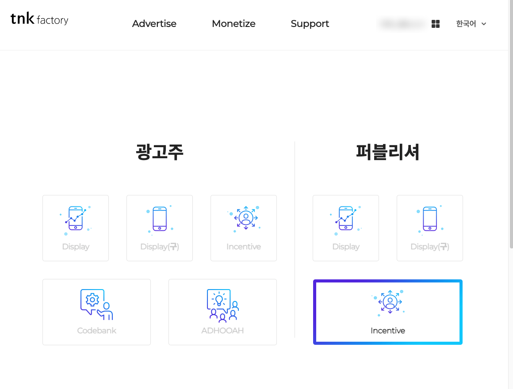
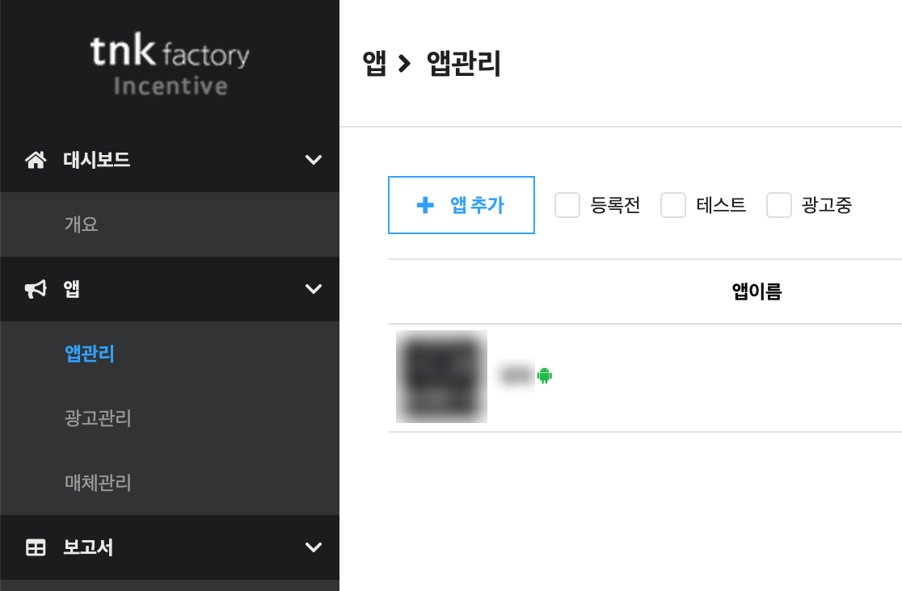
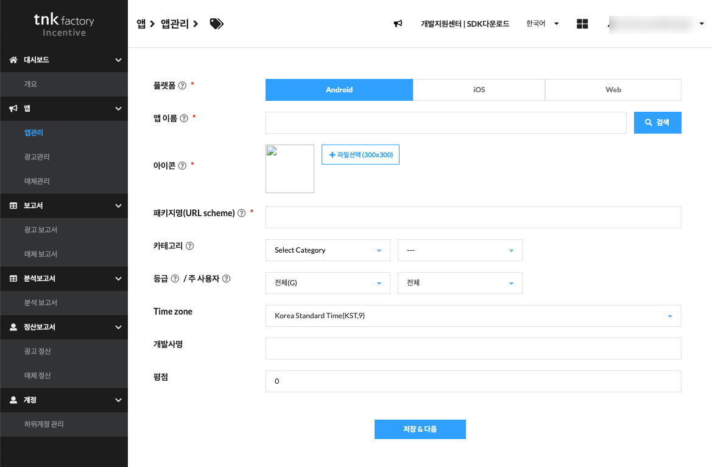
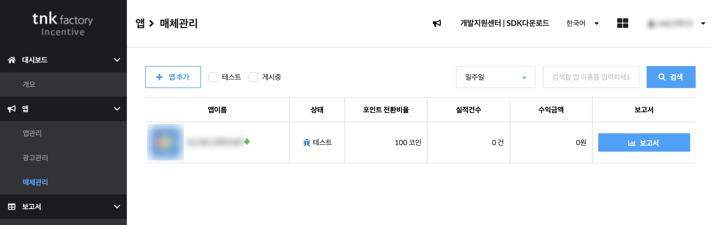

# APP ID 발급받기

이 페이지에서 하는 일: 퍼블리셔 페이지에 앱을 등록하고, 발급된 **APP ID** 를 확인해 앱에 넣습니다.

---

## 언제 필요한가

SDK 연동의 **첫 단계**이며, 모든 개발사에 필요합니다(필수).
발급받은 APP ID 는 앱의 `tnkad_app_id` 로 들어갑니다.

> Android 와 iOS 는 **각각 따로 등록**해야 합니다. 앱 하나당 플랫폼별로 APP ID 가 하나씩 발급됩니다.

진행 순서는 다음과 같습니다.

| 순서 | 할 일 | 퍼블리셔 페이지 메뉴 |
|:-:|---|---|
| 1 | 앱 등록 | 앱 → 앱관리 → **+ 앱 추가** |
| 2 | APP ID 확인 | 앱 → 매체관리 → 앱 선택 → 기본설정 |
| 3 | 앱에 넣기 | (앱 코드·설정 파일) |

---

## 1. 앱 등록하기

[TnkFactory 홈페이지](https://tnkfactory.com)에서 로그인합니다. 계정이 없다면 담당자에게 문의해 주세요.
로그인한 뒤 화면 오른쪽의 **퍼블리셔** 영역에서 **Incentive** 를 선택합니다. 왼쪽은 광고주용 메뉴이니 잘못 선택하지 않도록 주의하세요.

<figure><figcaption><p>퍼블리셔 영역의 <b>Incentive</b> 를 선택합니다.</p></figcaption></figure>

좌측 메뉴에서 **앱 → 앱관리** 로 이동해 **+ 앱 추가** 를 누릅니다.
**앱** 메뉴 아래에는 앱관리 · 광고관리 · 매체관리가 있습니다. 등록은 앱관리에서 하고, APP ID 확인은 매체관리에서 합니다.

<figure><figcaption><p>앱 → 앱관리 에서 <b>+ 앱 추가</b> 를 누릅니다.</p></figcaption></figure>

앱 정보를 입력하고 **저장 & 다음** 을 누릅니다.

<figure><figcaption><p>앱 등록 화면. 빨간 별표(*) 항목은 필수입니다.</p></figcaption></figure>

| 항목 | 필수 | 입력할 내용 |
|------|:-:|------|
| **플랫폼** | ✓ | Android 또는 iOS 를 선택합니다. 두 플랫폼을 모두 운영하면 **플랫폼마다 따로 등록**합니다 |
| **앱 이름** | ✓ | 퍼블리셔 페이지에서 구분하기 위한 앱 이름입니다 |
| **아이콘** | ✓ | 앱 아이콘을 등록합니다. 300x300 이하의 PNG 파일로 등록해 주세요 |
| **패키지명(URL scheme)** | ✓ | Android 는 앱의 패키지명(`applicationId`, 예: `com.example.myapp`), iOS 는 번들 ID(Bundle Identifier)를 입력합니다 |
| **카테고리** | | 앱과 관련된 카테고리를 선택합니다 |
| **등급 · 주 사용자** | | 해당 앱에 노출될 광고의 연령 등급과 주 사용자 성별 필터입니다. 화면의 기본값은 `전체(G)` · `전체` 입니다 |
| **Time zone** | | 앱이 주로 사용되는 지역의 타임존을 선택합니다. 기본값은 `Korea Standard Time(KST,9)` 입니다 |
| **개발사명** | | 앱을 개발한 회사의 이름입니다 |
| **평점** | | 필수 항목이 아니며 기본값 `0` 이 들어 있습니다 |

패키지명(번들 ID)은 이렇게 확인합니다.

- **Android** — 앱 모듈 `build.gradle(.kts)` 의 `applicationId`
- **iOS** — Xcode 의 Target → General → Identity → Bundle Identifier

> ⚠️ **패키지명(번들 ID)은 실제 배포할 앱과 정확히 일치해야 합니다.**
> TNK 는 패키지명(Android) / 번들 ID(iOS)로 앱을 식별합니다. 등록한 값과 실제 앱의 값이 다르면 오퍼월이 정상적으로 표시되지 않을 수 있습니다.
> 디버그 빌드처럼 `.debug` 같은 접미사가 붙은 앱으로 테스트하려면, 그 패키지명으로 앱을 하나 더 등록하고 거기서 발급된 APP ID 를 해당 빌드에 넣어 주세요. 설정이 어려우면 담당자에게 문의해 주세요.

---

## 2. APP ID 확인

등록은 **앱관리** 에서 했지만, 발급된 값은 **매체관리** 에서 확인합니다.
좌측 메뉴의 **매체관리** 에서 앱을 선택하고, **기본설정** 메뉴 상단의 `AppID` 값을 복사해 두세요.

아래 화면은 **매체관리** 의 앱 목록입니다. 목록에는 앱 이름 · 상태 · 포인트 전환비율 · 실적건수 · 수익금액 · 보고서가 표시되고, APP ID 는 목록이 아니라 앱을 선택해 들어가는 **기본설정** 에 있습니다.

<figure><figcaption><p>앱 → 매체관리 의 앱 목록. 여기서 앱을 선택합니다.</p></figcaption></figure>

목록의 **상태** 열에는 앱의 현재 상태가 표시됩니다. 상태가 **테스트** 인 동안 오퍼월의 광고 목록을 확인하려면 [테스트 기기 등록](test-device.md)이 필요합니다.

APP ID 는 등록한 앱(Android App, iOS App 등)의 식별자입니다. 플랫폼마다 값이 다릅니다.

> 서버 보상 콜백 검증에 쓰는 **`app_key`** 도 앱 등록 시 함께 부여되며 같은 페이지에서 확인할 수 있습니다.
> `app_key` 는 **앱에 포함하지 말고 개발사 백엔드에만 보관**하세요.
> ([서버 보상 콜백 URL](../common/server-callback.md) 참고)

---

## 3. 앱에 설정하기

발급받은 APP ID 를 앱에 넣습니다. 화면에 표시된 값을 그대로 붙여 넣으면 됩니다. 하이픈(`-`)이 들어 있어도 SDK 가 처리합니다.

| 방법 | Android | iOS | 언제 쓰나 |
|---|---|---|---|
| **설정 파일에 넣기** (기본) | 매니페스트의 `tnkad_app_id` meta-data | `Info.plist` 의 `tnkad_app_id` | 앱 코드를 바꾸지 않고 값만 넣을 때 |
| **코드로 넣기** | `TnkPpiHybSdk.init(applicationContext, "발급받은-앱-아이디")` | `TnkPpiHybSdk.shared.configure(appId: "발급받은-앱-아이디")` | 서버 설정 등으로 APP ID 를 실행 중에 정해야 할 때 |

Android 는 `<application>` 태그 안에 넣습니다.

```xml
<application ...>

    <meta-data
        android:name="tnkad_app_id"
        android:value="발급받은-앱-아이디" />

</application>
```

iOS 는 `Info.plist` 에 키를 추가합니다.

```xml
<key>tnkad_app_id</key>
<string>발급받은-앱-아이디</string>
```

> ⚠️ 코드로 넣는 경우에는 **다른 SDK 함수보다 먼저** 호출하세요.
> 다른 SDK 함수가 먼저 호출되면 매니페스트(Info.plist)의 값으로 SDK 가 시작되어, 그 뒤에 지정한 APP ID 는 적용되지 않을 수 있습니다.

자세한 설정은 아래 페이지를 참고하세요.

- **Android** — [AndroidManifest 설정](../android/manifest.md), [3. 초기화](../android/initialize.md)
- **iOS** — [Info.plist 설정](../ios/plist.md), [3. 초기화](../ios/initialize.md)

---

다음: [테스트 기기 등록](test-device.md)
