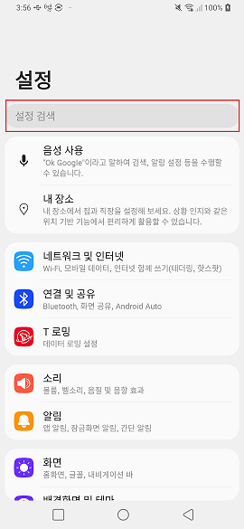
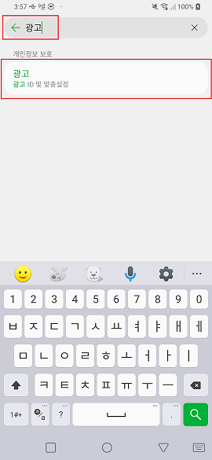
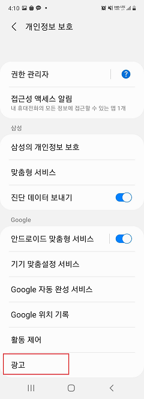
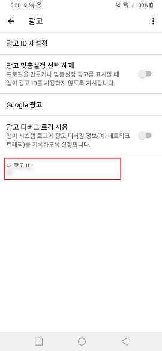
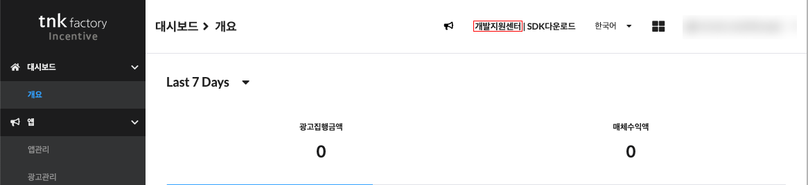
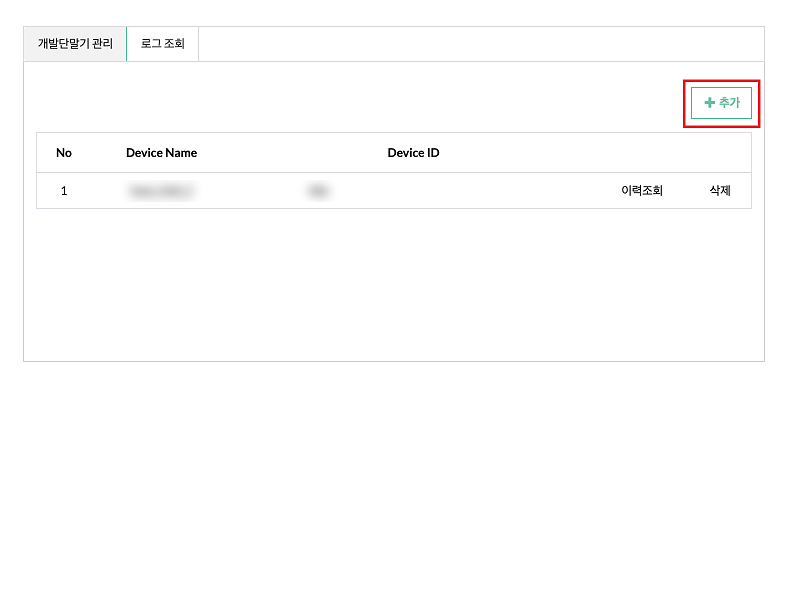
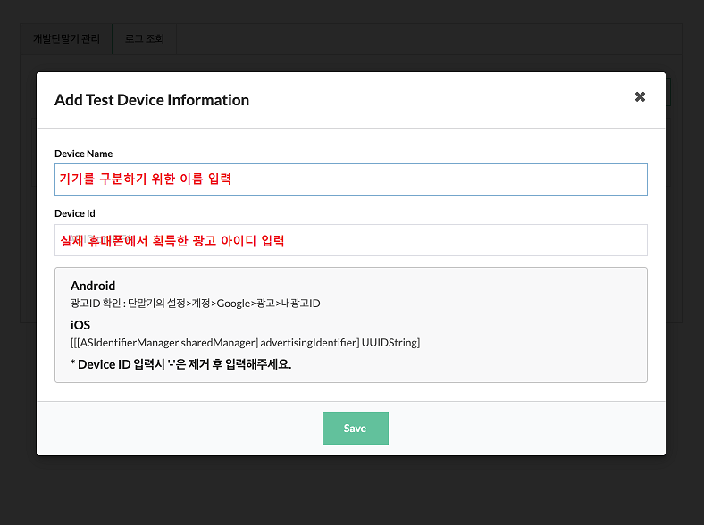
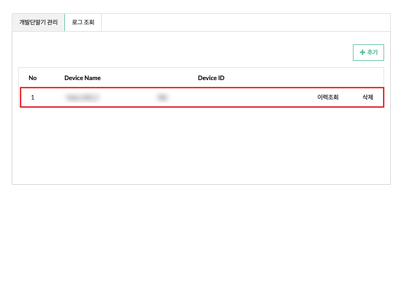

# 테스트 기기 등록

이 페이지에서 하는 일: 개발·테스트에 쓰는 기기의 **광고 ID** 를 확인해 퍼블리셔 페이지에 **테스트 기기** 로 등록합니다.

---

## 언제 필요한가

SDK 연동을 마치고 실기기에서 오퍼월의 광고 목록과 광고 참여 흐름을 확인하려는 개발사에 필요합니다.
기기마다 한 번 등록하면 됩니다.

퍼블리셔 페이지에서 앱 상태가 **테스트** 인 동안에는, 테스트 기기로 등록한 기기에서 광고 목록이 정상적으로 표시됩니다. 등록하지 않은 기기에서는 광고 목록이 비어 보일 수 있습니다.
앱 상태는 앱 → 매체관리 목록의 **상태** 열에서 확인합니다.

- 기기 등록은 퍼블리셔 페이지에서 합니다. SDK 설정은 바꾸지 않습니다. 광고 ID 를 확인하는 코드(방법 2)는 값을 읽어 볼 때만 넣고, 확인이 끝나면 지우세요.
- 기기는 광고 ID 로 구분합니다. 광고 ID 를 초기화하면 값이 바뀌므로 다시 등록해야 합니다.

> ⚠️ Android 에뮬레이터·가상 기기에서는 오퍼월이 열리지 않습니다. 동작 확인은 실기기에서 해 주세요.

| 순서 | 할 일 | 어디에서 |
|:-:|---|---|
| 1 | 광고 ID 확인 | 기기 설정(Android) 또는 앱 코드(Android · iOS) |
| 2 | 테스트 기기 등록 | 퍼블리셔 페이지 |
| 3 | 등록한 기기에서 오퍼월 확인 | 앱 |

---

## 1. 광고 ID 확인

Android 는 기기의 설정 화면 또는 앱 코드로, iOS 는 앱 코드로 확인합니다.
iOS 는 설정 앱에서 광고 ID(IDFA)를 볼 수 없습니다.

### 등록할 값의 모양

퍼블리셔 페이지에는 **하이픈(`-`)을 뺀 값**을 입력합니다. 확인한 곳에 따라 값의 모양이 다릅니다.

| 확인한 곳 | 값의 모양 | 등록할 때 |
|---|---|---|
| Android 설정 화면 | `38400000-8cf0-11bd-b23e-10b96e40000d` (하이픈 포함) | 하이픈을 모두 빼고 알파벳은 소문자로 입력합니다 → `384000008cf011bdb23e10b96e40000d` |
| 앱의 `getAdid` 값 (Android · iOS) | `384000008cf011bdb23e10b96e40000d` (하이픈 없는 소문자 32자리) | 그대로 입력합니다 |

> 💡 어디에서든 0 으로만 된 값(`00000000000000000000000000000000`)이 보이면 광고 ID 를 읽지 못한 상태입니다. 이 값으로는 기기를 구분할 수 없으니 등록하지 말고, 아래 '0 으로만 나올 때'를 먼저 확인하세요.

### 방법 1. 기기 설정에서 확인 (Android)

기기의 `설정` 화면에서 검색 버튼을 누른 후 **"광고"** 를 입력합니다.

<figure><figcaption><p>설정 화면의 검색창을 누릅니다.</p></figcaption></figure>

**광고 / 광고 ID 및 맞춤설정** 을 선택합니다.

<figure><figcaption><p>검색 결과에서 <b>광고</b> 항목을 선택합니다.</p></figcaption></figure>

기종에 따라 검색 결과가 바로 광고 화면으로 연결되기도 하고, 아래처럼 개인정보 보호 화면이 먼저 열려 하단의 **광고** 메뉴를 한 번 더 눌러야 하기도 합니다. 기기마다 메뉴 이름이 조금 다를 수 있습니다.

<figure><figcaption><p>개인정보 보호 화면에서는 하단의 <b>광고</b> 를 누릅니다.</p></figcaption></figure>

광고 화면의 **내 광고 ID** 또는 **이 기기의 광고 ID** 항목에 적힌 문자열이 광고 ID 입니다.

<figure><figcaption><p><b>내 광고 ID</b> 에 적힌 값을 확인합니다.</p></figcaption></figure>

### 방법 2. 앱 코드로 확인 (Android · iOS)

SDK 가 가진 광고 ID 를 로그로 찍어 확인합니다. 이 값은 이미 하이픈이 빠진 소문자 32자리라서 **그대로 퍼블리셔 페이지에 입력**하면 됩니다.

**Android** — `onAdidReady` 는 실제 광고 ID 를 받으면 한 번 호출됩니다. 광고 ID 를 읽지 못하는 기기에서는 호출되지 않습니다.
SDK 를 시작하는 호출(`init`, `setUserName` 등)이 앱에 있어야 합니다. `onAdidReady` 만 호출해서는 SDK 가 시작되지 않습니다.

```kotlin
import android.util.Log
import com.tnkfactory.ad.hrwd.TnkPpiHybSdk

TnkPpiHybSdk.onAdidReady { adid ->
    if (BuildConfig.DEBUG) Log.i("TNK", "광고 ID = $adid")   // 확인용 (개발 빌드 전용)
}
```

Java

```java
import android.util.Log;
import com.tnkfactory.ad.hrwd.TnkPpiHybSdk;
import kotlin.Unit;

TnkPpiHybSdk.onAdidReady(adid -> {
    if (BuildConfig.DEBUG) Log.i("TNK", "광고 ID = " + adid);   // 확인용 (개발 빌드 전용)
    return Unit.INSTANCE;
});
```

> 💡 `BuildConfig` 를 찾을 수 없다는 오류가 나면 앱 모듈 `build.gradle(.kts)` 의 `android { buildFeatures { buildConfig = true } }` 를 켜거나, 디버그 여부를 판단하는 기존 방식을 그대로 쓰세요.

Android Studio 의 Logcat 에서 `TNK` 로 검색하면 값이 보입니다. 확인이 끝나면 이 코드는 지우세요. 출시 빌드에서 광고 ID 를 로그로 남기지 마세요.
이미 받은 값을 바로 읽으려면 `TnkPpiHybSdk.getAdid(context)` 를 쓸 수 있습니다. 다만 광고 ID 를 새로 받기 전에는 이전 실행에서 받은 값이나 0 으로만 된 값이 나올 수 있으니, 등록할 값은 `onAdidReady` 로 받은 값으로 확인하세요.

**iOS** — 앱 추적 투명성(ATT) 동의를 받은 뒤에 읽습니다. ATT 동의 요청과 `Info.plist` 문구는 [3. 초기화](../ios/initialize.md)를 참고하세요.

```swift
import TnkPpiHyb

TnkPpiHybSdk.shared.requestTrackingAuthorization { granted in
    // granted 가 true 일 때 실제 광고 ID 가 나옵니다
    #if DEBUG
    let adid = TnkPpiHybSdk.shared.getAdid()
    print("광고 ID = \(adid)")   // 확인용 (개발 빌드 전용)
    #endif
}
```

이미 ATT 동의를 요청하는 코드가 앱에 있다면, 그 이후 아무 때나 `TnkPpiHybSdk.shared.getAdid()` 만 호출해도 됩니다. 확인이 끝나면 이 코드는 지우세요. 출시 빌드에서 광고 ID 를 로그로 남기지 마세요.

### 0 으로만 나올 때

`00000000000000000000000000000000` 이 나오면 광고 ID 를 읽지 못한 상태입니다.
Android 에서 `onAdidReady` 로그가 나오지 않는 것도 같은 원인일 수 있습니다.

| 플랫폼 | 이런 경우에 나옵니다 | 확인할 것 |
|---|---|---|
| Android | 앱을 처음 실행한 직후라 아직 광고 ID 를 받기 전에 `getAdid` 로 읽었을 때 | `onAdidReady` 콜백으로 받은 값을 사용하세요 |
| Android | 기기 설정에서 광고 ID 를 삭제했거나, 설정 화면에 광고 ID 가 표시되지 않을 때 | 설정의 광고 화면에서 광고 ID 가 표시되는지 확인하세요. 표시되지 않으면 같은 화면에서 광고 ID 를 새로 받을 수 있는지 확인합니다 |
| Android | 앱의 매니페스트에서 `com.google.android.gms.permission.AD_ID` 권한을 제거했을 때 | [AndroidManifest 설정](../android/manifest.md)을 확인하세요 |
| Android | Google Play 스토어·서비스가 없는 기기일 때 | Google Play 가 설치된 기기로 테스트하세요 |
| iOS | ATT 동의 전이거나 사용자가 거부했을 때 | ATT 동의를 받은 뒤 다시 조회하세요. 거부했다면 설정 앱에서 이 앱의 추적 허용 여부를 확인하세요 |

---

## 2. 테스트 기기 등록

퍼블리셔 페이지로 진입한 뒤 페이지 상단의 **개발지원센터** 메뉴를 선택합니다.

<figure><figcaption><p>상단의 <b>개발지원센터</b> 를 누릅니다.</p></figcaption></figure>

팝업 창이 열리면 **개발단말기 관리** 탭에서 우측 상단의 **+ 추가** 버튼을 누릅니다. 팝업 창이 열리지 않으면 브라우저의 팝업 차단을 해제해 주세요.

<figure><figcaption><p><b>+ 추가</b> 로 테스트 기기를 추가합니다.</p></figcaption></figure>

테스트 기기 정보를 입력하는 화면이 열리면 아래 두 값을 입력하고 **Save** 를 누릅니다.

| 입력란 | 입력할 값 |
|---|---|
| **Device Name** | 기기를 구분하기 위한 이름입니다. 예: `QA 갤럭시`, `테스트 아이폰` |
| **Device Id** | 1단계에서 확인한 광고 ID 입니다. **하이픈(`-`)을 빼고** 입력합니다 |

<figure><figcaption><p>Device Id 는 하이픈을 뺀 값을 입력합니다.</p></figcaption></figure>

저장하면 아래와 같이 목록에 기기가 추가됩니다. 더 이상 쓰지 않는 기기는 목록 오른쪽의 **삭제** 로 지울 수 있습니다.

<figure><figcaption><p>등록한 기기가 목록에 표시됩니다.</p></figcaption></figure>

---

## 3. 등록한 기기에서 확인

등록한 기기에서 앱을 실행해 오퍼월을 열고, 광고 목록이 보이는지 확인합니다.
오퍼월 여는 방법은 [Android 4. 오퍼월 띄우기](../android/offerwall.md) · [iOS 4. 오퍼월 띄우기](../ios/offerwall.md)를 참고하세요.

광고 목록이 비어 있다면 먼저 아래를 확인하세요.

- 퍼블리셔 페이지에 등록한 Device Id 가 앱에서 확인한 광고 ID 와 같은지 확인합니다. 하이픈이 남아 있거나 자리수가 다르면 등록한 기기와 맞지 않을 수 있습니다.
- 앱에서 확인한 광고 ID 가 0 으로만 된 값이 아닌지 확인합니다.
- 등록한 패키지명(번들 ID)이 실제 앱과 같은지 확인합니다. [APP ID 발급받기](app-id.md)를 참고하세요.

오퍼월이 열리지 않거나 그래도 광고 목록이 비어 있다면 [Android 문제 해결](../android/troubleshooting.md) · [iOS 문제 해결](../ios/troubleshooting.md)을 확인하세요.

---

## 참고

- 광고 ID 는 사용자가 기기 설정에서 **초기화할 수 있습니다.** 초기화하면 값이 바뀌므로 새 값을 확인해 다시 등록하세요.
- Android 에서 광고 ID 를 초기화한 뒤에는 앱을 완전히 종료했다가 다시 실행하고, `onAdidReady` 로 받은 새 값을 확인하세요. 시작 직후의 `getAdid` 는 초기화 전의 값을 돌려줄 수 있습니다.
- 기기를 교체했다면 새 기기의 광고 ID 를 등록하세요.

---

다음: [AI 도구에 문서 연결하기](ai-tools.md)
